# OGV-DATA-001: Ogevia Database and Data Dictionary

## Document metadata and verification status

| Field | Value |
|---|---|
| Document ID | OGV-DATA-001 |
| Version | 0.1 (DRAFT, not approved by the owner) |
| Inspection date | 2026-10-11 |
| Branch / commit | `claude/amazing-meitner-cap9fd` at `f0f1405` (documentation-only commits on top of `origin/main` = `a2d249b`). No database file differs from `a2d249b`. |
| Schema described | The schema produced by migrations `0001` to `0048` in `infra/aws/db/migrations/` |
| Companion files | [Appendix A: table dictionary](OGV-DATA-001-appendix-A-table-dictionary.md) (every column, constraint, index) · [Appendix B: functions and triggers](OGV-DATA-001-appendix-B-functions-and-triggers.md) |
| Related | [OGV-TECH-001](OGV-TECH-001-master-technical-reference.md) (architecture), [OGV-GOV-001](governance/OGV-GOV-001_Documentation_Governance_and_Register.md) (register) |
| Governance directive | Not available to this inspection; the author's unapproved draft OGV-GOV-001 conventions are used. |
| Approver | The owner. **Approval is not given.** |

### How the evidence was produced

1. **Repository reading** of `infra/aws/db/` (migrations, rollback, verification, scripts, deploy SQL, tests), `infra/aws/lib/`, `apps/sv-api/src/`, `supabase/`, and `docs/`.
2. **Local build of the schema.** All 48 migrations were applied, in order, one transaction per file, using the same role rules as the repository runner (`0001` as administrator; every other file after `SET LOCAL ROLE ogevia_owner`; `infra/aws/db/scripts/migrations.ts`) to a **new, empty, local PostgreSQL 16.15** database in the author's disposable container. All 48 applied without error. The schema was then read from the PostgreSQL catalogs (`pg_class`, `pg_attribute`, `pg_constraint`, `pg_indexes`, `pg_trigger`, `pg_proc`, `pg_policies`, privilege functions). The tables in Appendix A and every count in this document come from that build.
3. **The repository's own read-only verification scripts** `infra/aws/db/verification/02` to `07` were run against that build as `ogevia_readonly`: 158 checks, all true. Scripts `05` to `07` check data, so on an empty database they prove only that the queries run. Script `01` (migration ledger) was not run, because the ledger is created by the runner, which was not used.
4. **No production, pilot or Supabase database was queried.** No AWS call was made. The local build used no real or synthetic Ogevia data.

### Evidence classes

| Tag | Meaning in this document |
|---|---|
| **RV** | Repository-verified: defined by the migrations, confirmed by building them locally and reading the catalogs (or by reading repository files). |
| **DV** | Deployment-verified: about a running database, with date and source. Here only the owner-provided ledger of 2026-10-11 qualifies. |
| **H** | Historical or legacy (Supabase). |
| **P** | Planned or proposed. |
| **U** | Unverified or unknown. |
| **Analysis** | The author's reasoning from RV facts; not a legal or compliance determination. |

### Limitations that affect every statement

* The local build is **PostgreSQL 16**, the production engine is **PostgreSQL 18.3** (`docs/aws/CURRENT_AWS_INVENTORY.md`, 2026-10-01 to 05; CI uses `postgres:18`). Migrations applied cleanly on 16; behaviour on 18 was not tested here.
* The described schema is the **repository's `0048`**. The only recorded production level is **`46|0046`** (owner-provided, 2026-10-11, `docs/releases/DEPLOYMENT_CHECKPOINT_0047_0048.md`). Differences are listed in section 13.4. The pilot (`prod`) database level is U.
* Whether live databases match the migrations (drift, manual changes, data) is U. The repository runner detects checksum drift of applied files, but no drift check output is available.
* Row counts, data quality and the contents of any real database are U.
* Purposes and sensitivity labels in section 8 are the author's descriptions, written from migration headers and column shapes. They are labelled analysis where they are judgement.

---

## Table of contents

1. [Purpose and scope](#1-purpose-and-scope)
2. [Key facts and findings](#2-key-facts-and-findings)
3. [Database topology](#3-database-topology)
4. [Access model](#4-access-model)
5. [Tenant boundaries](#5-tenant-boundaries)
6. [Data conventions](#6-data-conventions)
7. [Entity relationship diagrams](#7-entity-relationship-diagrams)
8. [Data dictionary by domain](#8-data-dictionary-by-domain)
9. [Enumerations](#9-enumerations)
10. [Data integrity rules](#10-data-integrity-rules)
11. [Sensitive data](#11-sensitive-data)
12. [Data lifecycle](#12-data-lifecycle)
13. [Migrations](#13-migrations)
14. [Legacy Supabase schema relationship](#14-legacy-supabase-schema-relationship)
15. [How to verify and regenerate](#15-how-to-verify-and-regenerate)
16. [Limitations, risks and unresolved questions](#16-limitations-risks-and-unresolved-questions)
17. [Related SOPs and change log](#17-related-sops-and-change-log)

---

## 1. Purpose and scope

Document what data Ogevia stores in PostgreSQL, how it is structured and protected, and how it changes, so that an engineer who has not worked on Ogevia can read the schema, reason about tenant isolation and integrity, and run or review a migration without searching old conversations.

In scope: the AWS database (`infra/aws/db`), both environments that use it (PILOT / TEST `env=prod` database `ogevia_sv_test`; PRODUCTION / PRD `env=prd` database `ogevia_prd`), and the relationship to the legacy Supabase schema. Out of scope: S3 object contents (described only where the database references them), Cognito user data, and the Supabase schema's column-level detail.

## 2. Key facts and findings

| # | Fact or finding | Class | Evidence |
|---|---|---|---|
| 1 | The schema has **62 tables, 690 columns, 14 enumerated types, 210 foreign keys, 165 check constraints, 35 unique constraints, 1 exclusion constraint, 166 indexes (including primary-key and unique-constraint indexes) and 45 triggers**, in schema `ogevia`. The API surface is **175 functions** in `ogevia_api`. | RV | local build, catalogs |
| 2 | The application role `ogevia_app` has **no table privileges** and **no `EXECUTE` on internal `ogevia` functions**. It can execute only the 175 `ogevia_api` functions. All 175 are `SECURITY DEFINER` owned by `ogevia_owner`; all 298 functions (175 in `ogevia_api`, 123 in `ogevia`) pin `search_path`; none is executable by `PUBLIC`. | RV | catalogs; verification `04` |
| 3 | **Tenant isolation is enforced by the function layer, not by row level security.** RLS is enabled on 60 tables but never forced, the only policy anywhere is `SELECT ... USING (true)` for `ogevia_readonly` (59 policies), and the table owner bypasses RLS. Functions run as the owner. | RV, analysis | `pg_policies`, `pg_class.relforcerowsecurity` |
| 4 | **`ogevia_readonly` can read every tenant's rows** on 59 tables, including legal client names (`client_private_names`), evidence metadata, and the hash columns of link tokens and one-time codes. It is `NOLOGIN` in the migrations; which login role, if any, holds it in either environment is U. | RV; assignment U | `pg_policies`, grants |
| 5 | **56 of 62 tables carry `organization_id`** (NOT NULL, FK to `organizations`). Global tables: `permissions`, `role_permissions`, `scoring_rule_versions`, `zip_centroids`; identity: `app_users`; tenant root: `organizations`. | RV | catalogs |
| 6 | **Same-tenant parent/child consistency is enforced by composite foreign key for 45 references and by single-column foreign key (not tenant-bound) for 43** (section 5.3). The repository's detective checks (`verification/05`) cover 11 relationships. | RV, analysis | `pg_constraint` |
| 7 | **No date of birth, SSN, Medicaid, UCI or payer member ID column exists.** Direct client identifiers are the legal first and last name (`client_private_names`) and, indirectly, client code and city. Free-text columns exist (section 11) and can hold anything staff or public-link users type. | RV | column inventory |
| 8 | **One open visit per caregiver** is enforced by two partial unique indexes on `service_visits` (by `caregiver_user_id` and by `caregiver_record_id`) for statuses `draft` and `awaiting_signature`; **one visit per scheduled shift** by `service_visits_shift_unique`. | RV | `pg_indexes` |
| 9 | **Authorization overlap is prevented by an exclusion constraint** (`btree_gist`) on `client_authorizations`; versions are linked by `lineage_id` with `UNIQUE (lineage_id, version_number)`. | RV | `pg_constraint` |
| 10 | **Evidence bytes are never stored in PostgreSQL**: no `bytea` column exists (verification `04` `no_bytea_columns`), only S3 object keys, S3 version ids, sizes and SHA-256 hashes. | RV | catalogs |
| 11 | **Production's recorded migration level is 46, not 48.** `0047` and `0048` are not applied there (owner-provided). The repository's `verification/01_schema_version.sql` hard-codes 48, so its first two checks will report false against a level-46 database. | DV (owner-provided), RV | checkpoint doc; script |
| 12 | **The AWS migration tree (`infra/aws/db/migrations`) is the schema source for both AWS databases.** The 162-file Supabase tree is a separate, legacy history: 15 table names exist in both, 39 legacy tables have no same-name AWS table, 47 AWS tables have no legacy same-name table (static comparison, section 14). | RV, analysis | scripts, `deploy-production.sh` |
| 13 | **No automated retention, purge or archival job exists** in the migrations. Immutability is by trigger (section 12). Retention periods for audit, evidence and visit data are U (no policy in the repository). | RV; policy U | search of migrations |
| 14 | **Rollback files exist for all 48 migrations**: 32 `SAFE AUTOMATED`, 14 `BACKUP REQUIRED`, 1 `FORWARD FIX PREFERRED` (`0001`), 1 `IRREVERSIBLE WITHOUT DATA LOSS` (`0005`, the visit tables). | RV | rollback headers |

Material risks arising from these facts are collected in section 16.

## 3. Database topology

### 3.1 Instances and databases

| Item | PILOT / TEST (`env=prod`) | PRODUCTION / PRD (`env=prd`) | LEGACY (Supabase) |
|---|---|---|---|
| Database name | `ogevia_sv_test` | `ogevia_prd` | Supabase project (identifier not reproduced) |
| Host instance | RDS `ogevia-prod-postgres` (shared) | RDS `ogevia-prod-postgres` (shared) | Supabase-managed |
| Engine | PostgreSQL 18.3, `db.t4g.micro`, single-AZ, encrypted, private, 7-day backups (inventory 2026-10-01 to 05) | same instance | Supabase-managed PostgreSQL (version U) |
| Application login | secret `ogevia/database/app` (login role per `db/deploy/01_app_login_role.sql`; may be `ogevia_app` itself, see that file) | `ogevia_prd_app`, secret `ogevia/prd/database/app` (`db/deploy/11_prd_app_login.sql`) | n/a |
| Data | synthetic only | real-data candidate; not cleared (`URL_REGISTRY_AND_LAUNCH_CHECKLIST.md`) | possibly real (U) |
| Recorded migration level | 0036 (2026-10-05); current U | `46|0046` (owner-provided 2026-10-11) | separate history |
| Bootstrap SQL | `db/deploy/00` to `05` | `db/deploy/10` to `14` | `supabase/seed.sql`, `supabase/demo/` |

A second RDS instance `ogevia-postgres` is recorded as unmanaged and "Development"; its contents and use are U and outside this document.

### 3.2 Schemas, roles, extensions (RV)

| Object | Detail |
|---|---|
| Schema `ogevia` | 62 tables, 14 enums, 123 internal functions under 122 distinct names (`check_shift_caregiver` is overloaded), owned by `ogevia_owner`. No access for `PUBLIC`. |
| Schema `ogevia_api` | 175 functions, the only callable surface. |
| Schema `ogevia_meta` | Created by the runner: `schema_migrations(version, name, checksum)`; `ogevia_readonly` may read it. Not created by the migrations themselves. |
| Role `ogevia_owner` | `NOLOGIN`; owns every object; `SECURITY DEFINER` functions run as it. Not superuser, not `BYPASSRLS` (table ownership alone bypasses non-forced RLS). |
| Role `ogevia_app` | `NOLOGIN` in the migrations; `EXECUTE` on `ogevia_api` only. Login roles are granted it out of band and must `SET LOCAL ROLE ogevia_app` per request (Lambda `DB_SET_ROLE`). |
| Role `ogevia_readonly` | `NOLOGIN`; `SELECT` on 59 `ogevia` tables and the ledger; used by the verification scripts. |
| Extension `btree_gist` | The only extension; supports the authorization exclusion constraint. `pgcrypto` was deliberately removed; random UUIDs use core `gen_random_uuid()`. |
| Sequences | None. Identifiers are UUIDs, except `audit_events.id` (identity bigint). |

Roles are cluster-wide in PostgreSQL: the same `ogevia_owner`, `ogevia_app` and `ogevia_readonly` exist for both databases in the shared instance. Separation between PILOT / TEST and PRODUCTION / PRD relies on `CONNECT` privileges (`10_prd_create_database.sql` revokes `PUBLIC` connect on `ogevia_prd`; only `ogevia_prd_app` is granted it), distinct logins and secrets, and a fail-closed configuration check in the API (`apps/sv-api/src/config.ts:61`, `db.ts:44` to `:47`). `14_prd_verify_access.sql` is the script that proves a test credential is refused; it has not been run against `prd` (checklist item 8 open).

### 3.3 Connection model

The API Lambda connects with TLS verification, a pool of at most 2 connections, an 8 s statement timeout and a 5 s connection timeout (`apps/sv-api/src/db.ts:56` to `:61`). Each request is one transaction. `ogevia_api.begin_request(sub)` verifies an active `app_users` row and sets `ogevia.actor_user_id` and `ogevia.request_id` with `set_config(..., true)` (transaction-local), so a pooled connection cannot carry one caller's identity into another request (`0002_identity_tenancy.sql:116`).

## 4. Access model

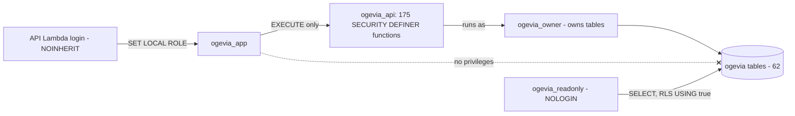

Facts (RV): the application can read or write data only through `ogevia_api` functions. Each function derives the actor from `begin_request`, checks `is_active_member` and `has_permission(organization, key)` (internal functions in schema `ogevia`), and then reads or writes tables as the owner. Permissions and their grants by role are in OGV-TECH-001 section 13; the authoritative source is `ogevia.role_permissions`.

Privilege summary:

| Role | Tables | Functions |
|---|---|---|
| `ogevia_app` | none | `EXECUTE` on all 175 `ogevia_api`; none on `ogevia` |
| `ogevia_owner` | owner of all 62 | owner of all |
| `ogevia_readonly` | `SELECT` on 59 (not `caregiver_invitations`, `caregiver_zip`, `client_service_zip`) plus the ledger | none |
| `PUBLIC` | none | none |

Row level security (RV, analysis):

* Enabled on 60 tables; **not** enabled on `permissions` and `role_permissions` (global reference data).
* 59 policies, all named `readonly_select`, all `FOR SELECT TO ogevia_readonly USING (true)`. 57 sit on RLS-enabled tables; 2 sit on `permissions` and `role_permissions`, where RLS is off, so those two policies have no effect (the role reads both tables through its plain `SELECT` grant).
* Three tables have RLS enabled, **no policy and no `SELECT` grant for `ogevia_readonly`** (`caregiver_invitations`, `caregiver_zip`, `client_service_zip`): the support role cannot read them. The migrations do not say why; the likely intent (invitation email, ZIPs) is the author's inference.
* `FORCE ROW LEVEL SECURITY` is not set on any table, so the owner (and therefore every `SECURITY DEFINER` function) bypasses RLS.
* Consequence: the RLS policies do not enforce tenant isolation. They exist to give the support role a read path. Tenant isolation depends on the function layer (section 5). This matches the stated design ("the application role cannot read or write any table directly", `docs/product/ACCESS_AND_BILLING_VISIBILITY.md`), but anyone expecting RLS to be the tenant control will be wrong.

## 5. Tenant boundaries

### 5.1 Rules (RV)

* **Tenant key.** `organization_id uuid NOT NULL REFERENCES organizations(id)` on 56 tables. No such column on `organizations` (the root), `app_users` (a person may belong to several organizations), `permissions`, `role_permissions`, `scoring_rule_versions`, `zip_centroids`.
* **Membership.** `organization_memberships(user, organization, role, status)`; functions call `is_active_member(org)` and `organization_is_active(org)`; a non-member receives the same "not found" error as a missing record.
* **Actor.** Derived in the database from the verified token subject, never accepted as a parameter.
* **Public links.** The ten public routes resolve a hashed token to one organization and scope inside the database (`care_portal_by_token`, `care_offer_by_token`, `visit_confirmation_requests`).
* **Storage keys.** Evidence object keys begin with the organization UUID; the API checks tenant ownership in PostgreSQL before every S3 read or write (OGV-TECH-001 section 20).

### 5.2 Which tables are global

| Table | Why global |
|---|---|
| `permissions`, `role_permissions` | One catalogue of permission keys and role grants for all agencies |
| `scoring_rule_versions` | Matching rule versions, platform-wide |
| `zip_centroids` | Shared ZIP reference data (empty until loaded with recorded source, licence, vintage) |
| `app_users` | A person is one identity across organizations (`cognito_sub` unique) |
| `organizations` | Tenant root |

### 5.3 Database-level tenant consistency (analysis)

A composite foreign key `(child_col, organization_id) REFERENCES parent(id, organization_id)` makes it impossible for a row to point at a parent in another organization. The schema has **45** such composite keys (parents carry `UNIQUE (id, organization_id)`). It also has **43 single-column foreign keys from an organization-scoped child to an organization-scoped parent**, which the database does not tie to the same organization. For those, correctness depends on the `ogevia_api` function that writes the row (and on triggers/checks that were not individually traced here).

The repository's detective script `verification/05_tenant_boundaries.sql` checks 11 relationships after the fact: visit→client, visit→authorization, evidence→visit, confirmation→visit, correction, assignment, visit caregiver membership, availability requests, service approvals, availability overrides, experience. It does not cover all 43.

| Child table | Column | Parent table |
|---|---|---|
| `assignment_readiness_flags` | `assignment_id` | `caregiver_assignments` |
| `authorization_reservations` | `authorization_lineage_id` | `client_authorizations` |
| `authorization_reservations` | `care_request_id` | `care_requests` |
| `authorization_reservations` | `shift_id` | `shifts` |
| `availability_overrides` | `shift_id` | `shifts` |
| `billing_approvals` | `visit_id` | `service_visits` |
| `billing_rounding_adjustments` | `client_id` | `clients` |
| `billing_rounding_adjustments` | `policy_id` | `billing_rounding_policies` |
| `billing_rounding_adjustments` | `service_id` | `services` |
| `billing_rounding_adjustments` | `visit_id` | `service_visits` |
| `care_notifications` | `care_request_id` | `care_requests` |
| `care_request_events` | `care_request_id` | `care_requests` |
| `care_request_events` | `shift_id` | `shifts` |
| `care_request_offers` | `care_request_id` | `care_requests` |
| `care_requests` | `assigned_shift_id` | `shifts` |
| `care_requests` | `authorization_lineage_id` | `client_authorizations` |
| `care_requests` | `portal_id` | `client_care_portals` |
| `caregiver_availability_windows` | `request_id` | `availability_requests` |
| `caregiver_unavailable_dates` | `request_id` | `availability_requests` |
| `client_authorizations` | `lineage_id` | `client_authorizations` |
| `client_authorizations` | `superseded_by_id` | `client_authorizations` |
| `client_authorizations` | `supersedes_id` | `client_authorizations` |
| `outage_visit_records` | `visit_id` | `service_visits` |
| `service_visits` | `original_visit_id` | `service_visits` |
| `service_visits` | `scheduled_shift_id` | `shifts` |
| `shift_coverage_events` | `shift_id` | `shifts` |
| `shift_readiness_flags` | `shift_id` | `shifts` |
| `shift_series` | `replaces_series_id` | `shift_series` |
| `shift_series_skipped_dates` | `series_id` | `shift_series` |
| `shifts` | `authorization_lineage_id` | `client_authorizations` |
| `shifts` | `series_id` | `shift_series` |
| `visit_confirmation_requests` | `visit_id` | `service_visits` |
| `visit_confirmations` | `evidence_id` | `visit_evidence` |
| `visit_confirmations` | `visit_id` | `service_visits` |
| `visit_corrections` | `corrected_visit_id` | `service_visits` |
| `visit_corrections` | `original_visit_id` | `service_visits` |
| `visit_evidence` | `visit_id` | `service_visits` |
| `visit_late_confirmation_reviews` | `late_confirmation_id` | `visit_late_confirmations` |
| `visit_late_confirmation_reviews` | `visit_id` | `service_visits` |
| `visit_late_confirmations` | `request_id` | `visit_confirmation_requests` |
| `visit_late_confirmations` | `visit_id` | `service_visits` |
| `visit_review_decisions` | `late_confirmation_review_id` | `visit_late_confirmation_reviews` |
| `visit_review_decisions` | `visit_id` | `service_visits` |

This is a hardening opportunity, not a demonstrated defect: no cross-tenant write path is shown here. Tenant-isolation tests exist (`infra/aws/db/test/tenant-assignment-visit.db.test.ts`, `access-roles.db.test.ts`, `care-token-security.db.test.ts`, `apps/sv-api/test/workflow.db.test.ts`) and were not run in this inspection.

## 6. Data conventions

| Convention | Rule | Source |
|---|---|---|
| Identifiers | `uuid` primary keys, `gen_random_uuid()`; no sequences; `audit_events.id` is `bigint` identity | catalogs |
| Client / caregiver codes | `clients.client_code`: `CL-` plus 10 random hex digits (40 random bits), unique per organization (case-insensitive, live rows); `caregiver_records.caregiver_code` unique per organization | `0003:46`, `:55` |
| Time | `timestamptz` everywhere; `service_date` is a `date`; visit start/end set by `now()` in SQL; organization `timezone` (default `America/Los_Angeles`) used for local-date logic; DST-safe local times (0035) | `0006`, `organizations.timezone` |
| Durations | **Integer minutes** throughout; hours exist only in migration and display (`PHASE_2_POSTGRES_ARCHITECTURE.md`); worked minutes 1 to 1440 | `service_visits_worked_range` |
| Money | Integer **cents** (`*_cents`); rates and amounts visible only with `billing.read` (owner) | `0019` |
| Status vocabularies | Native enums for core states (section 9); several others are `text` with check constraints | catalogs |
| Soft delete | `deleted_at` on `caregiver_records`, `client_authorizations`, `clients`, `services` | catalogs |
| Snapshots | Visits store `client_code_snapshot`, `caregiver_name_snapshot`, `visit_number_snapshot`; confirmations store `confirmed_visit_snapshot jsonb` (version 4) so later edits to master data do not rewrite what was confirmed | `0005`, `0006` |
| Idempotency | `idempotency_records(actor_user_id, operation, idempotency_key, request_fingerprint, response jsonb)`; same key and fingerprint returns the stored response | `0005` |
| Link secrets | Only SHA-256 hashes are stored (`token_hash`, `code_hash`); raw tokens and codes are never stored | `0011`, `0036` |
| Audit | `write_audit(...)` from definer functions into `audit_events`; payloads ids, statuses, minutes, timestamps | `0005:289` |
| Function names | Read functions `list_*`/`get_*`; writes verb-first; `public_*` for token routes | Appendix B |

## 7. Entity relationship diagrams

Generated from the 210 foreign keys. `organizations` is omitted from the diagrams because every organization-scoped table references it. A dashed-looking optional link (`|o--o{`) means the referencing column is nullable. Entities with only an `id` are shown for context from another domain. Attribute lists show keys and a few state columns, not every column (Appendix A has all).

### 7.1 Core overview

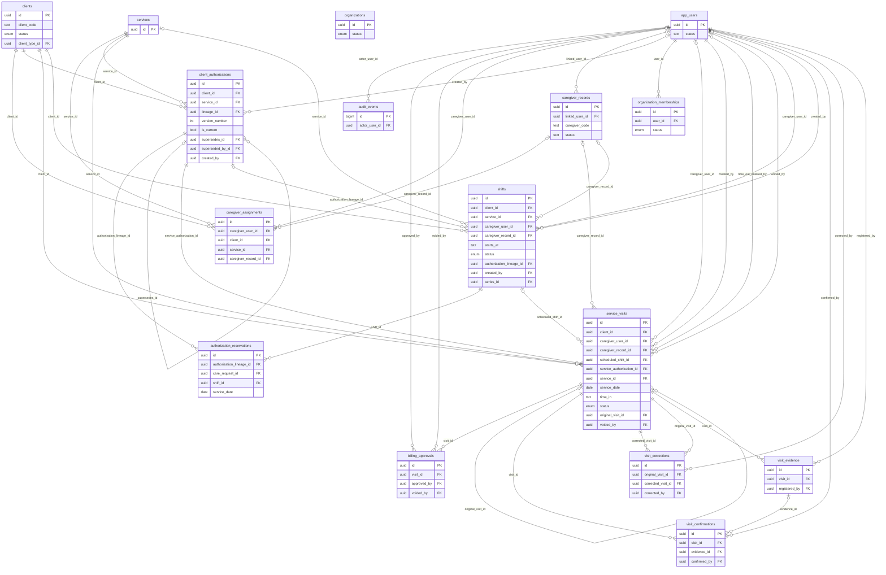

### 7.2 By domain

#### Identity and tenancy

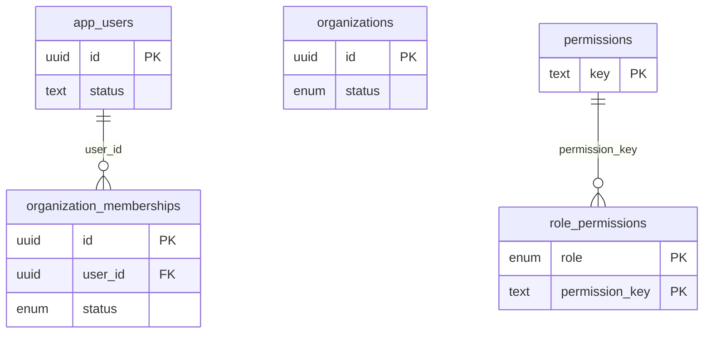

#### Care directory

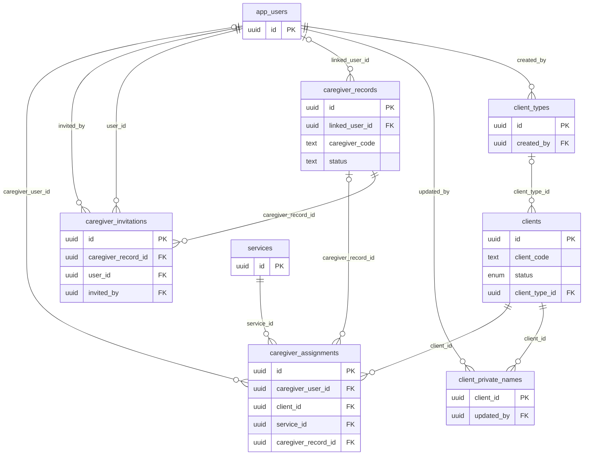

#### Authorizations

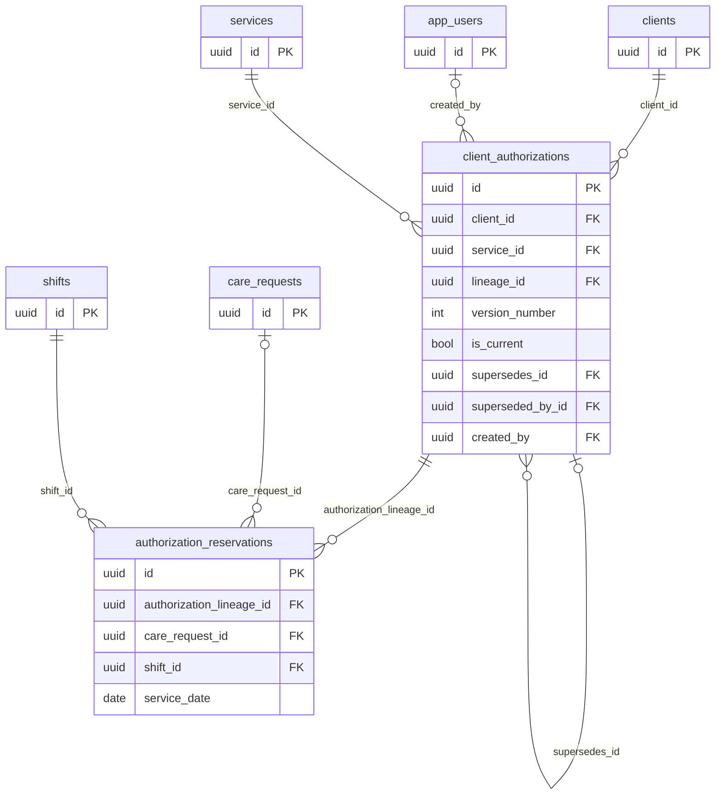

#### Scheduling

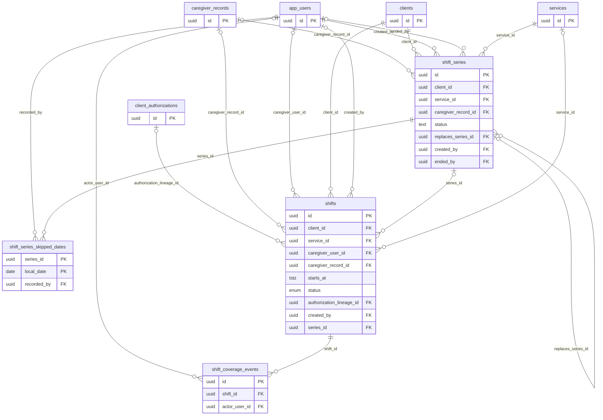

#### Visits, confirmation and evidence

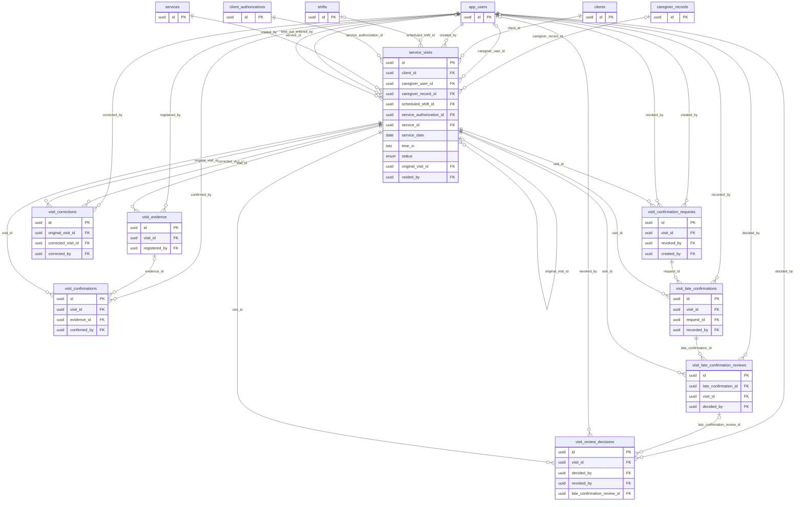

#### Billing readiness

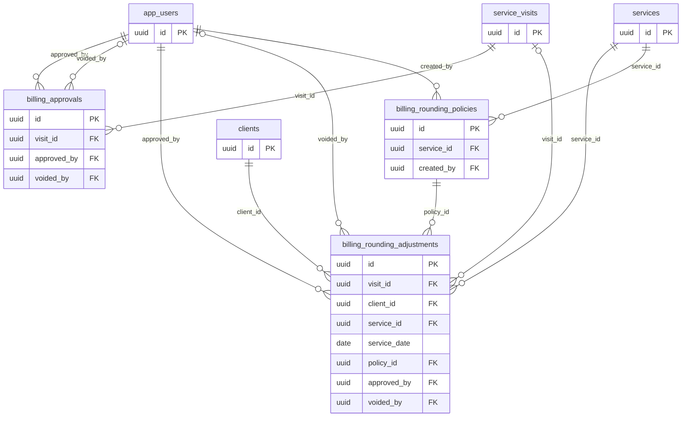

#### Continuity

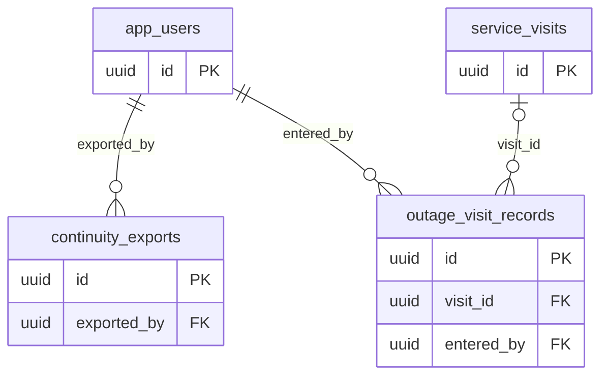

#### Care requests and portals

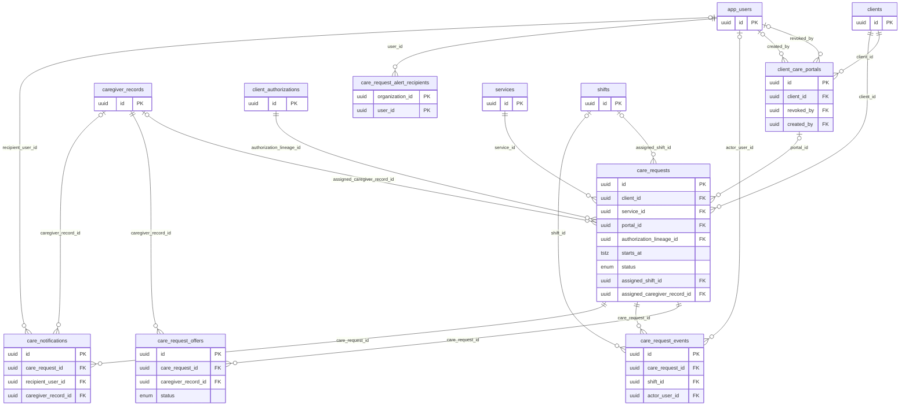

#### Availability and readiness

```mermaid
erDiagram
  app_users {
    uuid id PK
  }
  assignment_readiness_flags {
    uuid id PK
    uuid assignment_id FK
    uuid caregiver_record_id FK
    uuid resolved_by FK
  }
  availability_overrides {
    uuid id PK
    uuid caregiver_record_id FK
    uuid authorised_by FK
    uuid client_id FK
    uuid shift_id FK
  }
  availability_requests {
    uuid id PK
    uuid caregiver_record_id FK
    enum status
    uuid requested_by FK
    uuid reviewed_by FK
  }
  caregiver_assignments {
    uuid id PK
  }
  caregiver_availability_state {
    uuid organization_id PK
    uuid caregiver_record_id PK
    uuid updated_by FK
  }
  caregiver_availability_windows {
    uuid id PK
    uuid caregiver_record_id FK
    uuid request_id FK
  }
  caregiver_records {
    uuid id PK
  }
  caregiver_service_approvals {
    uuid id PK
    uuid caregiver_record_id FK
    uuid service_id FK
    uuid approved_by FK
    uuid revoked_by FK
  }
  caregiver_unavailable_dates {
    uuid caregiver_record_id FK
    uuid id PK
    uuid request_id FK
  }
  clients {
    uuid id PK
  }
  organization_readiness_settings {
    uuid organization_id PK
    uuid enforcement_activated_by FK
    uuid updated_by FK
  }
  readiness_setting_events {
    uuid id PK
    uuid changed_by FK
  }
  services {
    uuid id PK
  }
  shift_readiness_flags {
    uuid id PK
    uuid shift_id FK
    uuid caregiver_record_id FK
    uuid resolved_by FK
  }
  shifts {
    uuid id PK
  }
  caregiver_assignments ||--o{ assignment_readiness_flags : "assignment_id"
  caregiver_records ||--o{ assignment_readiness_flags : "caregiver_record_id"
  app_users |o--o{ assignment_readiness_flags : "resolved_by"
  app_users ||--o{ availability_overrides : "authorised_by"
  caregiver_records ||--o{ availability_overrides : "caregiver_record_id"
  clients |o--o{ availability_overrides : "client_id"
  shifts |o--o{ availability_overrides : "shift_id"
  caregiver_records ||--o{ availability_requests : "caregiver_record_id"
  app_users ||--o{ availability_requests : "requested_by"
  app_users |o--o{ availability_requests : "reviewed_by"
  caregiver_records ||--o{ caregiver_availability_state : "caregiver_record_id"
  app_users |o--o{ caregiver_availability_state : "updated_by"
  caregiver_records ||--o{ caregiver_availability_windows : "caregiver_record_id"
  availability_requests |o--o{ caregiver_availability_windows : "request_id"
  app_users ||--o{ caregiver_service_approvals : "approved_by"
  caregiver_records ||--o{ caregiver_service_approvals : "caregiver_record_id"
  app_users |o--o{ caregiver_service_approvals : "revoked_by"
  services ||--o{ caregiver_service_approvals : "service_id"
  caregiver_records ||--o{ caregiver_unavailable_dates : "caregiver_record_id"
  availability_requests |o--o{ caregiver_unavailable_dates : "request_id"
  app_users |o--o{ organization_readiness_settings : "enforcement_activated_by"
  app_users |o--o{ organization_readiness_settings : "updated_by"
  app_users ||--o{ readiness_setting_events : "changed_by"
  caregiver_records ||--o{ shift_readiness_flags : "caregiver_record_id"
  app_users |o--o{ shift_readiness_flags : "resolved_by"
  shifts ||--o{ shift_readiness_flags : "shift_id"
```

#### Staff documents

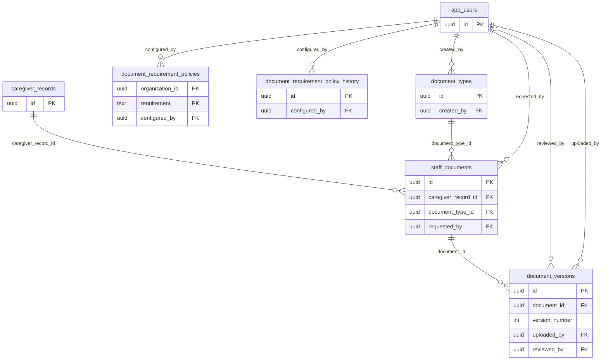

#### Matching inputs

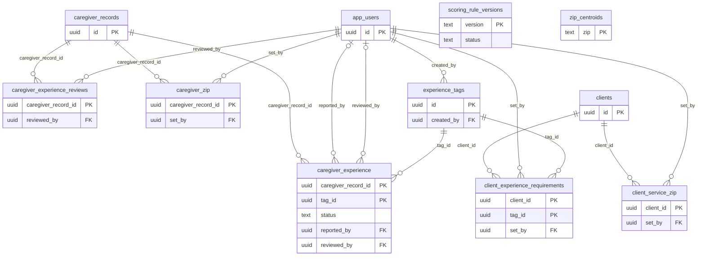

#### Audit and idempotency

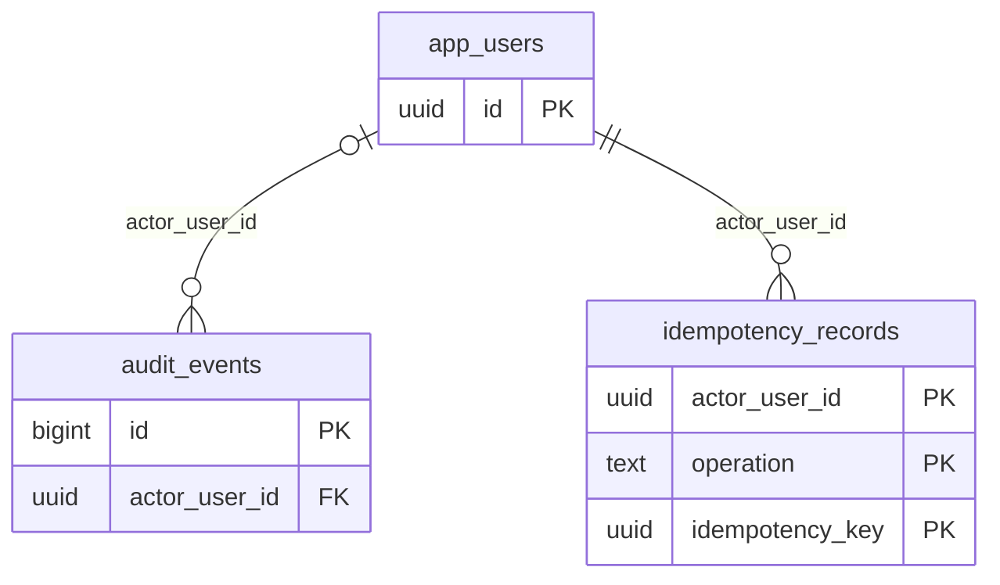


## 8. Data dictionary by domain

The complete per-table dictionary (columns, types, nullability, defaults, constraints, indexes, triggers) is [Appendix A](OGV-DATA-001-appendix-A-table-dictionary.md). The summary below gives purpose, lifecycle and sensitivity for each table. "Migration" is the migration that created the table; later migrations may have altered it (Appendix A shows the final state at `0048`).

### Identity and tenancy

| Table | Purpose | Lifecycle | Sensitivity (analysis) | Migration |
|---|---|---|---|---|
| `organizations` | The tenant (agency). Name, slug, status, time zone, branding and business contact data. | Mutable through `ogevia_api` functions | Business contact data (organization); no personal data of clients | 0002 |
| `app_users` | One row per signed-in person, keyed by the Cognito `sub`; status gates `begin_request`. No email or password is stored here. | Mutable through `ogevia_api` functions | Workforce identity: display name; Cognito `sub` (identifier) | 0002 |
| `organization_memberships` | A user's role in an organization (`system_role`) and membership status. | Mutable through `ogevia_api` functions | Workforce role data | 0002 |
| `permissions` | Catalogue of permission keys (global reference data). | Mutable through `ogevia_api` functions | None | 0002 |
| `role_permissions` | Which permission keys each role holds (global reference data). | Mutable through `ogevia_api` functions | None | 0002 |

### Care directory

| Table | Purpose | Lifecycle | Sensitivity (analysis) | Migration |
|---|---|---|---|---|
| `clients` | Care recipient record as used in operations: random client code, status, city, client type. Legal names are NOT here. | Soft delete (`deleted_at`) | Care-recipient operational record (code, city, status) | 0003 |
| `client_private_names` | Legal first/last name of a client, separated from `clients` and readable only with `clients.names.read`. | Mutable through `ogevia_api` functions | Care-recipient DIRECT IDENTIFIER (legal name) | 0020 |
| `client_types` | Agency-defined client categories. | Mutable through `ogevia_api` functions | None | 0022 |
| `services` | Agency service catalogue (code, name, active flag). | Soft delete (`deleted_at`) | None | 0003 |
| `caregiver_records` | Caregiver (staff) record: code, names, status, hire type, scheduling mode; may link to an `app_users` row. | Soft delete (`deleted_at`) | Workforce PII (names, code, employment attributes) | 0003 |
| `caregiver_assignments` | Standing assignment of a caregiver to a client and service over an effective period, with a family-relationship marker. | Mutable through `ogevia_api` functions | Links a caregiver to a care recipient | 0003 |
| `caregiver_invitations` | Invitation state for a caregiver sign-in (email, send count, first sign-in). | Mutable through `ogevia_api` functions | Workforce PII (email) | 0025 |

### Authorizations

| Table | Purpose | Lifecycle | Sensitivity (analysis) | Migration |
|---|---|---|---|---|
| `client_authorizations` | Versioned authorization: monthly authorized minutes per client/service/payer/period. Amendments add rows in one `lineage_id`. | DELETE blocked; guarded updates only (trigger) | Care-recipient service/payer data; payer and authorization number (free text); rate (financial) | 0004 |
| `authorization_reservations` | Minutes held against an authorization lineage for a scheduled care-request shift; released with a reason. | Mutable through `ogevia_api` functions | Care-recipient scheduling data | 0011 |

### Scheduling

| Table | Purpose | Lifecycle | Sensitivity (analysis) | Migration |
|---|---|---|---|---|
| `shifts` | Scheduled work interval for a client (and optionally caregiver, service, authorization lineage, series). | Mutable through `ogevia_api` functions | Care-recipient scheduling data; cancel reason (free text) | 0003 |
| `shift_coverage_events` | Append-style history of call-outs and reassignments on a shift. | Mutable through `ogevia_api` functions | Care-recipient scheduling data; reason (free text) | 0003 |
| `shift_series` | Definition of a recurring series of shifts, generated through a date. | Mutable through `ogevia_api` functions | Care-recipient scheduling data | 0034 |
| `shift_series_skipped_dates` | Dates deliberately skipped in a series. | Append-only: UPDATE and DELETE blocked by trigger | Scheduling data; reason (free text) | 0034 |

### Visits, confirmation and evidence

| Table | Purpose | Lifecycle | Sensitivity (analysis) | Migration |
|---|---|---|---|---|
| `service_visits` | The visit record: server-set times, worked/verified/billable minutes, status, authorization status, snapshots of client code and caregiver name. | DELETE blocked; guarded updates only (trigger) | Care-recipient service record; caregiver name snapshot; service notes and reasons (free text) | 0005 |
| `visit_evidence` | Metadata for an evidence object in S3 (key, S3 version id, size, SHA-256). Image bytes are never in PostgreSQL. | Append-only: UPDATE and DELETE blocked by trigger | Evidence metadata (object key is UUID-only) | 0005 |
| `visit_confirmations` | The client/representative confirmation of a visit with an immutable snapshot of what was confirmed. | Append-only: UPDATE and DELETE blocked by trigger | Signer name (typed), relationship, reason (free text); snapshot with client code and caregiver name | 0005 |
| `visit_corrections` | Append-only record linking an original visit to its corrected visit with the reason. | Append-only: UPDATE and DELETE blocked by trigger | Correction reason (free text) | 0005 |
| `visit_review_decisions` | Recorded administrator decision for a visit that needs review (accept capped billable / close not billable); revocable. | Guarded updates (trigger) | Review reason (free text) | 0031 |
| `visit_confirmation_requests` | Request to collect a missing confirmation later (secure link plus one-time code, or paper). Token and code stored as hashes. | Guarded updates (trigger) | Credential-like (token hash, code hash); recipient name | 0036 |
| `visit_late_confirmations` | Append-only response to a confirmation request (electronic or paper) with the snapshot it confirmed. | Append-only: UPDATE and DELETE blocked by trigger | Signer name, dispute reason (free text), evidence key | 0036 |
| `visit_late_confirmation_reviews` | Append-only staff review of a late confirmation. | Append-only: UPDATE and DELETE blocked by trigger | Review reason (free text) | 0036 |

### Billing readiness

| Table | Purpose | Lifecycle | Sensitivity (analysis) | Migration |
|---|---|---|---|---|
| `billing_approvals` | Human approval of billable minutes for a visit; one active approval per visit; void keeps history. | DELETE blocked; guarded updates only (trigger) | Financial (rate, amount; owner-only visibility); notes (free text) | 0019 |
| `billing_rounding_policies` | Agency/payer billing rounding rule with its reference and date. | Append-only: UPDATE and DELETE blocked by trigger | Financial configuration; payer label/key | 0029 |
| `billing_rounding_adjustments` | Approved rounding adjustment on a visit, voidable. | DELETE blocked; guarded updates only (trigger) | Financial (rate, amount); notes (free text) | 0029 |

### Continuity

| Table | Purpose | Lifecycle | Sensitivity (analysis) | Migration |
|---|---|---|---|---|
| `continuity_exports` | Log of continuity-pack downloads (who, when, counts). No pack content is stored. | Append-only: UPDATE and DELETE blocked by trigger | Counts and who/when only | 0027 |
| `outage_visit_records` | Pre-numbered outage visit records used while Ogevia is unavailable, reconciled to visits afterwards. | Append-only: UPDATE and DELETE blocked by trigger | Signer name, notes (free text), paper confirmation reference | 0028 |

### Care requests and portals

| Table | Purpose | Lifecycle | Sensitivity (analysis) | Migration |
|---|---|---|---|---|
| `client_care_portals` | Opaque-link portal for a client/family to submit care requests. Token stored as a hash; expiry and revocation tracked. | Mutable through `ogevia_api` functions | Credential-like (token hash); label (free text) | 0011 |
| `care_requests` | A client/family request for care, with status, note, assigned caregiver/shift and authorization lineage. | Mutable through `ogevia_api` functions | Care-recipient request; note entered through a public link (free text, unauthenticated source) | 0011 |
| `care_request_offers` | Offer of a request to a caregiver; offer link token stored as a hash; response status. | Mutable through `ogevia_api` functions | Credential-like (token hash); note (free text) | 0011 |
| `care_notifications` | In-app notification events for staff, portal or caregiver recipients. | Mutable through `ogevia_api` functions | Notification events | 0011 |
| `care_request_alert_recipients` | Staff members who are alerted about new care requests. | Mutable through `ogevia_api` functions Rows are deleted by functions. | Workforce identifiers | 0011 |
| `care_request_events` | Event history of a care request. | Mutable through `ogevia_api` functions | Event history; reason (free text) | 0011 |

### Availability and readiness

| Table | Purpose | Lifecycle | Sensitivity (analysis) | Migration |
|---|---|---|---|---|
| `caregiver_availability_windows` | Weekly availability windows of a caregiver (including overnight). | Mutable through `ogevia_api` functions Rows are deleted by functions. | Workforce availability | 0011 |
| `caregiver_unavailable_dates` | Specific dates a caregiver is unavailable. | Mutable through `ogevia_api` functions Rows are deleted by functions. | Workforce availability; reason (free text) | 0011 |
| `caregiver_availability_state` | One row per caregiver whose version counts approved changes (serialization point). | Mutable through `ogevia_api` functions | Workforce availability version | 0039 |
| `availability_requests` | Caregiver request to change availability, with review status and note. | Mutable through `ogevia_api` functions | Workforce availability; reason and review note (free text) | 0039 |
| `availability_overrides` | One-shot administrator override of an availability check (caregiver, client, exact shift, reason, expiry, consumption). | Mutable through `ogevia_api` functions | Workforce and care-recipient linkage; reason (free text) | 0042 |
| `caregiver_service_approvals` | Per-caregiver approval to deliver a service, with approval and revocation reasons. | Mutable through `ogevia_api` functions | Workforce qualification data; reasons (free text) | 0040 |
| `shift_readiness_flags` | Open flags on future shifts put at risk by readiness changes. | Mutable through `ogevia_api` functions | Workforce readiness | 0039 |
| `assignment_readiness_flags` | Standing assignments that lost approval or a required document. | Mutable through `ogevia_api` functions | Workforce readiness | 0040 |
| `organization_readiness_settings` | Per-agency readiness mode (report-only/enforced) and service-check switch. | Mutable through `ogevia_api` functions | None | 0042 |
| `readiness_setting_events` | History of changes to readiness settings. | Mutable through `ogevia_api` functions | Reason (free text) | 0042 |

### Staff documents

| Table | Purpose | Lifecycle | Sensitivity (analysis) | Migration |
|---|---|---|---|---|
| `document_types` | Agency catalogue of staff document types (for example CPR, TB). | Mutable through `ogevia_api` functions | None | 0021 |
| `staff_documents` | A requested/held document slot for a caregiver and type, with due date and closure. | DELETE blocked; updates only through functions | Workforce documents (for example CPR, TB: health-related) | 0021 |
| `document_versions` | Uploaded versions of a staff document (S3 key, hash, issue/expiry, review status). Versions are kept. | DELETE blocked; guarded updates only (trigger) | Workforce documents; S3 key, hash, expiry; rejection reason (free text) | 0021 |
| `document_requirement_policies` | Agency rule on which documents are required and how. | Mutable through `ogevia_api` functions | Reason (free text) | 0041 |
| `document_requirement_policy_history` | Archived previous policy rows. | Mutable through `ogevia_api` functions | Reason (free text) | 0041 |

### Matching inputs

| Table | Purpose | Lifecycle | Sensitivity (analysis) | Migration |
|---|---|---|---|---|
| `scoring_rule_versions` | Versioned matching rule (weights and parameters); global reference data. | Mutable through `ogevia_api` functions | None | 0043 |
| `experience_tags` | Agency catalogue of experience tags. | Mutable through `ogevia_api` functions | None | 0043 |
| `caregiver_experience` | Experience a caregiver reported, with administrator confirmation status. | Mutable through `ogevia_api` functions Rows are deleted by functions. | Workforce qualification data | 0043 |
| `caregiver_experience_reviews` | Record that an administrator reviewed a caregiver's experience. | Mutable through `ogevia_api` functions | Review note (free text) | 0043 |
| `client_experience_requirements` | Experience a client wants or requires (preferred/mandatory). | Mutable through `ogevia_api` functions Rows are deleted by functions. | Care-recipient needs/preferences | 0043 |
| `caregiver_zip` | Caregiver 5-digit ZIP (no address), administrators only. | Mutable through `ogevia_api` functions | Workforce location (5-digit ZIP) | 0043 |
| `client_service_zip` | Client service-location 5-digit ZIP (no address). | Mutable through `ogevia_api` functions | Care-recipient location (5-digit ZIP) | 0043 |
| `zip_centroids` | Shared ZIP centroid reference data; empty until a dataset with recorded source, licence and vintage is loaded. | Mutable through `ogevia_api` functions | None (public reference data) | 0043 |

### Audit and idempotency

| Table | Purpose | Lifecycle | Sensitivity (analysis) | Migration |
|---|---|---|---|---|
| `audit_events` | Append-only audit trail (ids, statuses, minutes, timestamps; no names or notes by design). | Append-only: UPDATE and DELETE blocked by trigger | Ids/statuses/minutes by design; `reason` is free text | 0005 |
| `idempotency_records` | Stored responses keyed by actor, operation and idempotency key so a retry returns the first result. | Mutable through `ogevia_api` functions | Stored API responses (may include visit identifiers and minutes) | 0005 |


## 9. Enumerations

| Enum | Values |
|---|---|
| `availability_request_status` | `pending`, `approved`, `declined`, `withdrawn`, `superseded` |
| `care_notification_recipient` | `staff`, `client_portal`, `caregiver` |
| `care_offer_status` | `sent`, `available`, `not_available`, `assigned`, `filled`, `cancelled` |
| `care_request_status` | `requested`, `offering`, `accepted_pending_assignment`, `assigned`, `coverage_needed`, `client_cancelled`, `filled`, `closed` |
| `client_status` | `active`, `inactive`, `discharged` |
| `document_review_status` | `awaiting_review`, `verified`, `rejected` |
| `membership_status` | `invited`, `active`, `suspended`, `revoked` |
| `organization_status` | `active`, `suspended`, `closed` |
| `service_visit_status` | `draft`, `awaiting_signature`, `signed`, `administrator_review`, `corrected`, `voided` |
| `shift_coverage_event_type` | `called_out`, `reassigned` |
| `shift_status` | `scheduled`, `completed`, `cancelled`, `no_show` |
| `system_role` | `platform_owner`, `organization_owner`, `organization_admin`, `manager`, `scheduler`, `coordinator`, `staff`, `caregiver`, `read_only` |
| `visit_authorization_status` | `within_authorization`, `limit_reached`, `exceeds_authorization`, `administrator_override` |
| `visit_signer_role` | `client`, `parent`, `guardian`, `authorized_representative` |

Many other status-like columns are `text` with check constraints (for example `visit_confirmations.confirmation_method`, `caregiver_records.status`, `caregiver_records.hire_type`, `app_users.status`); the allowed values are in the check definitions in Appendix A.

## 10. Data integrity rules

### 10.1 Constraint inventory (RV)

| Kind | Count |
|---|---|
| Primary keys | 62 |
| Foreign keys | 210 (45 composite with `organization_id`) |
| Check constraints | 165 |
| Unique constraints | 35 |
| Exclusion constraints | 1 |
| Indexes | 166 in total, including the 62 primary-key indexes (118 unique, of which 17 partial) |
| Triggers | 45 |

### 10.2 Business invariants and where they are enforced

| Invariant | Enforcement | Class |
|---|---|---|
| End time after start; worked minutes 1 to 1440; billable ≤ worked; non-negative minutes | `service_visits` checks (`service_visits_time_check`, `_worked_range`, `_billable_le_worked`, `_minutes_nonnegative`) | RV |
| Draft visit has no end, worked minutes or signature; ended visit has them; locked visit has verified and billable minutes | `service_visits_draft_shape`, `_ended_shape`, `_locked_shape` | RV |
| A correction needs a reason; a void needs actor, time, reason | `service_visits_correction_shape`, `_voided_shape` | RV |
| One open visit per caregiver; one visit per scheduled shift | partial unique indexes `service_visits_one_open_per_caregiver_user`, `_record`, `service_visits_shift_unique` | RV |
| Visit start/end times are server time | `now()` in `start_ad_hoc_service_visit`/`end_service_visit`; no time parameter on the start route | RV |
| Confirmation method rules: drawn or assisted mark needs evidence; typed or verbal needs a signer name; unable-to-confirm needs a reason | `visit_confirmations_method_evidence`, `_typed_name`, `_unable_reason`, `_confirmation_method_check` | RV |
| Locked visits cannot be edited; no delete | triggers `service_visits_guard_update`, `service_visits_no_delete` | RV |
| Confirmation, evidence, corrections, audit, late confirmations are append-only | `forbid_update` / `forbid_delete` triggers | RV |
| A visit without a drawn signature or mark has zero billable minutes | `confirm_service_visit` (`v_allowed := 0`); detective check `unconfirmed_visits_have_zero_billable` | RV |
| Billable never exceeds the current authorization cap | `confirm_service_visit` caps against the current version covering the service date, with the lineage locked | RV |
| No overlapping current authorizations for a client/service | exclusion constraint on `client_authorizations` | RV |
| Versions are linked and contiguous | `UNIQUE (lineage_id, version_number)`; `client_authorizations_set_lineage`; detective checks in `verification/06` | RV |
| Authorization rows are immutable and not deletable | triggers `client_authorizations_immutable`, `_no_delete` | RV |
| One active billing approval per visit; approved ≤ billable at approval; void needs actor, time, reason | `billing_approvals_active_visit_unique`, `billing_approvals_minutes_le_billable`, `billing_approvals_void_shape` | RV |
| An approved visit cannot be corrected until the approval is voided | `service_visits_billing_approval_guard` trigger | RV |
| One reservation per shift and per care request | `UNIQUE` on `authorization_reservations.shift_id` and `.care_request_id` | RV |
| Duplicate retry returns the first result | `idempotency_records` + function logic | RV |
| One open request/flag/decision per subject | partial unique indexes (for example `staff_documents_one_open`, `shift_readiness_flags_one_open`, `visit_review_decisions_one_active`, `visit_confirmation_requests_one_open`) | RV |
| Client requirements and readiness gate before commit | triggers `client_requirements_commit_guard`, `assert_valid_caregiver_assignment`, `new_live_visit_readiness_guard`; `assert_ready_for_work` | RV |
| Caregiver and client codes unique within an organization | unique indexes | RV |
| No free-form image data in the database | no `bytea` columns; verification `04` | RV |

The full list of check and unique constraints per table is in Appendix A. Partial unique indexes:

* `assignment_readiness_flags`: `assignment_readiness_flags_one_open`
* `availability_requests`: `availability_requests_one_pending`
* `billing_approvals`: `billing_approvals_active_visit_unique`
* `billing_rounding_adjustments`: `billing_rounding_adjustments_active_day`
* `billing_rounding_adjustments`: `billing_rounding_adjustments_active_visit`
* `caregiver_records`: `caregiver_records_one_link_per_user`
* `clients`: `clients_org_client_code_unique`
* `clients`: `clients_org_display_code_unique`
* `document_types`: `document_types_one_work_requirement`
* `service_visits`: `service_visits_one_open_per_caregiver_record`
* `service_visits`: `service_visits_one_open_per_caregiver_user`
* `service_visits`: `service_visits_shift_unique`
* `services`: `services_org_code_unique`
* `shift_readiness_flags`: `shift_readiness_flags_one_open`
* `staff_documents`: `staff_documents_one_open`
* `visit_confirmation_requests`: `visit_confirmation_requests_one_open`
* `visit_review_decisions`: `visit_review_decisions_one_active`

### 10.3 Detective checks in the repository

`infra/aws/db/verification/` holds seven read-only scripts (`PHASE_2_EXIT_GATE_REPORT.md` of 2026-10-05 says 94 checks; this run counted 158 true results for scripts 02 to 07; the difference was not reconciled): schema version (`01`), required objects (`02`), constraints and indexes (`03`), roles and grants (`04`), tenant boundaries (`05`), authorization invariants (`06`), visit invariants (`07`). They run as `ogevia_readonly` in a read-only transaction through `pnpm --filter @carelik/infra-aws db:verify`. Run against a real database they would detect violations in data; against the empty local build they confirm structure only.

## 11. Sensitive data

HIPAA classification is a compliance determination that this document does not make. The table below classifies by what the data is and where it lives (analysis). See OGV-TECH-001 sections 27 and 28 for the compliance context.

### 11.1 What is, and is not, stored

| Category | Stored? | Where |
|---|---|---|
| Client legal name | Yes | `client_private_names` (legal first and last name); read only with `clients.names.read`; also `readonly` role |
| Client operational identifier | Yes | `clients.client_code` (random), `caregiver_display_code`, `city`; `service_visits.client_code_snapshot` |
| Date of birth, SSN, Medicaid / UCI / payer member ID | **No column exists** | n/a |
| Payer and authorization number | Yes, as free text | `client_authorizations.payer`, `.authorization_number`, `.source_reference` |
| Diagnosis, clinical notes | **No dedicated column** | but free-text columns can hold them (11.3) |
| Client address | **No** (city and 5-digit ZIP only) | `clients.city`, `client_service_zip.zip` |
| Caregiver names, code, email, ZIP, availability | Yes | `caregiver_records`, `caregiver_invitations.email`, `caregiver_zip`, availability tables |
| Staff health-related documents (for example TB) | Metadata, S3 keys and review status | `staff_documents`, `document_versions` (files in S3) |
| Signature images | **Not in the database** | S3; metadata in `visit_evidence` |
| Passwords | **No** | Cognito |
| Cognito user email | **No** in `app_users`; email appears in `caregiver_invitations` and `organizations.contact_email` | |
| Rates, amounts | Yes | `client_authorizations.hourly_rate_cents`, `billing_approvals`, `billing_rounding_adjustments`; visible only with `billing.read` |
| Link tokens and one-time codes | Only SHA-256 hashes | `client_care_portals.token_hash`, `care_request_offers.token_hash`, `visit_confirmation_requests.token_hash`, `.code_hash` |
| IP address, device data | **No columns** | n/a |

### 11.2 Highest-sensitivity tables (analysis)

1. `client_private_names`: the only direct client identifier.
2. `service_visits`, `visit_confirmations`, `visit_late_confirmations`, `outage_visit_records`: care-recipient service records with free text and signer names.
3. `client_authorizations`, `billing_approvals`, `billing_rounding_adjustments`: payer and financial data.
4. The three tables holding token or code hashes (`client_care_portals`, `care_request_offers`, `visit_confirmation_requests`): hashes cannot be replayed directly, but the support role can see which links exist. All three are readable by `ogevia_readonly`.
5. `staff_documents`, `document_versions`: workforce health-related documents.

### 11.3 Free-text columns (can contain anything typed)

`service_visits.service_notes`, `.correction_reason`, `.void_reason`, `.time_out_reason`; `visit_confirmations.confirmation_reason`, `.typed_signer_name`; `visit_corrections.reason`; `visit_review_decisions.reason`, `.revoke_reason`; `visit_late_confirmations.dispute_reason`, `.signer_name`; `billing_approvals.notes`, `.void_reason`; `care_requests.note` and `care_request_offers.note` (entered through public links by unauthenticated users); `shifts.cancel_reason`; `shift_coverage_events.reason`; `outage_visit_records.notes`; `audit_events.reason`; availability, readiness, review and policy `reason`/`note` columns; `client_care_portals.label`. These fields have length or presence checks in places but no content controls. Anything entered there is as sensitive as the person who typed it chooses to make it.

### 11.4 Where sensitive columns reach logs or other stores

* API logs record route templates, status, latency and error codes only (`apps/sv-api/src/handler.ts:29` to `:35`); database error messages are not logged.
* `idempotency_records.response` stores API responses (identifiers, minutes, statuses).
* Evidence object keys are UUID-only; object contents are in S3.
* Backups and snapshots contain everything above (RDS automated backups, manual snapshots).

## 12. Data lifecycle

### 12.1 Mutability classes (RV; per-table in section 8 and Appendix A)

| Class (from triggers and columns) | Tables | Names |
|---|---|---|
| Mutable through `ogevia_api` functions | 41 | `organizations`, `app_users`, `organization_memberships`, `permissions`, `role_permissions`, `client_private_names`, `client_types`, `caregiver_assignments`, `caregiver_invitations`, `authorization_reservations`, `shifts`, `shift_coverage_events`, `shift_series`, `client_care_portals`, `care_requests`, `care_request_offers`, `care_notifications`, `care_request_alert_recipients`, `care_request_events`, `caregiver_availability_windows`, `caregiver_unavailable_dates`, `caregiver_availability_state`, `availability_requests`, `availability_overrides`, `caregiver_service_approvals`, `shift_readiness_flags`, `assignment_readiness_flags`, `organization_readiness_settings`, `readiness_setting_events`, `document_types`, `document_requirement_policies`, `document_requirement_policy_history`, `scoring_rule_versions`, `experience_tags`, `caregiver_experience`, `caregiver_experience_reviews`, `client_experience_requirements`, `caregiver_zip`, `client_service_zip`, `zip_centroids`, `idempotency_records` |
| Append-only: UPDATE and DELETE blocked by trigger | 10 | `shift_series_skipped_dates`, `visit_evidence`, `visit_confirmations`, `visit_corrections`, `visit_late_confirmations`, `visit_late_confirmation_reviews`, `billing_rounding_policies`, `continuity_exports`, `outage_visit_records`, `audit_events` |
| DELETE blocked; guarded updates only (trigger) | 5 | `client_authorizations`, `service_visits`, `billing_approvals`, `billing_rounding_adjustments`, `document_versions` |
| Soft delete (`deleted_at`) | 3 | `clients`, `services`, `caregiver_records` |
| Guarded updates (trigger) | 2 | `visit_review_decisions`, `visit_confirmation_requests` |
| DELETE blocked; updates only through functions | 1 | `staff_documents` |

`client_authorizations` also has a `deleted_at` column, but its immutability trigger (not soft delete) governs it. Rows are also hard-deleted by functions in five tables: `client_experience_requirements`, `caregiver_unavailable_dates`, `caregiver_experience`, `caregiver_availability_windows`, `care_request_alert_recipients` (static search for `delete from ogevia.*` in the migrations).

### 12.2 Lifecycle of the core record

`service_visits`: `draft` (start) → `awaiting_signature` (end) → `signed` (Billing Ready) or `administrator_review` → (`corrected` original with a new corrected row linked through `original_visit_id` and `visit_corrections`) or `voided`. Locked rows are never edited; a correction creates a new visit row. A billing approval (`billing_approvals`) is a separate record; voiding it returns the visit to Billing Ready. Nothing is deleted.

`client_authorizations`: an amendment inserts a new version in the same lineage and supersedes the previous; old versions stay.

### 12.3 Retention, archival and purge

* **No retention policy** is documented for any table, and **no purge or archival job exists** in the migrations (search of all 48 files). Deletion is by design rare: most tables are append-only or delete-blocked.
* Retention periods for audit events, visit records, evidence and logs: **U** (decision gate D4 in OGV-GOV-001).
* Rollback files for 0039 and 0041 copy history to `archived_*` tables created at rollback time; those tables do not exist in the migrations' schema.
* Tokens expire (`expires_at`) or are revoked, but expired token rows are not deleted.

### 12.4 Backup and recovery coverage

RDS automated backups with point-in-time recovery (7 days) and manual pre-deployment snapshots cover the **whole instance, both databases** (`docs/aws/CONTINUITY_AND_RECOVERY.md`). A database restore to a new instance took 4 min 15 s on 2026-10-05 (owner-reported). The database stores S3 object keys and version ids, so a restored database finds its evidence only if the objects still exist. Restore of `ogevia_prd` specifically, point-in-time loss window and full-system recovery time: U.

## 13. Migrations

### 13.1 Mechanics (RV)

* Files: `infra/aws/db/migrations/NNNN_snake_case.sql`, numbered `0001` to `0048` with no gaps (the runner refuses a gap or duplicate). Names must match `^\d{4}_[a-z0-9_]+\.sql$`.
* Execution: one transaction per file; `-- ogevia:run-as=admin` first line only on `0001`; every other file runs after `SET LOCAL ROLE ogevia_owner`. Files must not contain `BEGIN`/`COMMIT`, passwords or `LOGIN` grants.
* Ledger: `ogevia_meta.schema_migrations(version, name, checksum SHA-256)`. A file already applied whose checksum has changed is refused ("drift"). A session advisory lock prevents two runners at once.
* Remote safety: remote execution requires `OGEVIA_ALLOW_REMOTE_MIGRATION=approved-by-owner`; applying to RDS is a YELLOW action needing written owner approval (`CLAUDE.md` §13, `infra/aws/db/README.md`).
* Rule: never edit an applied file; fix forward.
* Verification: `db:verify` (read-only). Rollback: `db/rollback/NNNN_*.down.sql` run by `db:rollback`, and `db:rollback-readiness [target]` for the readiness release.

### 13.2 Catalogue

"ALTER TABLE" counts statements, not columns. "Functions" counts `create [or replace] function ogevia_api.*` statements in that file (a function may be replaced in several files).

| # | File | Title (first header line) | Tables created | ALTER TABLE statements | `ogevia_api` functions created or replaced | Rollback class |
|---|---|---|---|---|---|---|
| 0001 | `0001_roles_schemas_extensions.sql` | Roles, schemas, extensions. | 0 | 0 | 0 | FORWARD FIX PREFERRED |
| 0002 | `0002_identity_tenancy.sql` | Identity, organizations, memberships, permissions, request context. | 5 | 0 | 1 | BACKUP REQUIRED |
| 0003 | `0003_care_directory.sql` | Caregivers, clients, services, assignments, shifts (SV-relevant columns). | 6 | 0 | 0 | BACKUP REQUIRED |
| 0004 | `0004_authorizations.sql` | Versioned client authorizations (financial control). | 1 | 0 | 0 | BACKUP REQUIRED |
| 0005 | `0005_service_visits.sql` | Service visits, confirmations, evidence metadata, corrections, | 6 | 0 | 0 | IRREVERSIBLE WITHOUT DATA LOSS |
| 0006 | `0006_service_verification_api.sql` | Service Verification API (RDS equivalents of current-main RPCs). | 0 | 0 | 10 | SAFE AUTOMATED |
| 0007 | `0007_reporting_billing_review.sql` | Manager reporting and the billing-review data contract. | 0 | 0 | 3 | SAFE AUTOMATED |
| 0008 | `0008_grants.sql` | Least-privilege grants. | 0 | 16 | 0 | SAFE AUTOMATED |
| 0009 | `0009_api_context_evidence_read.sql` | Phase 4 read functions for the AWS API. | 0 | 0 | 3 | SAFE AUTOMATED |
| 0010 | `0010_reporting_acceptance_improvements.sql` | Browser-acceptance reporting improvements. | 0 | 0 | 2 | SAFE AUTOMATED |
| 0011 | `0011_care_requests_availability.sql` | Self-service care requests, caregiver availability, offers, assignment and coverage. | 9 | 10 | 22 | BACKUP REQUIRED |
| 0012 | `0012_care_portal_request_list.sql` | A reusable client/family care link lists its own upcoming requests. | 0 | 0 | 1 | SAFE AUTOMATED |
| 0013 | `0013_link_visits_to_shifts.sql` | Link Service Verification visits to the scheduled shift they deliver. | 0 | 0 | 3 | SAFE AUTOMATED |
| 0014 | `0014_visit_access_from_scheduled_shift.sql` | Let a caregiver clock in for a client they are SCHEDULED to serve now. | 0 | 0 | 3 | SAFE AUTOMATED |
| 0015 | `0015_manager_close_missed_visit.sql` | Manager close-out for a missed clock-out. | 0 | 1 | 3 | BACKUP REQUIRED |
| 0016 | `0016_remaining_minutes_count_reservations.sql` | Monthly service summary: "remaining" subtracts scheduled (reserved) time. | 0 | 0 | 1 | SAFE AUTOMATED |
| 0017 | `0017_next_scheduled_service.sql` | Caregiver start screen: the service of today's scheduled visit. | 0 | 0 | 1 | SAFE AUTOMATED |
| 0018 | `0018_correction_keeps_unchanged_times.sql` | Visit correction keeps unchanged times exactly (seconds and | 0 | 0 | 1 | SAFE AUTOMATED |
| 0019 | `0019_billing_approval.sql` | Human billing approval (translated from current main). | 1 | 1 | 3 | BACKUP REQUIRED |
| 0020 | `0020_workspace_identity_attention_utilisation.sql` | Agency workspace: signed-in identity, agency branding colour, | 1 | 3 | 11 | BACKUP REQUIRED |
| 0021 | `0021_staff_documents.sql` | Minimal Documents & Compliance: staff credential documents. | 3 | 3 | 10 | BACKUP REQUIRED |
| 0022 | `0022_client_authorization_admin.sql` | Client and authorization administration (ported from the Supabase | 1 | 2 | 9 | BACKUP REQUIRED |
| 0023 | `0023_caregiver_service_admin.sql` | Care Team (caregiver records) and service administration, so ordinary | 0 | 0 | 7 | SAFE AUTOMATED |
| 0024 | `0024_assignment_admin.sql` | Assignment administration: which caregiver may serve which client for | 0 | 0 | 3 | SAFE AUTOMATED |
| 0025 | `0025_invitations_planned_assignments.sql` | Caregiver invitations and planned assignments. | 1 | 5 | 9 | SAFE AUTOMATED |
| 0026 | `0026_staff_shifts_coverage.sql` | Staff-scheduled shifts, call-outs, replacements and coverage history. | 0 | 2 | 8 | SAFE AUTOMATED |
| 0027 | `0027_continuity_pack.sql` | Agency continuity pack (outage continuity, pilot-readiness blocker 7). | 1 | 1 | 2 | SAFE AUTOMATED |
| 0028 | `0028_outage_visit_records.sql` | Outage visit records and reconciliation (outage continuity, blocker 7). | 1 | 1 | 3 | SAFE AUTOMATED |
| 0029 | `0029_billing_rounding.sql` | Billing rounding policies (per payer and service), versioned, with | 2 | 2 | 6 | SAFE AUTOMATED |
| 0030 | `0030_caregiver_hire_scheduling_billing_review.sql` | Caregiver hire type, scheduling mode and family relationship; readable | 0 | 2 | 7 | SAFE AUTOMATED |
| 0031 | `0031_visit_review_decisions.sql` | Visit review: a recorded, audited decision for a visit that needs review. | 1 | 1 | 6 | SAFE AUTOMATED |
| 0032 | `0032_shift_card_held_reservations.sql` | Shift card shows only reservations still held; shift refusal in hours and minutes. | 0 | 0 | 2 | SAFE AUTOMATED |
| 0033 | `0033_document_reminders_attention.sql` | Document reminder thresholds, separate document status dimensions, and | 0 | 2 | 5 | SAFE AUTOMATED |
| 0034 | `0034_recurring_shift_series.sql` | Recurring shifts (weekly series), one-occurrence changes, and | 2 | 3 | 8 | SAFE AUTOMATED |
| 0035 | `0035_dst_local_times.sql` | Daylight-saving times are never resolved silently. | 0 | 2 | 2 | SAFE AUTOMATED |
| 0036 | `0036_signature_recovery.sql` | Missing-signature recovery: a visit without a client signature stays | 3 | 8 | 14 | SAFE AUTOMATED |
| 0037 | `0037_overnight_availability.sql` | Overnight caregiver availability. | 0 | 2 | 1 | SAFE AUTOMATED |
| 0038 | `0038_org_letterhead_contact.sql` | Agency letterhead details for printed reports. | 0 | 1 | 2 | SAFE AUTOMATED |
| 0039 | `0039_availability_approval.sql` | Availability changes need administrator approval (caregiver-readiness release). | 3 | 8 | 10 | ? |
| 0040 | `0040_caregiver_service_approvals.sql` | Caregiver service approvals (caregiver-readiness release). | 2 | 2 | 6 | ? |
| 0041 | `0041_required_documents.sql` | Required work documents: CPR and TB (caregiver-readiness release). | 2 | 3 | 6 | ? |
| 0042 | `0042_readiness_gate.sql` | Commit-time readiness gate, enforcement transition, availability override (caregiver-readi | 3 | 5 | 13 | ? |
| 0043 | `0043_explainable_matching.sql` | Explainable caregiver matching (caregiver-readiness release). | 8 | 8 | 13 | ? |
| 0044 | `0044_readiness_review.sql` | PR #76 review: mandatory client requirements on all commitment paths, | 0 | 0 | 1 | SAFE AUTOMATED |
| 0045 | `0045_manual_care_offer.sql` | Manual care-request offers (owner clarification: a caregiver the Matches list excludes may | 0 | 0 | 1 | SAFE AUTOMATED |
| 0046 | `0046_visit_start_availability.sql` | Approved availability is checked when a NEW visit starts (caregiver- or manager-started),  | 0 | 0 | 0 | SAFE AUTOMATED |
| 0047 | `0047_availability_override_one_shift.sql` | Availability override: ONE shift, ONE use, with the match result it was approved against. | 0 | 3 | 2 | SAFE AUTOMATED |
| 0048 | `0048_account_status_enable_disable.sql` | Sign-in account status and Admin enable/disable. | 0 | 0 | 4 | SAFE AUTOMATED |

Rollback classes: 32 SAFE AUTOMATED, 14 BACKUP REQUIRED, 1 FORWARD FIX PREFERRED, 1 IRREVERSIBLE WITHOUT DATA LOSS. **Irreversible operation:** rolling back `0005` drops the visit, confirmation, evidence, correction, audit and idempotency tables and their data. Several `BACKUP REQUIRED` rollbacks refuse to run while records exist (for example `0019`, `0036`).

### 13.3 Order dependencies (from release documents)

* `0047` drops the 5-argument `authorize_availability_override` and `list_shifts(uuid, date, date, uuid)` and recreates them; the API deployed before `0047` calls the old signature. Order: database, then API, then web, in one sitting (`DEPLOYMENT_CHECKPOINT_0047_0048.md`).
* Re-enable any accounts disabled with `0048` **before** rolling `0048` back.
* `0039` to `0046` form the caregiver-readiness release; applying `0047`/`0048` to a database at `0038` would deploy that release too. Gate: the ledger must read exactly `46|0046` before `0047`.

### 13.4 Repository versus production (DV, owner-provided 2026-10-11)

Production ledger: 46 migrations, latest `0046`. Repository: 48. Not in production:

* `0047`: five new nullable columns on `availability_overrides` (`client_id`, `original_status`, `consumed_at`, `consumed_context`, `shift_id`) and related constraints; replaced `availability_override_for`, `readiness_checks`, `assert_ready_for_work`; new `authorize_availability_override` (6-argument) and `list_shifts`; trigger function `link_availability_override_to_shift`.
* `0048`: permission `accounts.manage` (granted to `organization_owner`); `accounts_manage_guard`; `list_accounts`, `disable_account`, `prepare_account_enable`, `enable_account`.

Appendix A therefore differs from production for `availability_overrides`, and Appendix B lists four functions production does not yet have. The pilot database level is U. The `infra/aws/db/README.md` text "0001–0011 … Nothing here has been applied to any AWS database" is stale (OGV-GOV-001 C11).

## 14. Legacy Supabase schema relationship

Resolves OGV-GOV-001 conflict C5.

| | AWS tree | Legacy Supabase tree |
|---|---|---|
| Path | `infra/aws/db/migrations` | `supabase/migrations` |
| Files | 48, numeric `NNNN_`, contiguous (enforced) | 162, timestamp-style names (`20260715000100_…`, some date-only like `20260828_…`) |
| Schema | `ogevia`, `ogevia_api`, `ogevia_meta` | `public` (and Supabase `auth`, `storage`) |
| Applied by | the repository runner with a checksummed ledger | Supabase tooling (method U) |
| Authoritative for | `ogevia_sv_test` and `ogevia_prd` | the legacy Supabase database |
| Relationship | The AWS tree is a **re-implementation**, not a replay: `docs/aws/PHASE_2_SCHEMA_MAPPING.md` maps source objects (from main `de30bd8`) to targets and marks `REPLACE_FOR_RDS` (Supabase auth), `PORTABLE_POSTGRES`, `PHASE_5_STORAGE_DEPENDENCY` | |

Static comparison of table names (regular expressions over `create table` / `drop table`; approximate, 2026-10-11):

* Legacy `public` tables created: 55; dropped later: 1; net 54.
* Same name in both: 15: `billing_approvals`, `caregiver_assignments`, `caregiver_records`, `client_authorizations`, `clients`, `document_types`, `organization_memberships`, `organizations`, `permissions`, `role_permissions`, `service_visits`, `services`, `shift_coverage_events`, `shifts`, `visit_corrections`. **Same name does not mean same definition**; for example the legacy `visit_signatures` became `visit_evidence` plus `visit_confirmations`, `audit_logs` became `audit_events`, and `user_profiles` became `app_users` (per the mapping document).
* Legacy tables with no same-name AWS table (39): `audit_logs`, `billing_submission_items`, `billing_submissions`, `candidate_credentials`, `candidate_onboarding`, `candidate_portal_tokens`, `candidate_stage_history`, `caregiver_availability`, `caregiver_record_availability`, `caregiver_record_credentials`, `client_requested_schedule`, `client_requested_services`, `client_service_gap_reviews`, `credential_types`, `document_reminder_settings`, `document_request_batches`, `document_requests`, `domain_events`, `feature_flags`, `files`, `incident_types`, `incidents`, `integration_secrets`, `job_applicant_availability`, `job_applicant_services`, `job_applicants`, `languages`, `notifications`, `organization_candidate_stage_settings`, `organization_credential_requirements`, `organization_document_type_preferences`, `organization_settings`, `plan_definitions`, `shift_claim_tokens`, `skills`, `stripe_webhook_events`, `support_access_grants`, `user_profiles`, `visit_signatures`. Some are renamed in AWS (above); the rest (candidate hiring, incidents, skills and languages, feature flags, Stripe plans and webhook events, support access, billing submissions) are **not ported**; `docs/product/PENDING_RESTORATION.md` (2026-10-07) records which are pending restoration and which need an owner decision.
* AWS tables with no legacy same-name table: 47 (everything from care requests, readiness, matching, signature recovery, continuity, rounding, documents versions and others).
* `supabase/proposed/20261004120000_block_correction_of_billing_approved_visits.sql` is an unapplied proposal for the legacy path.

No data has been migrated from Supabase (`docs/aws/PHASE_2_DATA_MIGRATION_PLAN.md`: "BUILD ONLY, NOT EXECUTED"). Whether the legacy database holds real client data is U.

## 15. How to verify and regenerate

All commands are read-only unless stated. None was run against a live AWS database by this document.

**Rebuild and inspect locally (what this document did).** Requires a disposable local PostgreSQL and the repository checked out:

```bash
# create an empty database, then for each file in infra/aws/db/migrations in order:
#   0001: run as the administrator inside one transaction
#   others: begin; set local role ogevia_owner; <file>; commit;
# or use the repository runner against a LOCAL database only:
OGEVIA_DATABASE_URL=postgres://<local-admin>@127.0.0.1:5432/<scratch_db> pnpm --filter @carelik/infra-aws db:migrate
OGEVIA_DATABASE_URL=postgres://<local-admin>@127.0.0.1:5432/<scratch_db> pnpm --filter @carelik/infra-aws db:verify   # read-only
```

**Catalog queries behind the counts** (run in the scratch database):

```sql
select count(*) from information_schema.tables where table_schema = 'ogevia';                       -- 62
select count(*) from information_schema.columns where table_schema = 'ogevia';                      -- 690
select count(*) from information_schema.role_table_grants
  where grantee = 'ogevia_app' and table_schema = 'ogevia';                                          -- 0
select count(*) from pg_proc p join pg_namespace n on n.oid = p.pronamespace
  where n.nspname = 'ogevia_api' and has_function_privilege('ogevia_app', p.oid, 'execute');         -- 175
select relrowsecurity, relforcerowsecurity, count(*) from pg_class c join pg_namespace n on n.oid = c.relnamespace
  where n.nspname = 'ogevia' and c.relkind = 'r' group by 1, 2;                                      -- (t,f,60), (f,f,2)
select roles::text, cmd, qual, count(*) from pg_policies where schemaname = 'ogevia' group by 1, 2, 3; -- {ogevia_readonly}, SELECT, true, 59
```

**Verify a real environment (requires an approved private tunnel; not done here).**

```sql
select count(*), max(version) from ogevia_meta.schema_migrations;   -- production expected 46 / 0046 until 0047-0048 are applied
select rolname, rolcanlogin, rolsuper, rolbypassrls from pg_roles where rolname like 'ogevia%';
select grantee, count(*) from information_schema.role_table_grants where table_schema = 'ogevia' group by 1;
select roles, count(*) from pg_policies where schemaname = 'ogevia' group by 1;
```

Related SOP: OGV-SOP-002 (Database Migration SOP): **proposed, not written**. Interim sources: `infra/aws/db/README.md` (partly stale), `docs/releases/DEPLOYMENT_CHECKPOINT_0047_0048.md`, `docs/releases/caregiver-readiness/RELEASE_HANDOFF.md`.

## 16. Limitations, risks and unresolved questions

### 16.1 Findings that need an owner or engineering decision

| # | Finding | Why it matters | Recommended default |
|---|---|---|---|
| F1 | `ogevia_readonly` has cross-tenant `SELECT ... USING (true)` on 59 tables, including `client_private_names`. Who holds it in `prd` is U. | Any login granted this role reads every agency's data, including client names, regardless of the function layer. | Confirm in `ogevia_prd` that no login holds `ogevia_readonly` except an approved, audited operator path; consider excluding `client_private_names` and the hash columns from its policy in a future migration (needs owner approval; behavioural change to verification scripts). |
| F2 | RLS is not the tenant control and `FORCE ROW LEVEL SECURITY` is off. | Misreading the RLS count (60) as isolation is easy; any future direct-table access path (a new role, a reporting tool) would bypass nothing because no policy restricts by tenant. | Keep the rule "no direct table access for application roles". Document in code review checklists. Consider tenant-scoped policies only if a non-function access path is ever introduced. |
| F3 | 43 single-column foreign keys between organization-scoped tables are not tenant-bound. | A function bug could create a cross-tenant reference that no constraint rejects. | Add composite keys (or detective checks) for the highest-value relationships first: `service_visits`→`shifts`, `visit_*`→`service_visits`, `billing_approvals`→`service_visits`, `shifts`/`care_requests`→`client_authorizations`. Requires migrations and a data check; owner approval. |
| F4 | `verification/01_schema_version.sql` hard-codes 48. | `db:verify` against production (46) reports false for two checks until `0047`/`0048` are applied. | Interpret accordingly; parameterize in a future change. |
| F5 | `payer` and `authorization_number` are free text. | Typed values may contain identifiers or varying spellings; no normalization or validation. | Define an allowed payer list and format before real data entry (product decision). |
| F6 | No retention, purge or archival policy or job. | Records accumulate indefinitely, including free-text fields, backups and S3 versions. | Obtain a retention requirement (legal/compliance) before production data; record in OGV-SEC-001. |
| F7 | Test-slice login may be `ogevia_app` itself (`01_app_login_role.sql`). Roles are cluster-wide. | Separation of the two databases rests on `CONNECT` privileges; this has not been shown against the live instance. | Run `14_prd_verify_access.sql` / checklist item 8; record result. |
| F8 | Production is at level 46 while documentation and Appendix A describe 48. | Readers may assume columns/functions exist that do not (section 13.4). | State the level in every operational document; check the ledger first. |

### 16.2 Limitations

* Local build on PostgreSQL 16, not 18; no live database inspected; no data profiled.
* Purpose and sensitivity text is the author's; it should be reviewed by the owner and a compliance reviewer.
* Constraint, index and trigger counts are for the final state after all 48 migrations.
* The legacy comparison is a static name comparison.
* SQL function bodies were not exhaustively reviewed; behaviour claims cite specific functions only where read (OGV-TECH-001 sections 17 to 24).
* Cognito, S3 and CloudWatch data are outside this document.

### 16.3 Unresolved questions

1. Which login roles hold `ogevia_readonly`, `ogevia_app` or `ogevia_owner` in each database?
2. Does `ogevia_prd` contain any `app_users.cognito_sub` that also exists in the pilot database?
3. Is the pilot database at 0036 or later? Was `14_prd_verify_access.sql` run?
4. What retention applies to audit events, visit records, evidence and backups?
5. Does production behave identically on PostgreSQL 18.3 for all 48 migrations (CI runs `postgres:18`; result not retrieved)?
6. Are there tables or objects in the live databases that no migration created (manual changes)?
7. Are the three RLS-without-policy tables intentional?

## 17. Related SOPs and change log

| Needed | ID | State |
|---|---|---|
| Database migration | OGV-SOP-002 | Missing (proposed). Interim sources in section 15. |
| Rollback, backup, recovery | OGV-SOP-003 | Missing (proposed). Interim: `docs/aws/CONTINUITY_AND_RECOVERY.md`, `PHASE_2_ROLLBACK_PLAN.md`. |
| Deployment and release | OGV-SOP-001 | Missing (proposed). |
| Identity, roles, tenant isolation | OGV-IAM-001 | Missing (proposed). |

| Version | Date | Change |
|---|---|---|
| 0.1 | 2026-10-11 | First draft: schema built locally from migrations 0001 to 0048 and read from the catalogs. |

### Final validation record

Run on 2026-10-11 against the three files at the commit described in the metadata.

| Check | Result |
|---|---|
| Every count in the document re-derived from the local catalogs | PASS. 62 tables, 690 columns, 14 enums, 210 FKs (45 composite, 43 single-column between organization-scoped tables), 165 checks, 35 unique, 1 exclusion, 166 indexes, 45 triggers, 175 API functions (no overloads), 123 internal functions (122 names), RLS on 60 tables, 59 policies on 59 tables, 0 table privileges for `ogevia_app`. Two errors in the first draft were found and fixed during this check: the RLS/policy arithmetic (policies on 57 RLS tables plus 2 tables where RLS is off) and the function total |
| Repository verification scripts 02 to 07 against the local build | PASS: 158 of 158 true (script 01 not run; it needs the runner's ledger) |
| All 48 migrations apply in order on a fresh database | PASS on PostgreSQL 16.15. Not tested on PostgreSQL 18 |
| Mermaid syntax (`mermaid@10.9.1` `parse()`) | PASS: 14 of 14 diagrams in the master document (1 flowchart + 13 ER diagrams); TECH-001 re-checked, 6 of 6 |
| Internal links and companion-file links | PASS: 22 links in the master document, 1 in each appendix, all resolved |
| Cited repository paths | PASS: every cited path and file name exists, except the pattern placeholder `NNNN_snake_case.sql` |
| Environment naming | PASS: every `prod` is labelled PILOT / TEST and every `prd` PRODUCTION / PRD |
| Secrets and personal data | PASS: scans for keys, tokens, JWTs, private keys, credentialed connection strings, ARNs, email addresses and the Supabase project identifier found none. No real or synthetic Ogevia data was loaded into the local database |
| Claims needing deployment evidence or owner confirmation | Section 16.3 (login-role assignments, pilot level, retention, PostgreSQL 18 behaviour, out-of-band objects) |
| Corrections to earlier documents | OGV-TECH-001 updated to 0.1.1 (RLS wording, one-open-visit enforcement, legacy CareScore versions). OGV-GOV-001 register and conflict C5 updated |

Not done: any query against a live database; any test suite beyond the repository's read-only verification scripts; PostgreSQL 18 execution; review of every function body.

