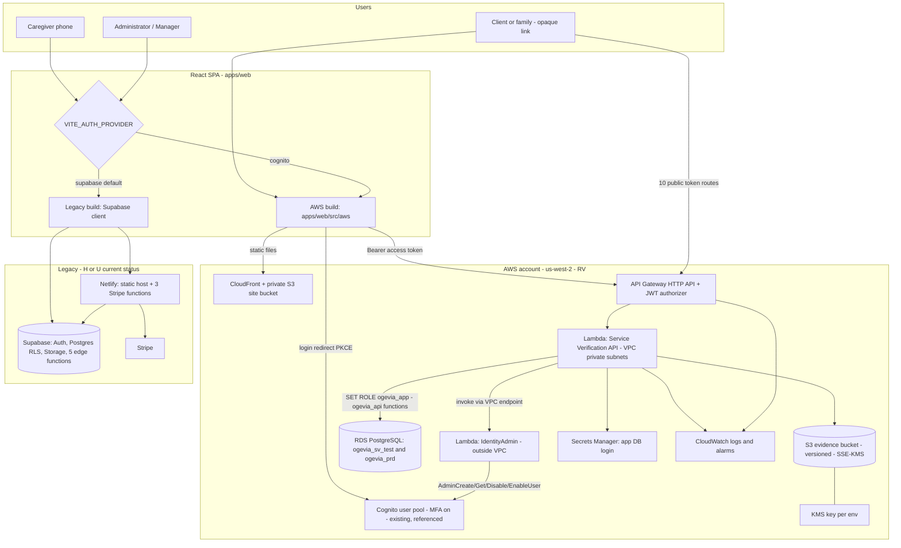
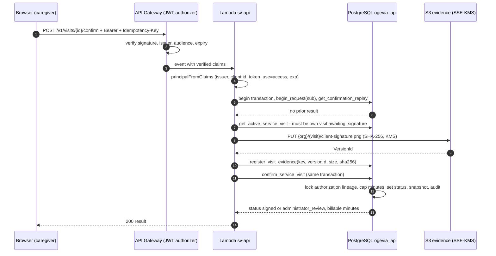
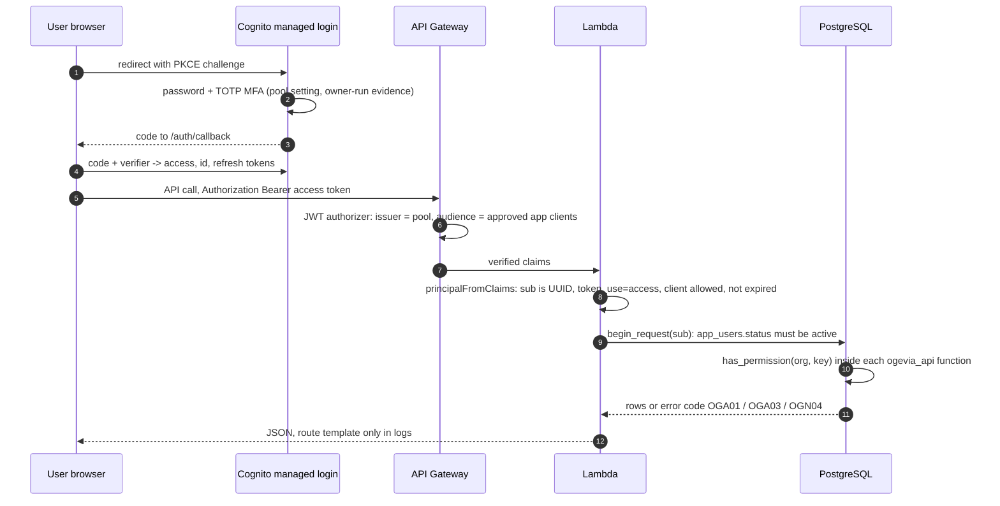
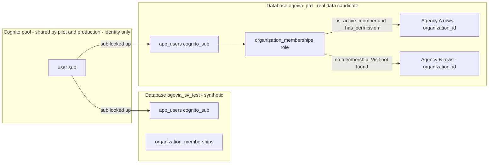
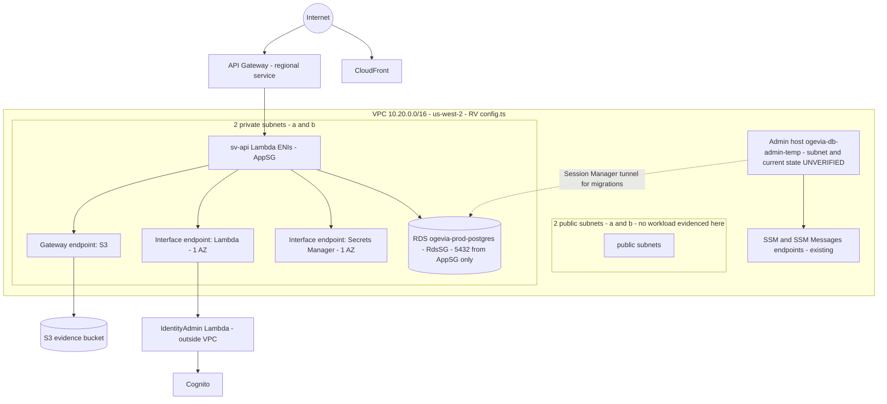
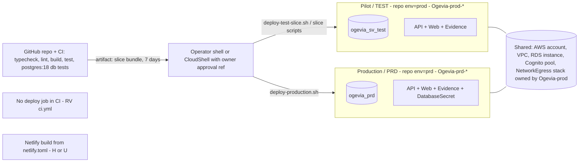

# OGV-TECH-001: Ogevia Master Technical Reference

## Document metadata and verification status

| Field | Value |
|---|---|
| Document ID | OGV-TECH-001 |
| Version | 0.1 (DRAFT, not approved by the owner) |
| Inspection date | 2026-10-11 |
| Branch inspected | `claude/amazing-meitner-cap9fd` |
| Commit inspected | `2b015725c9f2f26efe45cf532193bea80ac074a4` (a documentation-only commit on top of `origin/main` = `a2d249b0d947a7414e0b7ed7d7b94ed5a6cc9ca4`, "Merge pull request #81"). No application code differs between the two. |
| Scope | The whole repository `socalcaresservices/CarelikGlobal`: `apps/`, `packages/`, `infra/aws/`, `supabase/`, `docs/`, `.github/`, `netlify.toml`, `CLAUDE.md`, and Git history that is available. |
| Method | Read-only repository inspection (file reads, `grep`, `git log`). No code was changed, no migration run, nothing deployed, **no AWS or Supabase call was made**, and no test suite was executed. |
| Governance directive | The "Ogevia Documentation Governance Directive" was **not available** to this inspection. Its requirements were not invented. The nearest text is the author's own unapproved draft `OGV-GOV-001` (`docs/governance/OGV-GOV-001_Documentation_Governance_and_Register.md`). Location and format follow the instruction given with this task. |
| Approver | The owner. Approval is **not given**. |

### Evidence classes used in every section

| Tag | Meaning | What counts as proof |
|---|---|---|
| **RV** | Repository-verified implementation | Code, SQL, CDK or config at the commit above, cited by path and line. Proves the repository *contains* it. Does not prove it is deployed. |
| **DV** | Deployment-verified | Evidence about a running system with a date and a named source. In this document every DV item is **owner-provided or recorded in a repository document**, not collected by this inspection. Each says which. |
| **H** | Historical | Existed or was true at a past date; superseded or not confirmed current. |
| **P** | Planned / proposed | Written down or designed; no implementation, or implementation not accepted. |
| **U** | Unverified / unknown | Not established by available evidence. "Not recorded" is not "not done". |

An infrastructure definition (CDK) is **RV only**. A UI screen, table or endpoint is **not** treated as proof that a workflow is complete; workflows are traced end to end in sections 19 and 20.

### Evidence limitations (material)

1. **The Git clone is shallow** (`git rev-parse --is-shallow-repository` = `true`; 132 commits; earliest available commit is 2026-08-20). Decisions before that date can be dated only from file names (for example Supabase migration `20260715000100_platform_foundation.sql`), not from commit history.
2. **No live AWS evidence was collected.** Anything about running resources comes from repository documents and is attributed and dated where used. The newest is 2026-10-11 (`docs/releases/DEPLOYMENT_CHECKPOINT_0047_0048.md`, owner-provided).
3. **Tests were not run.** Test counts are file counts. Statements such as "a test enforces X" mean the test exists in the repository, not that it passes today.
4. **Many existing documents under `docs/aws/` are dated 2026-10-05** and predate migrations 0039 to 0048. They are used as dated snapshots only.
5. **The Resend service does not appear in the repository or in the available history** (section 55).
6. **Business and contractual facts** (the AWS BAA, agreements, payer rules) cannot be verified from code. They are labelled owner-stated or unknown.

### Claims that need deployment evidence or owner confirmation before anyone relies on them

| # | Claim | Needed |
|---|---|---|
| 1 | Production (`prd`) database `ogevia_prd` is migrated to 0046 | Owner-provided ledger `ogevia_prd\|46\|0046` dated 2026-10-11 exists (DV, owner-provided). Re-run `select count(*), max(version) from ogevia_meta.schema_migrations` before any release. |
| 2 | The production frontend calls the production API, not the pilot API | Open item 4 in `docs/aws/URL_REGISTRY_AND_LAUNCH_CHECKLIST.md`. |
| 3 | Sign-in with MFA, signature workflow, role isolation and cross-tenant negatives work on `prd` | Open items 9 to 13 of the same checklist. |
| 4 | Which system `app.ogevia.com` currently serves | Conflict between `docs/OGEVIA_OPERATING_RECORD.md` (says Cognito) and the URL registry (DNS not repointed). Owner to confirm. |
| 5 | The AWS BAA exists and its scope | Owner-stated, and `docs/aws/PHASE7_SECURITY_REVIEW.md` reports a live check on 2026-10-03. The agreement is not in the repository. |
| 6 | Whether Supabase or Netlify holds real client data, and whether BAAs exist for them | Unknown (`PHASE7_SECURITY_REVIEW.md` line 180). |
| 7 | Whether anyone receives CloudWatch alarm notifications | The CDK topic has no subscriber (section 49). |
| 8 | Whether Resend was ever used, and where | Owner to confirm (section 55). |

---

## Table of contents

**Part 1: What it is**
[1 Executive overview](#1-executive-technical-overview) · [2 What Ogevia does](#2-what-ogevia-does) · [3 Architecture overview](#3-architecture-overview) · [4 Architecture diagram](#4-architecture-diagram) · [5 Technology stack](#5-technology-stack) · [6 Repository structure](#6-repository-structure)

**Part 2: Application layers**
[7 Frontend](#7-frontend-architecture) · [8 Backend/API](#8-backendapi-architecture) · [9 Database](#9-database-architecture)

**Part 3: AWS and identity**
[10 AWS architecture](#10-aws-architecture) · [11 Authentication and authorization](#11-authentication-and-authorization) · [12 Cognito](#12-cognito) · [13 Roles and permissions](#13-user-roles-and-permissions) · [14 Tenancy](#14-organizationmulti-tenant-architecture)

**Part 4: Functional domains**
[15 Clients](#15-client-management) · [16 Caregivers](#16-caregiver-management) · [17 Scheduling](#17-scheduling) · [18 Authorizations](#18-authorizations) · [19 Visit verification](#19-servicevisit-verification) · [20 Signatures/evidence](#20-signaturesevidence) · [21 CareScore](#21-carescorematching) · [22 Compliance](#22-compliance) · [23 Reporting](#23-reporting) · [24 Billing readiness](#24-billing-readiness-architecture) · [25 Audit](#25-audit-logging)

**Part 5: Security**
[26 Controls](#26-security-controls) · [27 HIPAA](#27-hipaa-related-architecture) · [28 BAA](#28-aws-baa-dependency)

**Part 6: AWS components**
[29 Network](#29-network-architecture) · [30 RDS](#30-rds) · [31 Lambda](#31-lambda) · [32 API Gateway](#32-api-gateway) · [33 CloudFront](#33-cloudfront) · [34 S3](#34-s3) · [35 KMS](#35-kms) · [36 Secrets Manager](#36-secrets-manager) · [37 Cognito detail](#37-cognito-pools-clients-configuration-and-operational-dependencies) · [38 CDK/CloudFormation](#38-cloudformationcdk)

**Part 7: Environments and operations**
[39 Environments](#39-environment-architecture) · [40 URLs](#40-environment-urls) · [41 APIs](#41-apis) · [42 Databases](#42-databases) · [43 Cognito pools/clients](#43-cognito-poolsclients) · [44 Accounts/regions](#44-aws-regionsaccounts) · [45 Deployment](#45-deployment-architecture) · [46 Migration](#46-migration-architecture) · [47 Release](#47-release-architecture) · [48 Rollback/recovery](#48-rollbackrecovery-architecture) · [49 Observability](#49-observabilitylogging) · [50 External integrations](#50-external-integrations)

**Part 8: State of the system**
[51 Limitations](#51-current-limitations) · [52 Technical debt](#52-technical-debt) · [53 Risks](#53-known-risks) · [54 Deprecated architecture](#54-deprecated-architecture) · [55 History](#55-development-history-and-major-architecture-decisions)

**Part 9: Reference**
[56 Glossary](#56-glossary) · [57 Search index](#57-search-index-if-i-need-x-where-do-i-look) · [Known gaps](#known-gaps-and-unresolved-questions) · [Validation record](#final-validation-record)

---

# Part 1: What it is

## 1. Executive technical overview

Ogevia (the repository and package names still say `carelik` / `CareLikGlobal`) is a multi-tenant web application for community-care agencies. Its first tenant is SoCal Care Services (`CLAUDE.md` §2). The production milestone defined by the owner is **electronic Service Verification**: a caregiver starts and ends a visit, the server records authoritative times, a client or representative confirms, evidence is stored, and the visit becomes available for reconciliation and human billing approval.

Facts that shape everything else:

* **Two backends coexist in one repository and one React app.** The legacy path is React + Supabase (Auth, Postgres/RLS, Storage, Edge Functions) hosted on Netlify. The AWS path is React + Amazon Cognito + API Gateway HTTP API + Lambda + RDS PostgreSQL + private S3 with KMS. The build selects one at start-up from `VITE_AUTH_PROVIDER` (`apps/web/src/main.tsx:11`, default `supabase`, `apps/web/src/env.ts`). RV.
* **`CLAUDE.md` makes AWS the production direction** and keeps Supabase and Netlify "temporarily" until replacement acceptance (`CLAUDE.md` §3, §13). Retirement of either is **not verified** (section 54).
* **Two AWS environments share one account, VPC, RDS instance and Cognito user pool**: pilot/test (repository `env=prod`) and production (repository `env=prd`). See the warning and table in section 39. RV.
* **All privileged logic lives in PostgreSQL functions.** The API Lambda connects as a login that is `SET ROLE ogevia_app`, a role with `EXECUTE` on schema `ogevia_api` only and no table privileges (`infra/aws/db/migrations/0001_roles_schemas_extensions.sql`, `apps/sv-api/src/db.ts`, `infra/aws/lib/service-verification-api-stack.ts:275`). RV.

Size, by static count (RV; counts include objects later replaced):

| Item | Count | Source |
|---|---|---|
| API routes | 165 (10 public by opaque token, 155 behind the Cognito JWT authorizer) | `apps/sv-api/src/routes.ts:166` to end; `infra/aws/lib/public-routes.ts:24` |
| AWS database migrations | 48 (`0001` to `0048`) | `infra/aws/db/migrations/` |
| Supabase migration files | 162 | `supabase/migrations/` |
| Distinct SQL function names created | 122 in schema `ogevia`, 175 in `ogevia_api` | `grep` of `create [or replace] function` |
| `enable row level security` statements | 60 | `grep` over AWS migrations |
| Test files | about 200 (`*.test.ts[x]`): web 90, infra 63, packages 42, sv-api 5, plus 10 SQL test files under `supabase/tests/` | file count |

Status snapshot (dated; verify before use):

| Item | Status | Class | Source and date |
|---|---|---|---|
| Pilot/test (`prod`) deployed and accepted on real phones with synthetic data | Yes at 2026-10-03; release 0027 to 0036 recorded deployed and verified 2026-10-05 | DV, owner-run, recorded in repo | `docs/aws/SCS_PILOT_READINESS.md`, commit `909f91d` |
| Current pilot migration level | Not known | U | Latest recorded: 0036 (2026-10-05) |
| Production (`prd`) stacks `Ogevia-prd-WebHosting`, `Ogevia-prd-ServiceVerificationApi` | `UPDATE_COMPLETE` | DV, owner-provided | `docs/aws/URL_REGISTRY_AND_LAUNCH_CHECKLIST.md` §2, 2026-10-10 |
| Production database ledger | `46\|0046` | DV, owner-provided | `docs/releases/DEPLOYMENT_CHECKPOINT_0047_0048.md`, 2026-10-11 |
| Migrations 0047 and 0048 | Implemented and tested locally; **not deployed** | RV + doc | same file |
| Production cleared for real client data | **No.** Checklist items 4 to 14 are open | DV (doc) | URL registry §3 |
| Phase 7 security review | Prepared; **not signed** | RV (doc) | `docs/aws/PHASE7_SECURITY_REVIEW.md` line 3 |

## 2. What Ogevia does

Functional scope that exists in the AWS build (RV; per-domain detail in Part 4). Existence of a route and screen is shown; whether each is exercised in production is U.

| Domain | What it does | API / DB anchor |
|---|---|---|
| Service verification | Start visit (server time), end visit (server time), client/representative confirmation (drawn, assisted mark, typed, verbal, unable to confirm), lock, corrections, manager close-out of a missed clock-out | `POST /v1/visits`, `/end`, `/confirm`, `/close`, `/corrections`; `ogevia_api.*_service_visit` |
| Clients and caregivers | Directory, status, details, legal names kept separately, caregiver records, invitations, employment, ZIP | `/v1/clients*`, `/v1/caregivers*` |
| Scheduling | Shifts, recurring series, reschedule, caregiver call-out, coverage, assignments, outage visit records | `/v1/shifts*`, `/v1/shift-series*`, `/v1/assignments*`, `/v1/my-shifts*`, `/v1/outage-visits*` |
| Authorizations | Versioned (lineage) client authorizations, amendments, reservations that hold hours for scheduled shifts | `/v1/clients/{id}/authorizations`, `/v1/authorizations/{id}/amend` |
| Care requests | Client/family portal links, requests, caregiver offers, assignment | `/v1/care-*`, `/v1/public/care-*` |
| Readiness and matching | Availability approval, service approvals, CPR/TB documents, commit-time gate, explainable matching | `/v1/readiness*`, `/v1/availability*`, `/v1/matching/candidates` |
| Documents | Staff document types, versions, review, expiry reminders | `/v1/documents*`, `/v1/document-*` |
| Billing readiness | Billing Ready queue, review decisions, human billing approval, rounding policy and adjustments | `/v1/billing-review`, `/v1/visits/{id}/billing-approval`, `/v1/billing-rounding/*` |
| Reports | Monthly service/approval summaries, utilisation, correction history, attention counts | `/v1/reports/*`, `/v1/attention` |
| Administration | Branding and letterhead, accounts enable/disable (0048, not deployed), services catalogue, continuity pack | `/v1/branding*`, `/v1/accounts*`, `/v1/continuity/*` |

What Ogevia is **not** (owner direction, `CLAUDE.md` §10; route list reviewed, no contrary route found): a CalEVV/Sandata replacement, a GPS or geofencing system, an automatic payer-billing system. Billing approval is not submission (`docs/product/ACCESS_AND_BILLING_VISIBILITY.md`). The public marketing site advertises "Compliance tracking" and "CareScore matching" (`docs/OGEVIA_OPERATING_RECORD.md`); the matching claims were reviewed in `docs/releases/caregiver-readiness/MARKETING_CLAIMS_REVIEW.md`, and the AWS matching score is labelled provisional (section 21).

## 3. Architecture overview

Layered view of the AWS path (RV):

1. **Browser**: React single-page app, built once, configured at start-up from same-origin `/config.json` (identifiers only) merged over build-time values (`apps/web/src/aws/aws-runtime.ts:32` to end).
2. **Identity**: Cognito managed login (hosted UI), Authorization Code with PKCE, public client, no secret (`packages/auth/src/cognito/`, `infra/aws/lib/web-hosting-stack.ts:139` to `:152`).
3. **Edge**: CloudFront in front of a private S3 site bucket (origin access control) for static files; the API is called directly at the API Gateway URL (no CloudFront in front of the API).
4. **API**: API Gateway HTTP API with a Cognito JWT authorizer, throttled to 20 requests per second, burst 50 (`service-verification-api-stack.ts:560`), integrated with one Lambda in private subnets.
5. **Application logic**: the Lambda authenticates the principal (defence in depth), opens one database transaction per call, and calls SQL functions in `ogevia_api`. Signature and document bytes go to S3 with KMS.
6. **Data**: RDS PostgreSQL in private subnets; S3 evidence bucket, versioned, KMS-encrypted; Secrets Manager holds the database login.
7. **Control plane**: AWS CDK v2 (TypeScript) defines new stacks and *references* existing foundation resources; deployments run from operator shells with scripts and owner approval references.

Design rules enforced in code (each RV):

* Identity is resolved from the verified token `sub` only; the principal carries no organization, role or email (`packages/auth/src/server/principal.ts:1` to `:20`). Organization membership and permissions are looked up in PostgreSQL (`ogevia_api.begin_request`, `0002_identity_tenancy.sql:116`).
* The database context is transaction-local (`set_config(..., true)`), so a pooled connection cannot carry one caller's identity into another request (`0002:116` onward).
* Server time: `now()` in SQL sets `time_in`, `time_out` (`0006_service_verification_api.sql:360` to `:421`). The start route accepts no time parameter (`routes.ts:1050` to `:1067`).
* Idempotency: mutating routes take an `Idempotency-Key`; SQL stores a fingerprint and replays the stored result (`0006:486` onward, `ogevia.idempotency_records`).

## 4. Architecture diagram

### 4.1 Overall system (both backends)



Unverified elements: whether Netlify and Supabase currently serve live users; whether `app.ogevia.com` points at Netlify, either CloudFront distribution, or neither; DNS and any custom domain (none is defined in CDK; the CloudFront distributions use the default `*.cloudfront.net` certificate, `web-hosting-stack.ts` acknowledgement `AwsSolutions-CFR4`).

### 4.2 Request and data flow: confirm a visit with a drawn signature



Source: `apps/sv-api/src/routes.ts:1095` to `:1173`; `0006_service_verification_api.sql:423`, `:486`. Failure branch: if S3 fails the API returns 503 `evidence_unavailable` and the visit stays `awaiting_signature` (`routes.ts`, step 3). RV.

### 4.3 Authentication and authorization



Sources: `packages/auth/src/cognito/*`, `apps/sv-api/src/handler.ts:66` to `:84`, `packages/auth/src/server/principal.ts:71`, `0002_identity_tenancy.sql:116`. RV.

### 4.4 Organization and tenant boundaries



The tenant boundary is **inside PostgreSQL** (membership plus permission checks in every function), not at the user pool. A valid token for a person not provisioned in `ogevia_prd.app_users` fails at `begin_request` with `OGA01`. Whether `ogevia_prd` contains a pilot person's `sub` is U. See section 14.

### 4.5 AWS network and service relationships



No NAT gateway is defined (`CLAUDE.md` §11; egress by endpoints in `infra/aws/lib/network-egress-stack.ts`). The pilot and production Lambdas use the **same** security group and subnets. Source of VPC, subnet, SG IDs: `infra/aws/lib/config.ts:151` to `:250` (RV); live state U.

### 4.6 Deployment and environment relationships



---

## 5. Technology stack

| Layer | Technology | Version evidence | Class | Source |
|---|---|---|---|---|
| Language | TypeScript (strict monorepo), SQL (PL/pgSQL) | `typescript ^5.7.2` | RV | `package.json`, `tsconfig.base.json` |
| Monorepo | pnpm 9.15.4 workspaces + Turborepo 2 | `packageManager` | RV | `package.json`, `pnpm-workspace.yaml`, `turbo.json` |
| Frontend | React 18.3, React Router 7, TanStack Query 5, react-hook-form + zod, Tailwind 3, Vite 6, Recharts, lucide-react | listed ranges | RV | `apps/web/package.json` |
| Frontend legacy dependency | `@supabase/supabase-js ^2.47.10` | still a dependency | RV | `apps/web/package.json` |
| UI kit | `@carelik/ui` | local package | RV | `packages/ui/` |
| Auth | `@carelik/auth` (browser Cognito PKCE client, server principal) | local package | RV | `packages/auth/` |
| Shared domain code | `@carelik/shared` (zod schemas, permissions helpers, matching shapes) | local package | RV | `packages/shared/` |
| API runtime | AWS Lambda, `NODEJS_24_X`, ARM64, 512 MB, 10 s; identity Lambda 256 MB, 8 s | CDK | RV | `service-verification-api-stack.ts:450`, `:480` to `:496` |
| API libraries | `pg ^8.23`, AWS SDK v3 (S3, Secrets Manager, Lambda, Cognito IDP) | | RV | `apps/sv-api/package.json` |
| Database | PostgreSQL 18 (RDS 18.3 per inventory; CI service container `postgres:18`) | inventory 2026-10-01 to 05; `ci.yml:50` | RV + H doc | `docs/aws/CURRENT_AWS_INVENTORY.md` line 56 to 57 |
| IaC | AWS CDK v2 (TypeScript), cdk-nag (AwsSolutions + HIPAA packs) | | RV | `infra/aws/package.json`, `infra/aws/README.md` |
| Tests | Vitest 2, Testing Library, jsdom, Playwright (e2e folder), PostgreSQL integration tests | | RV | package manifests, `apps/web/e2e`, `infra/aws/db/test` |
| CI | GitHub Actions: `validate` and `postgres` jobs | Node 20, pnpm 9.15.4 | RV | `.github/workflows/ci.yml` |
| Legacy hosting | Netlify (Node 20, pnpm 9.15.4, esbuild functions) | | RV | `netlify.toml` |
| Legacy backend | Supabase (Auth, Postgres, Storage, 5 Deno edge functions) | | RV | `supabase/` |
| Payments (legacy path) | Stripe (checkout, billing portal, webhook) | | RV | `apps/netlify-functions/functions/*.ts` |

Node version note (RV, unresolved): Lambda runtime is Node 24, esbuild target is `node22` (`service-verification-api-stack.ts` bundling block), CI and Netlify run Node 20. Behaviour differences between these have not been assessed (section 52).

## 6. Repository structure

| Path | Purpose | Notes |
|---|---|---|
| `CLAUDE.md` | Authoritative build directive (AWS migration, security, approval gates). Standing rules in §0 take precedence. | Read first |
| `apps/web/` | React SPA. `src/aws/` is the AWS build; `src/pages/`, `src/components/`, `src/layout/`, `src/providers/`, `src/routes/` are mostly the legacy Supabase build; `src/lib/aws-api.ts` is the API client. `e2e/` holds Playwright tests. | 241 source files; 106 import Supabase |
| `apps/sv-api/` | Service Verification API Lambda source: `handler.ts`, `routes.ts` (2461 lines, route table), `evidence.ts`, `documents.ts`, `identity.ts`, `identity-handler.ts`, `config.ts`, `db.ts`, `validate.ts`, `errors.ts`, `http.ts` | |
| `apps/netlify-functions/` | Three Stripe functions (legacy billing) | |
| `packages/auth/` | Cognito PKCE client (`src/cognito`), principal/DB bridge (`src/server`), legacy provider | |
| `packages/shared/` | Zod schemas and helpers (billing, matching, permissions, tenant, documents, incidents …) | |
| `packages/ui/` | Shared components | |
| `infra/aws/` | CDK app (`bin/ogevia.ts`, `lib/*-stack.ts`, `lib/config.ts`), SQL migrations (`db/migrations`), rollbacks (`db/rollback`), verification SQL (`db/verification`), restore SQL (`db/restore`), bootstrap SQL (`db/deploy`), migration runner (`db/scripts`), deployment scripts (`scripts/`, `slice/`), tests (`test/`, `db/test/`) | `cdk.out/` present in the working tree |
| `supabase/` | 162 legacy migrations, 5 edge functions, `config.toml`, `seed.sql`, `demo/`, `tests/`, and `proposed/` (one unapplied file: `20261004120000_block_correction_of_billing_approved_visits.sql`) | Reference until retired |
| `docs/` | Product, AWS phase reports, release handoffs, governance | See register in OGV-GOV-001 |
| `.github/workflows/ci.yml` | CI (no deploy job) | |
| `netlify.toml` | Netlify build, functions, SPA redirect, deploy-preview Supabase demo values | Contains public Supabase values by design; not reproduced here |
| `PILOT_VERIFICATION_REPORT.md` | Historical (2026-10-07) report about a different branch state | Superseded for current state (OGV-GOV-001 C2) |
| `verify-migrations-aws-test.sh` | Root-level migration verification script | Not examined in depth |

---

# Part 2: Application layers

## 7. Frontend architecture

**Mode selection (RV).** `apps/web/src/main.tsx` imports `resolveAuthMode`; when `VITE_AUTH_PROVIDER` is `cognito` it loads `@/aws/aws-root` and `@/aws/aws-runtime` and never creates a Supabase client; otherwise it loads `@/App` and `@/providers/app-providers` (legacy).

**AWS build (`apps/web/src/aws/`).**

* Routes (`aws-root.tsx:56` to `:93`): public `/login`, `/auth/callback`, `/care`, `/care-offer`, `/confirm-visit`; authenticated `/`, `/service-verification`, `/service-verification/reports`, `/billing-review`, `/visits/:visitId`, `/care-requests`, `/accounts`, `/availability`, `/profile`, `/documents`, `/clients`, `/clients/:clientId`, `/care-team`, `/care-team/services-review`, `/care-team/:caregiverRecordId`, `/services`, `/schedule`, `/my-shifts`, `/continuity`, `/outage-visits`, `/settings/branding`, `/settings/billing-rounding`.
* Navigation groups HOME, CAREGIVERS, CLIENTS, VISITS, BILLING, REPORTS, DOCUMENTS, SETUP; each link's visibility is computed from permissions in `aws-shell.tsx` (`nav-model.ts`). Hiding a link is not the control (`docs/product/ACCESS_AND_BILLING_VISIBILITY.md`).
* API client: `src/lib/aws-api.ts` (`createAwsApiClient` attaches the access token; `createAwsPublicApiClient` for token routes). Base URL must be `https://` (`aws-runtime.ts`).
* Runtime config: `loadRuntimeEnv` fetches `/config.json` with `cache: "no-store"`, accepts only the ten listed keys (`aws-runtime.ts:32`), so one build can serve either environment. The file is "written by the deployment from CloudFormation outputs" (comment). Environment marker (test/development/production) comes from `VITE_APP_ENV`, never guessed (`environment.ts`, `environment-marker.tsx`).
* Security headers at the edge: CSP `default-src 'self'`, `script-src 'self'`, `connect-src` limited to `'self'`, `*.execute-api.us-west-2.amazonaws.com` and the Cognito domain, `frame-ancestors 'none'`; HSTS 365 days; `Permissions-Policy` disables camera, microphone, geolocation, payment (`web-hosting-stack.ts:24`, `:91` to `:105`).
* Refresh-token storage: `memory` or `session` (`packages/auth/src/cognito/config.ts`, `VITE_COGNITO_REFRESH_PERSISTENCE`).

**Legacy build.** `src/pages`, `src/components`, `src/layout/app-shell.tsx`, `src/routes/*`, subdomain-based tenant resolution (`useTenantContext`: marketing, admin, app, tenant), candidate hiring, incidents, credentials, platform admin, Stripe plan UI. Class H/U for current use.

| Card | |
|---|---|
| WHAT IT IS | A React 18 single-page application with two start-up modes (AWS Cognito, legacy Supabase). |
| WHY OGEVIA USES IT | Owner direction is to keep the existing UI and swap backend adapters (`CLAUDE.md` §3, §14 Phase 6). |
| WHERE IT LIVES | Source `apps/web/`; AWS build `apps/web/src/aws/`; built to `apps/web/dist`; AWS copies are published to the environment's private site bucket behind CloudFront (`deploy-production.sh web`, `slice` scripts); legacy copy builds on Netlify (`netlify.toml`). |
| WHAT DEPENDS ON IT | Every user workflow. It calls the API at `VITE_SV_API_BASE_URL` and Cognito at `VITE_COGNITO_DOMAIN`. |
| HOW TO VERIFY IT | RV: `pnpm --filter @carelik/web typecheck`, `lint`, `test`, `build`. DV: open the environment URL, then read `/config.json` and check the API base URL is that environment's API (open item 4 in the URL registry). Not run here. |
| WHAT BREAKS IF IT FAILS | AWS build: invalid or missing config shows `AwsConfigurationError` instead of the app (`main.tsx`). Wrong `/config.json` points users at the wrong API. A CSP that omits a host blocks calls (browser console). |
| WHERE TO TROUBLESHOOT | `aws-runtime.ts`, `main.tsx`, browser console and network tab, CloudFront response headers, `docs/aws/PHASE_6_FRONTEND_AND_HOSTING.md`. |
| RELATED SOP | OGV-SOP-001 (Deployment and Release SOP): **proposed, not written**. Interim: `infra/aws/scripts/deploy-production.sh web`, `docs/aws/PRODUCTION_DEPLOYMENT.md`. |

## 8. Backend/API architecture

**Request path (RV, `apps/sv-api/src/handler.ts`).**

1. Look up `event.routeKey` in `ROUTES`; unknown → 404 `not_found` (`:68`).
2. If not a public route, build the principal from the claims API Gateway verified: issuer, allowed app client ids, `token_use=access`, UUID `sub`, unexpired, `openid` scope; failure → 401 `unauthenticated` (`:76` to `:84`).
3. Run the route inside one transaction. With a principal, `withPrincipal` calls `begin_request(sub, requestId)` and then `SET LOCAL ROLE ogevia_app` (`:96`); public routes begin a transaction and set the role without a principal.
4. Map errors through `toApiError`; log one JSON line per request: route *template*, status, latency, request ids, error code, SQLSTATE. Never bodies, query strings, path values, headers, tokens, claims, signature bytes or names (`:29` to `:35`).

**Route table.** `ROUTES` in `routes.ts` is keyed by API Gateway route key. Each route declares `mutating`, optional `public`, optional `status`. The CDK stack declares the same routes with the JWT authorizer, and a test is documented to require the two lists to be identical (comment above `export const ROUTES`, `routes.ts:150` to `:154`); that test was not run here.

**Validation** (`validate.ts`, `routes.ts` helpers): UUIDs, bounded text, dates, timestamps, whole numbers with ranges (for example `monthlyAuthorizedMinutes` 1 to 44640), enumerations (`SIGNER_ROLES`, `METHODS`, `VISIT_STATUSES`), opaque 64-hex tokens. Errors are `ApiError(status, code, message)`.

**Idempotency.** Mutating routes read `Idempotency-Key` (`idempotencyKey(event.headers)`); `confirm` and signature upload derive `stableUuid` seeds so retries reuse object keys (`routes.ts:61`).

**Public routes (10, RV).** Care-portal links (5), care-offer links (3), visit-confirmation links (2); protected by a 256-bit random token stored only as SHA-256; visit confirmation additionally needs a 6-digit one-time code (SHA-256 of `tokenHash:code`), locked after 5 wrong codes (`public-routes.ts:1` to `:23`, `0036_signature_recovery.sql` header). Adding a public route is a recorded security decision: the template scanner, CDK stack, handler table and smoke suite all compare against `APPROVED_PUBLIC_ROUTE_KEYS`.

**Full endpoint inventory** (165 routes, from `routes.ts`). Grouped; method and path as routed.

| Group | Routes (`/v1/...`) |
|---|---|
| Identity and branding | `GET me`, `POST me/display-name`, `GET/POST branding`, `POST branding/letterhead`, `POST branding/logo`, `POST branding/logo/clear`, `GET branding/logo` |
| Clients | `GET clients`, `GET clients/directory`, `GET clients/{clientId}`, `POST clients`, `POST clients/{id}/details`, `/status`, `/legal-name`, `GET/POST clients/{id}/zip`, `GET client-types`, `POST client-types`, `GET/POST clients/{id}/experience-requirements` |
| Authorizations | `GET/POST clients/{id}/authorizations`, `POST authorizations/{id}/amend` |
| Caregivers | `GET/POST caregivers`, `POST caregivers/{id}/details`, `/status`, `/employment`, `/invitation`, `/invitation/resend`, `/availability`, `GET/POST caregivers/{id}/zip`, `GET caregivers/{id}/experience`, `POST …/experience/review` |
| Accounts (0048) | `GET accounts`, `POST accounts/{userId}/disable`, `/enable` |
| Services | `GET/POST services`, `POST services/{id}/name`, `/status` |
| Shifts and series | `GET/POST shifts`, `POST shifts/{id}/reschedule`, `/callout`, `/caregiver`, `/cancel`, `GET shifts/{id}/coverage`, `GET shift-series/preview`, `GET/POST shift-series`, `POST shift-series/{id}/change`, `/end`, `/extend`, `GET my-shifts`, `POST my-shifts/{id}/callout` |
| Assignments | `GET/POST assignments`, `POST assignments/{id}/end`, `/family-relationship` |
| Visits | `GET visits/active`, `GET clients/assigned`, `GET clients/{id}/services`, `POST visits`, `POST visits/{id}/end`, `/close`, `/confirm`, `GET visits`, `GET/POST visits/{id}/corrections`, `GET visits/{id}/signature`, `GET visits/{id}/review`, `POST visits/{id}/review-decision`, `POST visit-review-decisions/{id}/revoke` |
| Late confirmation | `GET/POST visits/{id}/confirmation-requests`, `POST visit-confirmation-requests/{id}/revoke`, `/paper`, `POST late-confirmations/{id}/review`, `GET late-confirmations/{id}/evidence` |
| Billing | `GET billing-review`, `GET billing-approvals`, `POST visits/{id}/billing-approval`, `POST billing-approvals/{id}/void`, `GET/POST billing-rounding/policies`, `GET billing-rounding/preview`, `POST billing-rounding/adjustments`, `POST …/adjustments/{id}/void` |
| Reports and attention | `GET reports/utilisation`, `reports/monthly-approval-summary`, `reports/monthly-service-summary`, `reports/correction-history`, `GET attention` |
| Continuity | `POST continuity/pack`, `GET continuity/status`, `POST outage-visits`, `POST outage-visits/not-used`, `GET outage-visits/reconciliation` |
| Documents | `GET document-types`, `POST document-types`, `POST document-reminder-days`, `GET documents/people`, `GET documents`, `GET documents/alerts`, `POST documents/requests`, `POST documents/{id}/versions`, `POST document-versions/{id}/review`, `GET document-versions/{id}/file`, `GET/POST document-requirements*`, `GET document-readiness`, `GET document-readiness/all` |
| Care requests | `GET care-requests`, `GET/POST care-requests/{id}/offers`, `GET care-requests/{id}/candidates`, `POST care-requests/{id}/assign`, `GET care-requests/{id}/matches`, `GET care-portals/clients`, `POST care-portals`, `POST care-portals/revoke`, `GET/POST care-alert-staff`, `GET care-notifications` |
| Availability | `GET/POST availability/me`, `GET availability`, `GET/POST availability/requests`, `GET availability/requests/{id}`, `POST …/withdraw`, `POST …/review`, `POST availability/overrides`, `GET care-opportunities`, `POST care-opportunities/{offerId}/respond` |
| Readiness and matching | `GET readiness/flags`, `GET readiness`, `POST readiness/activate`, `POST readiness/service-checks`, `POST readiness/evaluate`, `GET/POST caregiver-services`, `POST caregiver-services/{id}/revoke`, `GET caregiver-services/review`, `POST caregiver-services/bulk-approve`, `POST matching/candidates`, `GET/POST experience-tags`, `GET/POST experience/me`, `GET location-data` |
| Public (no JWT) | `GET public/care-portals/{token}`, `…/requests` (GET, POST), `…/requests/{requestId}` (GET), `…/requests/{requestId}/cancel`, `GET public/care-offers/{token}`, `POST …/respond`, `POST …/cancel-assignment`, `POST public/visit-confirmations/{token}/open`, `…/respond` |

Request and response schemas are in the route handlers (camelCase JSON mapped from snake_case rows by `toCamel`, `routes.ts:84`). Sanitized examples and per-route permission mapping are the job of OGV-API-001 (not yet written). The older contract narrative is `docs/aws/PHASE_4_API_CONTRACT.md` (dated 2026-10-05; covers only the original routes).

| Card: Service Verification API Lambda | |
|---|---|
| WHAT IT IS | One Node Lambda behind API Gateway that authenticates, validates, opens a DB transaction and calls `ogevia_api` functions; also puts/gets objects in S3. |
| WHY OGEVIA USES IT | Removes direct browser access to privileged database operations (`CLAUDE.md` §14 Phase 4); serverless keeps fixed cost low (`CLAUDE.md` §11). |
| WHERE IT LIVES | Source `apps/sv-api/src`; defined in `infra/aws/lib/service-verification-api-stack.ts`; deployed name `Ogevia-<env>-ServiceVerificationApi-Handler…` (generated). |
| WHAT DEPENDS ON IT | Web app, public token pages, smoke tests. |
| HOW TO VERIFY IT | RV: `pnpm --filter @carelik/sv-api test`; DB-backed tests `test:db`. DV (read-only): `aws lambda get-function-configuration --function-name <name>` and check `OGEVIA_ENV`, `DB_NAME`; `curl -i <api>/v1/me` returns 401 with `www-authenticate: Bearer` (recorded 2026-10-10 for both APIs, URL registry item 6). Not run here. |
| WHAT BREAKS IF IT FAILS | All authenticated and public workflows. Cold start refuses to run on malformed config (`config.ts`); `OGEVIA_ENV=prd` with any `DB_NAME` other than `ogevia_prd` stops start-up (`config.ts:61`). |
| WHERE TO TROUBLESHOOT | CloudWatch log group of the handler (JSON lines, route template and `errorCode`/`sqlState`), API access-log group, `Api5xx`/`LambdaErrors` alarms, `apps/sv-api/src/errors.ts` code map. |
| RELATED SOP | OGV-SOP-001, OGV-OPS-001: **proposed**. Interim: `docs/aws/PRODUCTION_DEPLOYMENT.md`, `infra/aws/scripts/deploy-production.sh smoke`. |

## 9. Database architecture

**Instance and databases.** One RDS PostgreSQL instance `ogevia-prod-postgres` holds two databases: `ogevia_sv_test` (pilot) and `ogevia_prd` (production) (section 30, 42). A second instance `ogevia-postgres` exists (inventory 2026-10-01 to 05, "UNMANAGED", described in `OGEVIA_OPERATING_RECORD.md` as "Development"); its current use is U.

**Schemas and roles (RV, `0001_roles_schemas_extensions.sql`).**

| Object | Purpose |
|---|---|
| Schema `ogevia` | Tables and internal functions; owned by `ogevia_owner`; `PUBLIC` has no access (`:47`). |
| Schema `ogevia_api` | The only functions the app role may call; SECURITY DEFINER with `search_path = ogevia, pg_temp`. |
| Schema `ogevia_meta` | Migration ledger `schema_migrations(version, name, checksum SHA-256)` created by the runner (`db/scripts/migrations.ts:66`). |
| Role `ogevia_owner` | NOLOGIN owner of all objects. |
| Role `ogevia_app` | NOLOGIN here; `EXECUTE` on `ogevia_api` only; no table privileges. A login role is granted it outside Git. |
| Role `ogevia_readonly` | NOLOGIN; SELECT-only support role. |
| Production login `ogevia_prd_app` | NOINHERIT, `CONNECT` on `ogevia_prd`, must `SET ROLE ogevia_app` (`db/deploy/11_prd_app_login.sql`). |
| Extension `btree_gist` | Exclusion constraint on overlapping current authorizations. |

Default privileges revoke `EXECUTE` from `PUBLIC` for functions the owner creates; `0008_grants.sql` grants explicitly.

**Tables by migration (RV; static `create table` extraction).**

| Domain | Tables | Migration |
|---|---|---|
| Identity and tenancy | `app_users`, `organizations`, `organization_memberships`, `permissions`, `role_permissions` | 0002 |
| Care directory | `caregiver_records`, `clients`, `services`, `caregiver_assignments`, `shifts`, `shift_coverage_events` | 0003 |
| Authorizations | `client_authorizations` (versioned by `lineage_id`, `is_current`) | 0004 |
| Visits and evidence | `service_visits`, `visit_evidence`, `visit_confirmations`, `visit_corrections`, `audit_events`, `idempotency_records` | 0005 |
| Care requests, availability | `client_care_portals`, `caregiver_availability_windows`, `caregiver_unavailable_dates`, `care_requests`, `care_request_offers`, `authorization_reservations`, `care_request_alert_recipients`, `care_notifications`, `care_request_events` | 0011 |
| Billing | `billing_approvals` (0019), `billing_rounding_policies`, `billing_rounding_adjustments` (0029), `visit_review_decisions` (0031) | |
| Names | `client_private_names` | 0020 |
| Documents | `document_types`, `staff_documents`, `document_versions` (0021), `document_requirement_policies`, `document_requirement_policy_history` (0041) | |
| Admin | `client_types` (0022), `caregiver_invitations` (0025) | |
| Continuity | `continuity_exports` (0027), `outage_visit_records` (0028) | |
| Series | `shift_series`, `shift_series_skipped_dates` (0034) | |
| Signature recovery | `visit_confirmation_requests`, `visit_late_confirmations`, `visit_late_confirmation_reviews` (0036) | |
| Readiness and availability | `caregiver_availability_state`, `availability_requests`, `shift_readiness_flags` (0039), `caregiver_service_approvals`, `assignment_readiness_flags` (0040), `organization_readiness_settings`, `readiness_setting_events`, `availability_overrides` (0042) | |
| Matching | `scoring_rule_versions`, `experience_tags`, `caregiver_experience`, `caregiver_experience_reviews`, `client_experience_requirements`, `caregiver_zip`, `client_service_zip`, `zip_centroids` (0043) | |

The full data dictionary, column definitions, constraints and an ERD are the job of OGV-DATA-001 (not yet written).

**Core invariants visible in code (RV).**

* Visit state: `draft` → `awaiting_signature` → `signed` | `administrator_review` → `corrected` | `voided` (`0005:6`); authorization status per visit `within_authorization`, `limit_reached`, `exceeds_authorization`, `administrator_override`.
* Locked visits are immutable through ordinary update (`service_visits_guard_update`, 0005); corrections append rows (`visit_corrections`).
* `audit_events` and similar tables are append-only by trigger (`forbid_update`, `0005:262`; triggers `audit_events_append_only`, `audit_events_no_delete`).
* Row level security is enabled on tables (60 statements) with a `readonly_select` policy pattern for `ogevia_readonly` (for example `client_private_names`, `0020:449`); the application never touches tables directly, so the **primary control is the function layer**, with RLS as a second layer. Whether RLS is *forced* for the owner role is not asserted here.

| Card: PostgreSQL schema and functions | |
|---|---|
| WHAT IT IS | Versioned SQL migrations defining tenancy, care data, visits, evidence metadata, billing approval, readiness and matching, as tables plus SECURITY DEFINER functions. |
| WHY OGEVIA USES IT | Relational model and existing logic translated from Supabase with the least rewrite risk (`CLAUDE.md` §5). Rules enforced in the database cannot be bypassed by a UI. |
| WHERE IT LIVES | `infra/aws/db/migrations/0001…0048`; rollback SQL `db/rollback`; checks `db/verification`; legacy source `supabase/migrations`. |
| WHAT DEPENDS ON IT | The API Lambda (all routes), reports, billing approval, audit. |
| HOW TO VERIFY IT | RV: `pnpm --filter @carelik/infra-aws test` (static) and `test:db` against a local PostgreSQL (needs `OGEVIA_TEST_DATABASE_URL`). DV: `select count(*), max(version) from ogevia_meta.schema_migrations` against the target database through the approved tunnel; `pnpm --filter @carelik/infra-aws db:verify` (read-only transaction). Not run here. |
| WHAT BREAKS IF IT FAILS | Everything. A function signature mismatch between API and database fails the route (`0047` removes the old 5-argument `authorize_availability_override`, so API and database must deploy in order; `DEPLOYMENT_CHECKPOINT_0047_0048.md`). |
| WHERE TO TROUBLESHOOT | `ogevia_meta.schema_migrations`, `db/verification/*.sql`, the SQLSTATE in handler logs (`OGA01` not authenticated, `OGA03` not permitted, `OGN04` not found, `OGC09` conflict, `OGV22` validation), `infra/aws/db/README.md` (stale, section 52). |
| RELATED SOP | OGV-SOP-002 (Database Migration SOP): **proposed, not written**. Interim: `docs/releases/DEPLOYMENT_CHECKPOINT_0047_0048.md`, `docs/releases/caregiver-readiness/RELEASE_HANDOFF.md`. |

---

# Part 3: AWS and identity

## 10. AWS architecture

**Account and region.** One AWS account and one region, `us-west-2` (`infra/aws/lib/config.ts`, `OGEVIA_ACCOUNT`, `OGEVIA_REGION`). Administration through IAM Identity Center with MFA (`CLAUDE.md` §7; `docs/OGEVIA_OPERATING_RECORD.md`; live state U).

**Stacks per environment (RV, `infra/aws/lib/app.ts:60` onward).** Names are `Ogevia-<envName>-<Suffix>`.

| Stack | Pilot (`prod`) | Production (`prd`) | Creates |
|---|---|---|---|
| `…-EvidenceStorage` | yes | yes | KMS key `alias/ogevia/<env>/evidence` (rotation on), versioned SSE-KMS signature bucket, S3 access-log bucket |
| `…-ServiceVerificationApi` | yes | yes | API Lambda, IdentityAdmin Lambda, roles/policies, log groups, HTTP API, stage, authorizer, routes |
| `…-Observability` | yes | yes | SNS topic and six alarms |
| `…-NetworkEgress` | yes (owner) | **no** (shared; `egress.sharedWith = "prod"`) | Secrets Manager and Lambda interface endpoints, S3 gateway endpoint, endpoint SG |
| `…-WebHosting` | yes | yes | Site bucket, log bucket, CloudFront distribution, security-headers policy, SPA rewrite function, Cognito app client, managed-login branding |
| `…-DatabaseSecret` | no | yes | Generated production app-login secret |

**Existing resources referenced, not owned** (`lib/existing-foundation.ts`; `PHASE_1_RESOURCE_OWNERSHIP.md`): VPC, four subnets, app/RDS/admin security groups, SSM endpoints, RDS instance `ogevia-prod-postgres` (owned by CloudFormation stack `ogevia-prod-data-layer`, logical id `PostgreSQLDatabase`), its master secret, the pilot app DB secret, the Cognito user pool.

**Deferred and forbidden by design** (`lib/ownership.ts`): NAT, new VPC/subnets/SGs, RDS creation, Aurora, ECS, EKS, OpenSearch, ElastiCache, a new Cognito pool, Budgets, WAF. All stacks have termination protection (`config.ts:155`), retained stateful resources, and one-year log retention (`config.ts:156`).

Resource-by-resource cards are in sections 29 to 38.

## 11. Authentication and authorization

Three enforcement layers (RV), traced for a typical call:

| Layer | Control | Source |
|---|---|---|
| 1. Browser | Cognito Authorization Code + PKCE; access token attached by the API client; UI hides unavailable links (not a control) | `packages/auth/src/cognito/`, `aws-api.ts` |
| 2. API Gateway | JWT authorizer on every non-public route: issuer = the pool, audience ∈ app client ids | `service-verification-api-stack.ts:533` to `:536`, `:590` to `:593` |
| 3. Lambda | `principalFromClaims`: rejects wrong issuer, client, `token_use`≠access, malformed `sub`, expired, missing scope | `packages/auth/src/server/principal.ts:71` to `:100` |
| 4. PostgreSQL | `begin_request(sub)` requires an **active** `app_users` row; each function calls `is_active_member` / `has_permission(org, key)` and compares the actor to the record owner | `0002:116`, `0006:360` onward |

Examples of the fourth layer: `end_service_visit` allows the recording caregiver or a holder of `visits.manage` (`0006:377` to `:382`); `confirm_service_visit` allows only the caregiver who recorded the visit (`0006:538` to `:542`); not-found and not-permitted are reported with deliberately similar messages to avoid revealing other tenants' records.

**Public tokens.** Care and visit-confirmation links use a bearer token instead of Cognito (section 8).

**Account lifecycle.** Invitations: API → Identity Lambda → `AdminCreateUser` (Cognito emails a temporary password; no password passes through Ogevia). Switch a sign-in off or on by Cognito `sub`: `AdminDisableUser` / `AdminEnableUser` (migration 0048; **not deployed** as of 2026-10-11). Source: `apps/sv-api/src/identity.ts`, `identity-handler.ts`.

Why an Identity Lambda exists: the API Lambda is in private subnets with no NAT, and the pool uses a managed-login domain so Cognito PrivateLink cannot be used; the Lambda therefore invokes a small identity function outside the VPC through a Lambda interface endpoint (`identity.ts` header, `network-egress-stack.ts:104` to `:126`).

| Card: Identity Lambda `Ogevia-<env>-IdentityAdmin` | |
|---|---|
| WHAT IT IS | A 256 MB, 8 s Lambda outside the VPC whose role may only `AdminCreateUser`, `AdminGetUser` and (0048) `AdminDisableUser`/`AdminEnableUser` on the one pool. |
| WHY OGEVIA USES IT | Let admins invite caregivers without giving the VPC Lambda internet egress. |
| WHERE IT LIVES | `apps/sv-api/src/identity-handler.ts`; role/policy in `service-verification-api-stack.ts:410` to `:463`. |
| WHAT DEPENDS ON IT | `POST /v1/caregivers/{id}/invitation`, `…/resend`, and (0048) account disable/enable. |
| HOW TO VERIFY IT | RV: `apps/sv-api/test/identity.test.ts`. DV: read-only `aws lambda get-function-configuration` and `aws iam get-policy-version` on its managed policy. The `sub` lookup was recorded for the production pool on 2026-10-11 (owner-provided); Disable/Enable is not proven. |
| WHAT BREAKS IF IT FAILS | New invitations fail with 502 `identity_unavailable` or 503 "not switched on"; existing sign-ins continue. |
| WHERE TO TROUBLESHOOT | Its log group (`IdentityLogGroup`), `identity.ts` error table, Cognito console user status. |
| RELATED SOP | None. OGV-IAM-001 (**proposed**) will cover provisioning and removal. |

## 12. Cognito

(Pool and client detail and operational dependencies are in sections 37 and 43; this section is the logical role.)

* One user pool, `us-west-2_849AYz5J7`, **existing and referenced, not managed by CDK** (`config.ts`, `PHASE_1_CDK_ARCHITECTURE.md` line 120). Live settings last recorded: MFA ON with TOTP, WebAuthn single-factor configured, Essentials tier, deletion protection on (owner-run read-only checks, 2026-10-01 to 2026-10-05; `PHASE_1_CDK_ARCHITECTURE.md`, `CONTINUITY_AND_RECOVERY.md`). Current state U.
* Managed login (hosted UI) at a Cognito-provided domain (default prefix domain in `config.ts`, `testSlice.cognitoDomain`).
* The browser requests scopes `openid email`; the API requires `openid` only. Roles and organizations are **not** carried in tokens: no Cognito groups or custom claims are used for authorization (`principal.ts:1` to `:20`).
* Users are provisioned in two places: Cognito (credentials, MFA) and `ogevia.app_users` (`cognito_sub`, status), plus `organization_memberships` (role). Both are needed to use the application.

## 13. User roles and permissions

**Roles** (`ogevia.system_role`, `0002:15`): `platform_owner`, `organization_owner` (shown to users as Administrator/Owner), `organization_admin`, `manager`, `scheduler`, `coordinator`, `staff`, `caregiver`, `read_only`. Legacy values are kept so migrated rows load.

**Permission keys** found by static extraction of `insert into ogevia.permissions`: `accounts.manage`, `assignments.manage`, `authorizations.rates.manage`, `authorizations.read`, `authorizations.update`, `availability.manage_own`, `availability.override`, `availability.read`, `availability.review`, `billing.approve`, `billing.read`, `billing.rounding.manage`, `billing.visits.read`, `care_requests.manage`, `care_requests.read`, `caregiver_services.approve`, `caregiver_services.read`, `caregiver_services.read_own`, `caregivers.manage`, `clients.manage`, `clients.names.manage`, `clients.names.read`, `continuity.export`, `documents.manage`, `documents.manage_own`, `documents.read`, `documents.requirements.manage`, `documents.review_own`, `experience.report_own`, `matching.manage`, `matching.read`, `organization.update`, `readiness.manage`, `readiness.read`, `services.manage`, `shifts.manage`, `visits.manage`, `visits.read`.

**Grants by role** (static extraction of `insert into ogevia.role_permissions` across migrations 0002 to 0048; the authoritative answer is `select * from ogevia.role_permissions` on the target database; one extraction false positive was removed):

| Role | Permissions granted |
|---|---|
| `organization_owner` | 34 of the 38 keys above (all except `availability.manage_own`, `caregiver_services.read_own`, `documents.manage_own`, `experience.report_own`) |
| `manager` | `assignments.manage`, `authorizations.read`, `authorizations.update`, `availability.read`, `billing.approve`, `billing.visits.read`, `care_requests.manage`, `care_requests.read`, `caregiver_services.read`, `caregivers.manage`, `clients.manage`, `clients.names.manage`, `clients.names.read`, `continuity.export`, `documents.manage`, `documents.read`, `matching.manage`, `matching.read`, `readiness.read`, `shifts.manage`, `visits.manage`, `visits.read` |
| `scheduler` | `authorizations.read`, `availability.read`, `care_requests.manage`, `care_requests.read`, `caregiver_services.read`, `matching.read`, `readiness.read`, `shifts.manage`, `visits.read` |
| `caregiver` | `availability.manage_own`, `caregiver_services.read_own`, `documents.manage_own`, `experience.report_own`; plus record-ownership checks inside visit functions |
| `organization_admin`, `coordinator` | `care_requests.manage`, `care_requests.read` |
| `staff`, `read_only`, `platform_owner` | none found in migrations (U whether granted elsewhere) |

**Owner decisions on visibility** (`docs/product/ACCESS_AND_BILLING_VISIBILITY.md`, 2026-10-03): managers may approve billing; rates, dollar amounts, payroll, margins and agency finances are owner-only (`billing.read` is owner-only; the server returns null for managers). A manager cannot change branding. Only an `organization_owner` holds `accounts.manage` (0048).

## 14. Organization/multi-tenant architecture

* **Tenant key**: `organization_id` on every tenant table, FK to `ogevia.organizations`. RV.
* **Membership gate**: `ogevia.is_active_member(org)` and `ogevia.organization_is_active(org)` precede data access in functions (for example `0006:377`). `begin_request` fixes the actor for the transaction.
* **Isolation tests** exist: `infra/aws/db/test/tenant-assignment-visit.db.test.ts`, `care-token-security.db.test.ts`, `access-roles.db.test.ts`, `workspace.db.test.ts`; `apps/sv-api/test/workflow.db.test.ts`. Not run here. Not run against `prd` (URL registry item 13).
* **Public links** resolve a token to one organization and scope inside the database (`care_portal_by_token`, `care_offer_by_token`).
* **Storage isolation**: object keys begin with the organization UUID; IAM restricts to three key shapes, and tenant ownership is checked in PostgreSQL before every read and write (CDK acknowledgement text).
* **Environment isolation is weaker than tenant isolation.** Pilot and production share one account, VPC, RDS instance and Cognito pool. Separation is by database name, distinct app login and secret (`ogevia_prd_app`, `ogevia/prd/database/app`), and a fail-closed check (`config.ts:61`, `db.ts` secret-name check). Both APIs' JWT authorizers accept the shared `ogevia-web` app client as well as their own environment client (`app.ts` `extraAppClientIds` plus `config.auth.appClientId`; `PRD` spreads `PROD`). A pilot user's token therefore passes API Gateway on the production API and is stopped only by `begin_request` if that `sub` is absent from `ogevia_prd.app_users`. Whether any pilot `sub` is present in `ogevia_prd` is U. (Analysis from code reading; not demonstrated.)
* **Legacy path**: tenant resolution by subdomain and Supabase RLS (`useTenantContext`; `docs/BUILD_022_MULTI_TENANT_ARCHITECTURE.md`, status "Foundation Complete (Phases 1-2), Production Verification In Progress", 2026-08-20). H.

---

# Part 4: Functional domains

For each domain: what is implemented (RV), what is unproven (U), and the dependency chain. "Chain" = frontend → API → SQL → storage/audit.

## 15. Client management

* **Implemented (RV).** Create client (`POST /v1/clients` → `ogevia_api.create_client`), update details, status (`active|inactive|discharged`), client types, services per client, directory. Client identity in the field is a random **client code** (`clients.client_code`, unique per organization, default from `set_default_client_code`, `0003:46`, `:55`); the code is `CL-` plus 10 random hex digits (40 random bits, retried until unused in the organization, `0003:55` onward), not derived from personal data; legal names live in `client_private_names` and are returned only to holders of `clients.names.read` (`0020:440` onward; permission grants in section 13). ZIP (5 digits only, no address) for matching (`0043`).
* **Chain.** `apps/web/src/aws/clients-page.tsx`, `client-detail-page.tsx`, `client-admin.ts` → `routes.ts:296` to `:416` → `ogevia_api.list_clients`, `create_client`, `update_client`, `set_client_status`, `set_client_legal_name` → audit rows.
* **Legacy.** Supabase `clients` pages (`src/pages/clients-page.tsx`). H/U.
* **Unproven.** Production data volume and migration of real clients: `PHASE_2_DATA_MIGRATION_PLAN.md` is titled "BUILD ONLY, NOT EXECUTED".

## 16. Caregiver management

* **Implemented (RV).** Caregiver records with code (`caregiver_code`, `0003:15`), create/update/status (`onboarding|ready|active|inactive`), employment, invitation and resend (Cognito via Identity Lambda), availability submission and approval (0039), service approvals (0040), CPR/TB document readiness (0041), experience tags and administrator review (0043), ZIP.
* **Chain.** `care-team-page.tsx`, `readiness/*` → `routes.ts:473` to `:560`, `:2054` to `:2432` → `ogevia_api.create_caregiver`, `begin_caregiver_invitation`, `complete_caregiver_invitation`, `request_availability_change`, `approve_caregiver_service`, `evaluate_assignment_readiness` …
* **Unproven.** Real caregiver onboarding at scale; MFA enrollment friction for part-time staff is flagged as a product decision (`PHASE_1_CDK_ARCHITECTURE.md` line 124).

## 17. Scheduling

* **Implemented (RV).** Single shifts and recurring series with preview, change-from-date, end, extend; DST-safe local times (0035); overnight availability (0037); reschedule; caregiver call-out and administrator call-out; coverage events; reassignment; assignments with family-relationship marker (0030); client care requests that become shifts with authorization reservations (0011, 0032). Each commit path first passes one readiness gate (section 22).
* **Concurrency.** Advisory locks serialize commit-time checks per caregiver (`ogevia.lock_caregiver`, `0042` header) and per authorization lineage (`ogevia.lock_authorization_lineage`, used at `0006` confirm). Tests: `readiness-gate.db.test.ts`, `shifts.db.test.ts`, `shift-series.db.test.ts`, `dst-local-times.db.test.ts`, `care-requests.db.test.ts`.
* **Chain.** `schedule-page.tsx`, `recurring-schedule.tsx`, `my-shifts` → `routes.ts:648` to `:866` → `ogevia_api.create_shift`, `create_shift_series`, `reschedule_shift`, `record_shift_callout`, `assign_shift_caregiver`, `cancel_shift` → `authorization_reservations`, `shift_coverage_events`, audit.
* **Visit-to-shift link.** `13_link_visits_to_shifts`, `14_visit_access_from_scheduled_shift` (start from a scheduled shift), `46_visit_start_availability`.
* **Unproven.** Behaviour with real DST dates in production; readiness enforcement is **off by default** per agency (section 22).

## 18. Authorizations

* **Implemented (RV).** `client_authorizations` is versioned: each amendment is a new row in a `lineage_id`; `is_current` marks the one in force; an exclusion constraint (via `btree_gist`) forbids overlapping current authorizations (`0004:1` to `:50`). Amendment endpoint `POST /v1/authorizations/{id}/amend` → `amend_client_authorization`. Monthly authorized minutes (1 to 44640), payer text, period, optional authorization number, received date, source reference (`routes.ts:123` to `:133`).
* **Reservations.** Scheduling a care-request shift writes `authorization_reservations` (unique per shift and per care request; released with reason); remaining = authorized − billable − reserved (0016). A cap check refuses assignment past the remaining balance (`assign_care_request`).
* **Visit confirmation uses the *current* version covering the service date and sums usage across the whole lineage**; if an amendment removes coverage the cap is 0 and the visit goes to administrator review (`0006:575` to `:600`, comment "M-1 fix" at `:579`).
* **Not implemented / not claimed.** Original-versus-amended impact reports on already-billed visits beyond correction history; automatic payer-specific rules (none; `CLAUDE.md` §8 forbids hard-coding).
* **Tests.** `authorization.db.test.ts`, `remaining-hours.db.test.ts`, `packages/shared/src/authorizations.test.ts`.

## 19. Service/visit verification

This is the primary workflow. Trace, with the state and the evidence at each step.

| # | Step | Frontend | API | SQL (function; migration) | Result / audit |
|---|---|---|---|---|---|
| 1 | Find work | `service-verification-page.tsx` (caregiver view) | `GET /v1/visits/active`, `GET /v1/clients/assigned`, `GET /v1/clients/{id}/services` | `get_active_service_visit`, `list_assigned_visit_clients`, `list_authorized_services_for_client` | Only assigned, authorized clients and services |
| 2 | Start | start button | `POST /v1/visits` (no time or caregiver parameter) | `start_ad_hoc_service_visit(org, client, service, …, idempotency key)`, latest `0042:718`; readiness check at start (0042/0046) | Row in `draft`; `time_in = now()`; caregiver from the verified actor; one open visit per caregiver as a business rule (U exact constraint, see `0005`) |
| 3 | End | end button | `POST /v1/visits/{id}/end` | `end_service_visit` (`0006:360`, replaced by `0013:211`) | Locks row `FOR UPDATE`; refuses < 1 min or > 24 h; sets `time_out`, `worked_minutes`, `caregiver_attested_at`, status `awaiting_signature`; audit `service_visit.ended`; idempotent if already ended |
| 4 | Confirm | confirm page / signature pad | `POST /v1/visits/{id}/confirm` | `confirm_service_visit` (`0006:486`) | Methods `draw`, `assisted_mark` (need evidence), `typed`, `verbal`, `unable_to_confirm`; computes billable minutes against current authorization; status `signed` (Billing Ready) or `administrator_review`; writes `visit_confirmations` with an immutable snapshot (`confirmation_version` 4) |
| 5 | Lock | | | `service_visits_guard_update` (0005) | Signed visit is immutable via ordinary update |
| 6 | Missed clock-out | manager screen | `POST /v1/visits/{id}/close` | `close_missed_service_visit` (0015) | Manager enters actual time out with reason; visit returns for client confirmation |
| 7 | No signature | visit review | `POST …/confirmation-requests`, public `…/open`, `…/respond`, `POST …/paper` | 0036 functions | Secure link + one-time code (phone) or paper form; late confirmation append-only |
| 8 | Review | `visit-review-page.tsx` | `GET …/review`, `POST …/review-decision` | `decide_visit_review` (0031) | `accept_capped_billable` or `close_not_billable`, reason required, revocable unless an active billing approval exists |
| 9 | Correct | corrections dialog | `POST /v1/visits/{id}/corrections` | `correct_service_visit` (`0018`) | Original retained, corrected times, actor, reason; refused while a billing approval is active (`0019` header) |
| 10 | Approve for billing | `billing-review-page.tsx` | `POST /v1/visits/{id}/billing-approval` | `approve_visit_for_billing` (`0036:994`) | Human action, `billing.approve`; one active approval per visit |

Important behaviours and boundaries (RV):

* The caregiver's second handwritten signature is not required; caregiver attestation is the authenticated end action (`end_service_visit` sets `caregiver_attested_at`).
* A visit confirmed without a drawn signature or mark yields **zero billable minutes** and `administrator_review` (`0006` confirm, `v_allowed := 0`).
* Visits over the authorization are capped, never raised; `exceeds_authorization` triggers administrator review.
* This is **electronic Service Verification**, not California EVV (`CLAUDE.md` §10).

**Unproven.** The full chain was demonstrated on the pilot with synthetic data (2026-10-03 phone acceptance, `docs/aws/PILOT_ACCEPTANCE_RECORD.md`; owner-run, DV). It has **not** been demonstrated on `prd` (URL registry items 9 to 11 open).

## 20. Signatures/evidence

* **Capture.** Browser canvas (`components/signature-pad.tsx`) → base64 PNG in the confirm request body.
* **Validation** (`evidence.ts:41` to `:58`, RV): base64 only; 1 byte to 1 MiB; PNG magic and `IHDR` first; width and height 1 to 4096; SHA-256 computed server-side. Never logged.
* **Order of operations** (`routes.ts:1095` to `:1173`): (1) replay check for a retried request; (2) authority check **before** any S3 write: the visit must be the caller's own, in this organization, `awaiting_signature`; (3) S3 put with SSE-KMS, bucket key, `ChecksumSHA256`, `ExpectedBucketOwner` (`evidence.ts:68` to `:83`); (4) in one transaction `register_visit_evidence` (key, S3 version id, size, hash) then `confirm_service_visit`. A concurrent duplicate that loses returns the stored result (`OGI09`/`OGC09`).
* **Object key**: `{organizationId}/{visitId}/client-signature.png`; documents `{org}/documents/{document}/{version}`; logos `{org}/branding/logo/*`; late confirmations `{org}/{lateConfirmationId}/client-signature.png` and `{org}/documents/{id}/paper-form` (0036 header). UUID-only keys, no personal data in names.
* **Database stores metadata**, not images: `visit_evidence` (key, version id, byte size, SHA-256, content type). Reading a signature: `GET /v1/visits/{id}/signature` → `get_visit_signature_evidence` checks permission and tenant, then the Lambda reads the exact version (`evidence.ts:85` to `:98`).
* **Retention and immutability.** Bucket versioned; Object Lock **not** enabled (irreversible controls require explicit approval, `CLAUDE.md` §14 Phase 5); lifecycle only aborts incomplete multipart uploads after 7 days. Retention periods: U.

| Card: Evidence S3 bucket | |
|---|---|
| WHAT IT IS | Private, versioned, SSE-KMS bucket `ogevia-<env>-signature-evidence-<account>-<region>` for signature, late-confirmation, staff-document and logo objects. |
| WHY OGEVIA USES IT | Keeps binary evidence out of the database and under KMS and IAM control (`CLAUDE.md` §9 invariant). |
| WHERE IT LIVES | `infra/aws/lib/evidence-storage-stack.ts`; access code `apps/sv-api/src/evidence.ts`, `documents.ts`. |
| WHAT DEPENDS ON IT | Visit confirmation with image, late confirmation, staff documents, agency logo, signature display. |
| HOW TO VERIFY IT | RV: `evidence.ts` tests and `template-scan.ts` rules. DV (read-only): `aws s3api get-public-access-block`, `get-bucket-versioning`, `get-bucket-encryption`, `get-bucket-policy` on the bucket; list metadata only. The bucket for `prd` was an open check (URL registry item 11). Not run here. |
| WHAT BREAKS IF IT FAILS | Confirmation with an image returns 503 `evidence_unavailable`; the visit stays `awaiting_signature`; non-image methods still work. Signature display fails. |
| WHERE TO TROUBLESHOOT | Lambda logs (`errorCode evidence_unavailable`), S3 access-log bucket, KMS key policy and VPC endpoint policy (`network-egress-stack.ts:86` to `:99`), `PHASE_5_EVIDENCE_STORAGE.md`. |
| RELATED SOP | OGV-SOP-003 (Rollback, Backup and Recovery): **proposed**. Interim: `docs/aws/CONTINUITY_AND_RECOVERY.md`. |

## 21. CareScore/matching

Two unrelated implementations exist. Do not mix them.

| | Legacy Supabase CareScore | AWS explainable matching (0043) |
|---|---|---|
| Class | H / U current use | RV; **provisional**. Migration 0043 is inside the `ogevia_prd` ledger level 46 (owner-provided 2026-10-11), so it is applied there by inference; pilot level U |
| Shape | `matchScore` 0 to 100 = proximity 30 + language 25 + availability 20 + skills 10 + history 15 | Rule `v0-provisional-50-25-25`: availability 50 + location 25 + experience 25, normalized over applicable components |
| Source | `packages/shared/src/matching.ts:33` to `:40`; `supabase/migrations/20260719280000_caregiver_client_matching.sql` | `0043_explainable_matching.sql` (header); `docs/releases/caregiver-readiness/MATCHING_WORKED_EXAMPLES.md` |
| Eligibility | Not separate | **Eligibility first**: the same gate as commit time (status, approved services, CPR, TB, approved availability, double booking, mandatory client requirements). Score only orders eligible people; it can never rescue a failed check |
| Missing inputs | n/a | Component marked `missing` (never 0, never full); "Score incomplete"; if any eligible candidate is incomplete the list is **not ordered by score** |
| Location | City/ZIP text | ZIP centroid distance, only if a centroid dataset with recorded source, licence, vintage is loaded **and** both ZIPs recorded. **No dataset ships with Ogevia; no external geocoding.** 25 miles shapes points, not a limit |
| Tie-break | n/a | Higher score; already assigned to the client; fewer minutes scheduled that week; caregiver code |
| Known weakness | | For a fully covered single shift every eligible caregiver scores 50 on availability, so availability cannot rank anyone (worked examples) |

Chain: `readiness/matching-panel.tsx`, `matching-inputs.tsx` → `POST /v1/matching/candidates`, `GET /v1/care-requests/{id}/matches` → `match_caregivers`, `match_caregivers_for_request`. Tests: `infra/aws/db/test/matching.db.test.ts`. Claims about scores in marketing were reviewed in `MARKETING_CLAIMS_REVIEW.md`; a "match score" claim must be checked against this table.

## 22. Compliance

"Compliance" in the code means **caregiver readiness and document compliance**, not a regulatory certification.

* **Staff documents** (0021): types, requests, versions kept forever, review (a reviewer cannot review their own upload; rejection needs a reason), every file view audited, expiry reminders (0033).
* **Required documents** (0041): explicit per-agency CPR/TB rules; "verified and current, covering the whole interval" is required.
* **Commit-time readiness gate** (0042, `ogevia.assert_ready_for_work`, `:251`): one gate for shifts, series, reschedules, reassignments, care-request assignments, standing assignments, and visit start. Checks kept separate: caregiver status, approved services, CPR, TB, availability, double booking, client requirements.
* **Enforcement is not automatic.** Every agency starts in report-only mode; an owner reviews a report and then activates enforcement (audited, owner only). `docs/releases/availability-override/ENFORCEMENT_ACTIVATION.md`: enforcement for SoCal Care Services is **not activated** (2026-10-11).
* **Availability override** (0047, not deployed): one caregiver, one client, one exact shift, single use, 30-minute validity; lifts the availability check only.
* **Outage continuity** (0027, 0028): agency exports a continuity pack and records visits on pre-numbered outage records; assessed **NOT READY** pending a combined recovery drill (`CONTINUITY_AND_RECOVERY.md`, 2026-10-05).
* **Legacy** credentials/incidents pages (Supabase). H/U.

## 23. Reporting

* **API reports** (RV): `GET /v1/reports/monthly-approval-summary`, `monthly-service-summary` (authorized, billable, reserved, remaining), `correction-history`, `utilisation`; `GET /v1/attention` (Needs-attention counts); `GET /v1/outage-visits/reconciliation`; `GET /v1/billing-review`, `/billing-approvals`.
* **Web**: `/service-verification/reports` views `overview`, `caregiver`, `reconciliation`, `corrections`, `staff-access` (`nav-model.ts`); visit list; calendar view; billing review.
* **Lineage.** Summaries compute from `service_visits`, `visit_confirmations`, `client_authorizations`, `authorization_reservations`, `billing_approvals`; remaining = authorized − billable − reserved (0016). Dollar amounts appear only for holders of `billing.read`.
* **Exports.** CSV exports existed in the legacy build (`30d82cb`, `672d7b4`); AWS exports: continuity pack and printable letterhead documents. Per-report permission and filter semantics belong to OGV-REPORT-001 (not yet written).
* **Unproven.** Report correctness on production-scale data. The owner-stated reconciliation of 2026-10-05 is in `infra/aws/slice/reconcile-2026-10-05-no-signer.sql` (not examined).

## 24. Billing-readiness architecture

States (RV):

```text
service_visits.status: draft → awaiting_signature → signed (= Billing Ready) | administrator_review → corrected | voided
billing_approvals: one ACTIVE row per visit (partial unique index); void keeps history
```

* **Billing Ready** = status `signed`: confirmed with signature/mark, within authorization (capped minutes already computed). Visits in `administrator_review` become approvable only after a review decision (0031).
* **Human approval** (`approve_visit_for_billing`, 0019, replaced 0031, 0036): requires `billing.approve`; approved minutes 0 to `billable_minutes`; rate snapshotted at approval (owner-only visibility); idempotent with a key; audited; a visit with an active approval cannot be corrected until the approval is voided.
* **Rounding** (0029): policy and adjustments, void.
* **Not implemented (RV, route list reviewed).** Payer/eBilling submission, invoices, claim generation, EVV aggregator submission. "Approval is not submission."
* **Planned.** None recorded in the repository as scheduled; Sandata and automatic submission are deferred by `CLAUDE.md` §10.
* **A known defect class, documented.** `supabase/tests/billing-correction/README.md` and `supabase/proposed/20261004120000_block_correction_of_billing_approved_visits.sql` describe a production defect on the legacy path when correcting a billing-approved visit; the AWS path blocks it (`0019`). The proposed Supabase fix is unapplied (H/U).

## 25. Audit logging

* **Application audit** (RV): `ogevia.audit_events(id, organization_id, actor_user_id, action, entity_type, entity_id, request_id, reason, before_state, after_state, occurred_at)` (`0005:246`), written by `ogevia.write_audit(...)` (`0005:289`) from SECURITY DEFINER functions; triggers make it append-only with no delete. Action names found in `write_audit` calls include `service_visit.started`, `.ended`, `.confirmed`, `.corrected`, `.closed_by_manager`, `.voided`, `.outage_recorded`; `visit_evidence.registered`, `visit_evidence.read`; `billing.approved`, `billing.approval_voided`, `billing.rounding_policy_set`; `client_authorization.created`, `.amended`; `client.created`, `.updated`, `.status_changed`, `.legal_name_set`; `caregiver.created`, `.invited`, `.status_changed`; `shift.created`, `.rescheduled`, `.called_out`, `.cancelled`, `.caregiver_assigned`; `availability.approved`, `.override_authorized`, `.override_used`; `readiness.enforcement_activated`, `readiness.service_checks_changed`; `document.uploaded`, `document.viewed`; `account.disabled`, `account.enabled`; `visit.review_decided`, `visit.late_confirmation_received`; `organization.branding_updated`, `.letterhead_updated`, `.logo_updated`; `continuity.pack_downloaded` (static extraction; 100+ distinct names).
* **Other append-only records**: `visit_corrections`, `visit_late_confirmations`, `billing_approvals` (void columns only), `readiness_setting_events`, `document_requirement_policy_history`, `care_request_events`, `shift_coverage_events`.
* **Request correlation.** `request_id` set by `begin_request`; API access log records `requestId`.
* **Operational logs.** Lambda JSON line per request (handler policy); API Gateway access log fields `requestId, requestTime, routeKey, status, responseLatency, integrationStatus, authorizerError` (no path, query, body, headers or source IP) (`service-verification-api-stack.ts:561` to `:572`).
* **Account-level.** CloudTrail multi-region with log-file validation was recorded as PASS in a live check on 2026-10-03 (`PHASE7_SECURITY_REVIEW.md` line 44; owner-run script; DV, dated). Current state U.
* **Limits.** Audit reading UI exists for the legacy build (`pages/audit-page.tsx`); an AWS audit viewer was not found among AWS routes (U). Retention period of `audit_events`: U (no policy found).

---

# Part 5: Security

## 26. Security controls

| Control | Implementation | Class | Evidence |
|---|---|---|---|
| Individual identities | Cognito users; no shared logins; invitation flow | RV | `identity.ts`; `PHASE_3_AUTH_ARCHITECTURE.md` |
| MFA | Pool-level TOTP, required | DV (owner-run, 2026-10-01 to 10-05; deploy check lists it) | `PHASE_1_CDK_ARCHITECTURE.md:120`, `DEPLOYMENT_CHECKPOINT_0047_0048.md` stop condition 3 |
| Token validation | Gateway authorizer + Lambda principal check | RV | `principal.ts:71`, `handler.ts:76` |
| Server-side authorization | `has_permission` in SQL; app role has no table access | RV | `0001`, `0002`, `0008` |
| Server-authoritative time | `now()` in SQL | RV | `0006:374` |
| Idempotency | Keys + fingerprint replay | RV | `0006:486` |
| Immutability and audit | Guard triggers, append-only tables | RV | `0005` |
| Encryption in transit | DB TLS with certificate verification; HTTPS only; HSTS; S3 `enforceSSL`, TLS 1.2 | RV | `db.ts:56`; `web-hosting-stack.ts`; `evidence-storage-stack.ts` |
| Encryption at rest | RDS storage encrypted (key id not verified); evidence bucket SSE-KMS CMK with rotation; site/log buckets SSE-S3 | RV (S3/KMS), DV doc (RDS) | `evidence-storage-stack.ts:61`, `:81`; inventory |
| Network | RDS private; Lambda in private subnets; no NAT; endpoint policies pin secret, bucket keys, identity function | RV | `network-egress-stack.ts` |
| Secrets | Secrets Manager; value read into memory only; never logged | RV | `db.ts`; `deploy-production.sh` header |
| Least privilege IAM | Explicit role, customer-managed policy, no wildcard actions; scanner fails wildcard actions and `Resource:*` outside the ENI list | RV | `service-verification-api-stack.ts:342` to `:408`; `template-scan.ts` |
| Public access | Buckets block all public access; CloudFront OAC | RV | stacks |
| API abuse | Stage throttle 20 rps, burst 50; no WAF; account Lambda concurrency limit 10 so no reserved concurrency | RV (doc says live) | `service-verification-api-stack.ts:560`, `:630` |
| Web hardening | CSP, HSTS, no framing, no referrer, Permissions-Policy | RV | `web-hosting-stack.ts` |
| Log hygiene | Route template only; no bodies/names/tokens/signatures | RV | `handler.ts:29` |
| Static template scan and cdk-nag | HIPAA + AwsSolutions packs with explicit acknowledgements | RV | `infra/aws/test`, `lib/template-scan.ts` |
| Public-link security | 256-bit token as SHA-256, one-time code, lockout after 5 | RV | `public-routes.ts`, `0036` |
| Termination protection / retain | On for stacks; RETAIN on stateful resources | RV | `config.ts:155`, stacks |
| Phase 7 live checks | PASS 36, GAP 5, MANUAL 1 at 2026-10-03; sign-off **not given** | DV (doc) | `PHASE7_SECURITY_REVIEW.md` |

Not in place (RV absence or documented): WAF; custom domain and TLS policy `TLSv1.2_2021` (default CloudFront certificate); customer-managed key for CloudWatch Logs and SNS; multi-AZ database; cross-region copies; Object Lock; alarm subscribers (section 49).

## 27. HIPAA-related architecture

Position (RV, `CLAUDE.md` §8; `SECURITY_DECISIONS.md` line 224): HIPAA is a design constraint. Using AWS does not make Ogevia compliant. Compliance is an organizational and contractual state that this repository cannot prove.

**Data classes and where they live** (RV unless noted):

| Data | Location | Minimization |
|---|---|---|
| Client legal name | `ogevia.client_private_names` | Separate table; read only with `clients.names.read` |
| Client identifier in operations | `clients.client_code` (random, per org) | Used on screens and snapshots instead of names/IDs |
| Payer / Medicaid / UCI identifiers | Not modelled as columns in the extracted table list | The field `payer` in an authorization is free text (`text(body.payer, …, 120)`), so what staff type there is U |
| Caregiver pay / payroll | No data source exists | `ACCESS_AND_BILLING_VISIBILITY.md` |
| Signature images | S3 only, SSE-KMS | Keys contain UUIDs only |
| Staff documents | S3, metadata in `document_versions` | Private, per-org, views audited |
| Timestamps/visit times | `service_visits` | Server-authoritative |
| Logs | CloudWatch | Route templates only; no PHI by design |

**Technical safeguards (RV):** Section 26. **Contractual/administrative safeguards:** not evidenced in the repository (BAA, risk analysis, workforce training, breach procedure, retention). Do not treat section 26 as proof of compliance.

**Open HIPAA-relevant items:** BAA scope (section 28); Phase 7 sign-off not given; production PHI gate: `SECURITY_DECISIONS.md` says production PHI stays prohibited until BAA and the other gates (MFA sign-in, tenant isolation on production, backups/restore) are verified on production, and those are not yet verified (2026-10-10 update).

## 28. AWS BAA dependency

| Fact | Class | Source |
|---|---|---|
| The owner states the AWS BAA is confirmed | Owner-stated | `URL_REGISTRY_AND_LAUNCH_CHECKLIST.md` item 5 (2026-10-10); `SECURITY_DECISIONS.md` line 224 |
| A live check recorded "AWS BAA ACTIVE in AWS Artifact" as PASS (item A2) on 2026-10-03 | DV, dated, recorded in a document; produced by an owner-run script | `PHASE7_SECURITY_REVIEW.md` lines 44, 189 |
| The same document's check table (line 59) also contains the text "No document records it as accepted" for A2 | Appears to describe document evidence rather than the live check; the two statements are not reconciled in the source | `PHASE7_SECURITY_REVIEW.md` lines 59, 44 |
| The executed agreement is not in the repository | RV absence | |
| Which AWS services are covered by the BAA, and whether each service Ogevia uses (Lambda, API Gateway, CloudFront, RDS, S3, KMS, Secrets Manager, Cognito, CloudWatch, SNS) is HIPAA-eligible today | **U.** No outside source was consulted in this inspection. Check AWS's current "HIPAA Eligible Services Reference" and the executed BAA. | |
| Supabase and Netlify BAAs | U | `PHASE7_SECURITY_REVIEW.md` line 180 |
| Stripe handles payments on the legacy path; PHI is not intended there | Intent only; U | `apps/netlify-functions` |

Dependency effect: `CLAUDE.md` §8 rule 1 forbids production PHI until the BAA/security gate is confirmed. The code does not enforce this; it is a procedural gate owned by the owner.

---

# Part 6: AWS components

## 29. Network architecture

Diagram: section 4.5. Details (RV, `lib/config.ts`, `network-egress-stack.ts`, `existing-foundation.ts`):

* VPC `vpc-0ee9df0c38297cbc1`, CIDR `10.20.0.0/16`, AZs `us-west-2a` and `us-west-2b`; two public and two private subnets; public subnets share one route table; the two private subnets have separate route tables.
* Security groups (existing, referenced): `prodApp` (Lambda ENIs), `prodRds` (5432 from `prodApp` only), `dbAdmin` (admin host). Pilot and production Lambdas share `prodApp`.
* Endpoints: SSM and SSM Messages (existing); created by `NetworkEgress`: Secrets Manager interface (1 AZ, private DNS, policy limits `GetSecretValue` to the pilot app secret plus production secret name pattern within the account), Lambda interface (1 AZ, policy limits `InvokeFunction` to the two identity functions), S3 gateway on both private subnets (policy limits to the three object key shapes of both environment buckets).
* No NAT; no Lambda route to the internet. Therefore Cognito calls go through the Identity Lambda, and any new AWS dependency needs an endpoint (a design constraint, not a bug).
* Admin access to the database: SSM Session Manager through the temporary host `ogevia-db-admin-temp`; owner-provided output on 2026-10-11 shows the host still carries the app and admin security groups ("standing attachment"). The owner flagged this for a separate decision.
* Fixed monthly endpoint cost is documented per AZ (~$7.30 each) in code comments; billing evidence is not available (`docs/aws/COST_MODEL.md`: billing data not available).

| Card: VPC and endpoints | |
|---|---|
| WHAT IT IS | The existing Ogevia VPC with private compute/data subnets and VPC endpoints replacing NAT. |
| WHY OGEVIA USES IT | Keep RDS and Lambda off the internet at lowest fixed cost (`CLAUDE.md` §11). |
| WHERE IT LIVES | IDs in `lib/config.ts`; endpoints in `lib/network-egress-stack.ts` (stack `Ogevia-prod-NetworkEgress`, owned by the **pilot** environment). |
| WHAT DEPENDS ON IT | API Lambda → RDS, Secrets Manager, S3, Identity Lambda; admin migrations through SSM. |
| HOW TO VERIFY IT | DV read-only: `aws ec2 describe-vpcs`, `describe-subnets`, `describe-route-tables`, `describe-security-groups`, `describe-vpc-endpoints` (filter the VPC id); confirm no NAT with `describe-nat-gateways`. Not run here. |
| WHAT BREAKS IF IT FAILS | Missing Secrets endpoint: cold start cannot read the DB secret → every request fails. Missing S3 endpoint: evidence read/write fails. Missing Lambda endpoint: invitations fail. **Deleting `Ogevia-prod-NetworkEgress` breaks production**, because `prd` shares it. |
| WHERE TO TROUBLESHOOT | Lambda error codes (timeouts at 10 s), endpoint policies, security group rules, `PHASE_1_CDK_ARCHITECTURE.md`. |
| RELATED SOP | OGV-OPS-001: **proposed**. |

## 30. RDS

| Card | |
|---|---|
| WHAT IT IS | `ogevia-prod-postgres`: RDS PostgreSQL 18.3, `db.t4g.micro`, single-AZ, storage-encrypted, not publicly accessible, 7-day automated backups, deletion protection on; owned by CloudFormation stack `ogevia-prod-data-layer` (not CDK). (Inventory 2026-10-01 to 05; deletion protection also in `OGEVIA_OPERATING_RECORD.md` 2026-10-07.) A second instance `ogevia-postgres` is unmanaged (U purpose). |
| WHY OGEVIA USES IT | Preserve relational logic; avoid a DynamoDB redesign (`CLAUDE.md` §5). Right-sized for the stage. |
| WHERE IT LIVES | us-west-2; two databases `ogevia_sv_test`, `ogevia_prd`; reference constants in `lib/config.ts:151` to `:250`. Master secret is RDS-managed with automatic rotation. |
| WHAT DEPENDS ON IT | API Lambda; migrations; reports; observability alarms (`DBInstanceIdentifier`). |
| HOW TO VERIFY IT | DV read-only: `aws rds describe-db-instances --db-instance-identifier ogevia-prod-postgres` (engine, class, `MultiAZ`, `StorageEncrypted`, `PubliclyAccessible`, `BackupRetentionPeriod`, `DeletionProtection`); `deploy-production.sh check` automates this read-only. Ledger: `select count(*), max(version) from ogevia_meta.schema_migrations`. Not run here. |
| WHAT BREAKS IF IT FAILS | All workflows. Single-AZ: an AZ or instance failure means downtime until restore. Pilot and production share the instance: load or failure in one affects both. Burstable class: sustained CPU depletes credits (alarm `RdsCpuCreditsLow`). |
| WHERE TO TROUBLESHOOT | CloudWatch RDS metrics and the three RDS alarms; RDS events; `ogevia_meta.schema_migrations`; handler SQLSTATE logs; `CONTINUITY_AND_RECOVERY.md`. |
| RELATED SOP | OGV-SOP-002, OGV-SOP-003: **proposed**. Interim: `DEPLOYMENT_CHECKPOINT_0047_0048.md` (snapshot, ledger, rollback), `CONTINUITY_AND_RECOVERY.md`. |

Recovery measurements recorded (owner-reported, `CONTINUITY_AND_RECOVERY.md` §2): a database restore to a new instance took 4 min 15 s on 2026-10-05; point-in-time data-loss window not yet measured; full-system recovery time **unknown**. No recovery objective is asserted here.

## 31. Lambda

Two functions per environment (RV, `service-verification-api-stack.ts`):

| | Service Verification handler | Identity |
|---|---|---|
| Name | generated: `Ogevia-<env>-ServiceVerificationApi-Handler…` | `Ogevia-<env>-IdentityAdmin` (`:58`) |
| Runtime | `NODEJS_24_X`, ARM64, bundle target `node22` | `NODEJS_24_X` |
| Memory / timeout | 512 MB / 10 s | 256 MB / 8 s |
| Network | VPC private subnets, `prodApp` SG, `allowPublicSubnet: false` | outside VPC |
| Key environment | `OGEVIA_ENV`, `DB_HOST`, `DB_PORT`, `DB_NAME`, `DB_SECRET_ARN`, `DB_SET_ROLE=ogevia_app`, `EVIDENCE_BUCKET`, `EVIDENCE_KEY_ARN`, `COGNITO_USER_POOL_ID`, `COGNITO_APP_CLIENT_ID` (comma list), `IDENTITY_FUNCTION_NAME`, `NODE_EXTRA_CA_CERTS` | pool id |
| Role | explicit; logs; `secretsmanager:GetSecretValue` on the app secret; `s3:PutObject/GetObject/GetObjectVersion` on three key patterns; `kms:Decrypt/GenerateDataKey` on the env key; `lambda:InvokeFunction` on the identity function; EC2 ENI actions | logs; Cognito Admin actions on the one pool |
| Concurrency | none reserved (account limit 10; AWS requires ≥ 10 unreserved) | |

Config validation fails start-up on any malformed value (`config.ts`). The DB pool is `max: 2`, `statement_timeout` 8 s, connection timeout 5 s, TLS verified (`db.ts:56` to `:61`). An idle-client error drops the pool so the next request reconnects (`db.ts:63`).

| Card: Lambda (both) | |
|---|---|
| WHAT IT IS | Node functions: API handler, Identity admin. |
| WHY OGEVIA USES IT | Usage-based compute; no always-on servers (`CLAUDE.md` §11). |
| WHERE IT LIVES | `apps/sv-api/src` (index.ts exports handlers), CDK stack above. |
| WHAT DEPENDS ON IT | API Gateway integration; invitations. |
| HOW TO VERIFY IT | DV read-only: `aws lambda get-function-configuration --function-name <name>` (runtime, memory, timeout, VPC config, `OGEVIA_ENV`, `DB_NAME`); `aws lambda get-policy`. Owner-provided 2026-10-10: prd handler `State=Active`, `LastUpdateStatus=Successful`, `DB_NAME=ogevia_prd`, `OGEVIA_ENV=prd`. |
| WHAT BREAKS IF IT FAILS | Section 8 card. |
| WHERE TO TROUBLESHOOT | CloudWatch logs and alarms `LambdaErrors`, `LambdaThrottles`; the 10 s timeout and 10-concurrency account limit are the first suspects under load. |
| RELATED SOP | OGV-SOP-001, OGV-OPS-001: **proposed**. |

## 32. API Gateway

* HTTP API (v2), `$default` stage with auto-deploy, throttle 20 rps / burst 50, JSON access log (section 25). CORS: allowed origins = `config.auth.allowedOrigins` (currently `https://app.ogevia.com`) plus the environment's CloudFront origin; methods `GET, POST, OPTIONS`; headers `authorization, content-type, idempotency-key`; max age 1 hour (`:542` to `:551`).
* One Lambda integration with a single resource-policy permission for the API (a per-route permission passed the 20 KB policy limit at 60 routes, `:579` to `:586`).
* JWT authorizer `CognitoJwt`: issuer `https://cognito-idp.us-west-2.amazonaws.com/<pool>`, audience = approved app client ids. Public routes have no authorizer and carry an explicit cdk-nag acknowledgement (`:594` to `:597`).
* No custom domain, no WAF, no usage plans.

| Card | |
|---|---|
| WHAT IT IS | Regional HTTP API fronting the handler Lambda. |
| WHY OGEVIA USES IT | Cheapest managed JWT-authenticated front door, no servers (`CLAUDE.md` §4). |
| WHERE IT LIVES | `service-verification-api-stack.ts`; endpoints in section 40. |
| WHAT DEPENDS ON IT | Web app; public pages. |
| HOW TO VERIFY IT | `curl -i <api>/v1/me` → 401 with `www-authenticate: Bearer` (recorded for both APIs, 2026-10-10, public GET). DV read-only: `aws apigatewayv2 get-apis`, `get-routes`, `get-stage`, `get-authorizers`. Route list should equal `ROUTE_KEYS` (165). |
| WHAT BREAKS IF IT FAILS | All API calls; 429 when throttled; CORS error in browser if the web origin is not allowed. |
| WHERE TO TROUBLESHOOT | API access log group; `Api5xx` alarm; CORS config; authorizer audience. |
| RELATED SOP | OGV-SOP-001: **proposed**. |

## 33. CloudFront

* One distribution per environment: price class 100, HTTP/2 and HTTP/3, access logging to a log bucket (90-day expiry), default root `index.html`, viewer-request function rewriting extensionless paths to `/index.html` (SPA routing), `CACHING_OPTIMIZED`, redirect HTTP to HTTPS, security-headers policy (section 7). Origin: private S3 site bucket via origin access control.
* No custom domain or ACM certificate; no WAF; no geo restriction (documented reasons in acknowledgements).
* Because the SPA rewrite and caching apply to every path, `/config.json` is a static object in the site bucket; the browser requests it with `no-store`, but CloudFront caching of that object is **not analysed here** (U; check the deployment script's invalidation step).

| Card | |
|---|---|
| WHAT IT IS | CDN + private S3 static site per environment. |
| WHY OGEVIA USES IT | Owner-approved AWS web hosting; Netlify retained only during migration (`CLAUDE.md` §0, §3). |
| WHERE IT LIVES | `web-hosting-stack.ts`; domains in section 40. |
| WHAT DEPENDS ON IT | Loading the AWS web app. |
| HOW TO VERIFY IT | DV read-only: `aws cloudfront list-distributions`, `get-distribution-config`; fetch `/config.json` and check API/pool/client values. Claude could not open either distribution from its sandbox (URL registry item 8). |
| WHAT BREAKS IF IT FAILS | Users cannot load the app; API itself still works. A stale bundle or `config.json` points users at the wrong backend. |
| WHERE TO TROUBLESHOOT | CloudFront logs, invalidation history, S3 site bucket versions (previous builds kept 30 days for rollback). |
| RELATED SOP | OGV-SOP-001, OGV-SOP-003: **proposed**. |

## 34. S3

| Bucket (per environment) | Encryption | Versioning | Logging | Lifecycle | Removal |
|---|---|---|---|---|---|
| Evidence `ogevia-<env>-signature-evidence-<account>-<region>` | SSE-KMS (CMK), bucket key | on | server access logs → log bucket | abort incomplete multipart after 7 days | RETAIN |
| Evidence access-log bucket | SSE-S3 (log delivery requirement) | on | | none | RETAIN |
| Web site bucket (CDK-generated name) | SSE-S3 | on | → web log bucket | noncurrent versions expire 30 days | RETAIN |
| Web log bucket | SSE-S3 | on | | objects expire 90 days; noncurrent 30 | RETAIN |

All: block public access, `enforceSSL`, TLS ≥ 1.2. Replication is a deferred cost decision. CDK-managed buckets of the *CDK bootstrap* stack, if any, are U (`cdk bootstrap` is a YELLOW action; the bootstrap state of the account is not evidenced after 2026-10-01 here).

Card: see section 20 (evidence) and section 33 (site).

## 35. KMS

* One customer-managed key per environment: alias `alias/ogevia/<env>/evidence`, automatic rotation on, RETAIN, encrypts evidence objects (`evidence-storage-stack.ts:58` to `:66`). Used by the API role (`kms:Decrypt`, `kms:GenerateDataKey`).
* RDS storage encryption keys: the inventory lists key ids as "NOT VERIFIED" (2026-10-01 to 05). Whether RDS uses an AWS-managed or customer-managed key is U. CloudWatch Logs and SNS use service-owned or AWS-managed keys (acknowledged exceptions).

| Card | |
|---|---|
| WHAT IT IS | Evidence encryption key per environment. |
| WHY OGEVIA USES IT | Encrypt PHI-bearing evidence under a key whose use is IAM-controlled and auditable. |
| WHERE IT LIVES | `evidence-storage-stack.ts`. |
| WHAT DEPENDS ON IT | Every evidence read/write. Note: the bucket policy/endpoint policies and the Lambda role must all allow the key. |
| HOW TO VERIFY IT | DV read-only: `aws kms describe-key`, `get-key-rotation-status`, `list-aliases`. Not run here. |
| WHAT BREAKS IF IT FAILS | `AccessDenied`/KMS errors → 503 `evidence_unavailable`; **scheduling key deletion or disabling makes all evidence unreadable**, so deletion is RED (`CLAUDE.md` §13). |
| WHERE TO TROUBLESHOOT | CloudTrail KMS events; handler logs; key policy. |
| RELATED SOP | OGV-SOP-003: **proposed**. |

## 36. Secrets Manager

| Secret | Purpose | Managed by | Class |
|---|---|---|---|
| `rds!db-…` (two) | RDS master credentials, auto-rotated | RDS | DV doc (metadata, 2026-10-01 to 05) |
| `ogevia/database/app` | Pilot app DB login | Manual (referenced by ARN in `config.ts`) | RV ref |
| `ogevia/prd/database/app` | Production app login `ogevia_prd_app` | `Ogevia-prd-DatabaseSecret` (generated password; no value in template) | RV |

The Lambda reads the secret once per container into memory (`db.ts`), never logs it. Production refuses a secret whose `dbname` differs from `DB_NAME` (`db.ts:44` to `:47`). Secret values are never retrieved by this document. ARNs are deliberately omitted here.

| Card | |
|---|---|
| WHAT IT IS | Stored database credentials. |
| WHY OGEVIA USES IT | `CLAUDE.md` §8 rule 4. |
| WHERE IT LIVES | `database-secret-stack.ts`; referenced in `existing-foundation.ts`. |
| WHAT DEPENDS ON IT | Every Lambda cold start. |
| HOW TO VERIFY IT | DV metadata only: `aws secretsmanager describe-secret` / `list-secrets`. **Never** `get-secret-value`. |
| WHAT BREAKS IF IT FAILS | All requests fail at connect (`Database secret is missing username or password`). Rotation of the app login without a matching database change breaks the API. |
| WHERE TO TROUBLESHOOT | Handler logs (error code only), interface endpoint policy, secret ARN pattern in `secretArnPattern`. |
| RELATED SOP | OGV-SOP-001: **proposed**. |

## 37. Cognito pools, clients, configuration, and operational dependencies

| Item | Value | Class |
|---|---|---|
| User pool | `us-west-2_849AYz5J7`, Essentials tier, MFA ON (TOTP; WebAuthn single factor), deletion protection on | DV (owner-run, 2026-10-01 to 10-05); pool id RV `config.ts` |
| Managed login domain | prefix domain `us-west-2849ayz5j7.auth.us-west-2.amazoncognito.com`, active, managed login v2 | DV (2026-10-01) |
| Existing client `ogevia-web` | public, code flow, scopes `email openid`, current callback = an older CloudFront URL, refresh 5 days; **target** per `cognito-target.ts`: callback `https://app.ogevia.com/auth/callback`, no `ALLOW_USER_AUTH`, refresh 12 h | RV (`cognito-target.ts`); live state U |
| Per-environment client (created by `WebHostingStack`) | pilot: `ogevia-web-prod-test-slice`; production: `ogevia-web-prd`; public, code flow, scopes `openid email`, SRP + refresh only, tokens: access 60 min, ID 60 min, refresh 12 h, token revocation on, user-existence errors prevented | RV (`web-hosting-stack.ts:132` to `:151`); client ids generated by CloudFormation, **not recorded in the repository** (U) |
| Authorizer audience | `ogevia-web` client id + the environment client id | RV |
| Operational dependencies | Cognito email delivery for invitations (sender configuration U); the Identity Lambda; `ogevia.app_users.cognito_sub`; no backup or export feature for passwords/MFA secrets (a pool loss forces every user to reset passwords and re-enrol MFA, `CONTINUITY_AND_RECOVERY.md`) | RV + doc |

Verification: DV read-only `aws cognito-idp describe-user-pool`, `list-user-pool-clients`, `describe-user-pool-client`, `describe-user-pool-domain`. Not run here. Related SOP: OGV-IAM-001 **proposed**.

Card (Cognito):

| | |
|---|---|
| WHAT IT IS | The identity provider for the AWS build. |
| WHY OGEVIA USES IT | Replaces Supabase Auth; individual identities, MFA, no per-seat SaaS licence (`CLAUDE.md` §3, §11). |
| WHERE IT LIVES | us-west-2 pool above; client code `packages/auth/src/cognito`; CDK for clients only. |
| WHAT DEPENDS ON IT | Every authenticated user; the API authorizer. |
| HOW TO VERIFY IT | As above. |
| WHAT BREAKS IF IT FAILS | No one can sign in; existing access tokens work until expiry (60 min); public token links keep working. Pool deletion is blocked by deletion protection. |
| WHERE TO TROUBLESHOOT | Browser network tab on `/auth/callback`, Cognito console user status, `AuthError` codes (`packages/auth/src/errors.ts`), API log `errorCode` (`wrong_client`, `wrong_issuer`, `expired`). |
| RELATED SOP | OGV-IAM-001: **proposed**. |

## 38. CloudFormation/CDK

* CDK v2 TypeScript app: entry `infra/aws/bin/ogevia.ts`, stacks in `lib/`. Context `-c env=<prod|prd|production>` (no default, `resolveEnvironment`) and `-c mode=<plan|deploy>`; `mode=deploy` requires `OGEVIA_DEPLOY_APPROVAL=<ref>` recorded in the tag `ogevia:deployment-status` (`app.ts:22` to `:36`, `:134`).
* `assertDatabaseConfig` fails synth if production does not name `ogevia_prd`, a dedicated login and secret, or if the test slice mis-names its database (`config.ts:279`). `assertAccount` refuses credentials for another account.
* Read-only commands: `pnpm --filter @carelik/infra-aws synth` (plan mode), `inventory`, `diff:template` (always `--method=template`; the default creates a change set, a write) (`infra/aws/README.md`).
* One CloudFormation stack, `ogevia-prod-data-layer` (lowercase), pre-dates CDK and owns the RDS instance and its security groups; it is **not** CDK-managed.
* Bootstrap state of the account (the `CDKToolkit` stack) is U.

| Card | |
|---|---|
| WHAT IT IS | The infrastructure source of truth for new Ogevia stacks. |
| WHY OGEVIA USES IT | Same language and toolchain as the repository (`CLAUDE.md` §6). |
| WHERE IT LIVES | `infra/aws/`. |
| WHAT DEPENDS ON IT | All deployments. |
| HOW TO VERIFY IT | RV: `pnpm --filter @carelik/infra-aws test` (assertions, template scanner, cdk-nag); `synth` offline. DV read-only: `aws cloudformation describe-stacks`; `cdk diff --method=template` with a read-only profile. Not run here. |
| WHAT BREAKS IF IT FAILS | Cannot change infrastructure; running stacks continue. |
| WHERE TO TROUBLESHOOT | CloudFormation events, `cdk.out`, test output from `lib/template-scan.ts`. |
| RELATED SOP | OGV-SOP-001: **proposed**. |

---

# Part 7: Environments and operations

## 39. Environment architecture

> **Naming warning (read before any operation).** In this repository, `env=prod` and stacks `Ogevia-prod-*` identify the **PILOT / TEST** environment (database `ogevia_sv_test`, synthetic data). `env=prd` and stacks `Ogevia-prd-*` identify **PRODUCTION / PRD** (database `ogevia_prd`). The two spellings differ by one letter, and "prod" reads as production. The code comments say the same: `"prod"` is "the AWS production ACCOUNT's existing pilot/test-slice deployment" (`config.ts:21` to `:32`).
>
> **Verification of the supplied mapping:** CONFIRMED by `infra/aws/lib/config.ts:151` (`PROD`, database `ogevia_sv_test`), `:251` (`PRD`, database `ogevia_prd`), `app.ts:60` (stack names), `docs/aws/PRODUCTION_DEPLOYMENT.md` §1, and `docs/aws/URL_REGISTRY_AND_LAUNCH_CHECKLIST.md` §1. No discrepancy was found in the mapping itself. Related confusions found (not changes to the mapping):
> 1. The shared RDS instance is *named* `ogevia-prod-postgres` and is owned by the lowercase stack `ogevia-prod-data-layer`; it serves **both** environments.
> 2. `Ogevia-prod-NetworkEgress` (pilot-named) supplies the endpoints for production too.
> 3. "Production" is also used for the legacy Supabase/Netlify system. The commit message of `c35e7d2` (2026-10-07) says "Production's start_ad_hoc_service_visit has no scheduled_shift_id argument … (migration 20260828 not applied)", which refers to the Supabase database.
> 4. `OGEVIA_OPERATING_RECORD.md` (2026-10-07) lists `ogevia-prod-postgres` as the "Production" database instance, while the pilot database inside it holds synthetic data. (`CLAUDE.md` §7 names a different instance, `ogevia-postgres`, as the "target/name discussed".)
>
> In operational text below, environments are written as **PILOT / TEST (`prod`)** and **PRODUCTION / PRD (`prd`)**; the legacy system is **LEGACY (Supabase + Netlify)**.

Environment comparison (see also sections 40 to 44). `U` = unknown from the repository.

| Attribute | PILOT / TEST (`env=prod`) | PRODUCTION / PRD (`env=prd`) | LEGACY (Supabase + Netlify) |
|---|---|---|---|
| Purpose | Synthetic-data pilot and acceptance; "not to be used as production" (`PRODUCTION_DEPLOYMENT.md`) | Production candidate for real client data after open checks close | The original application; current live use U |
| Data | Synthetic only | Real data candidate; **not yet cleared** (URL registry §3) | Possibly real data (U, `PHASE7_SECURITY_REVIEW.md:180`) |
| CDK context | `-c env=prod` | `-c env=prd` (alias `production`) | none |
| Stacks | `Ogevia-prod-EvidenceStorage`, `-ServiceVerificationApi`, `-Observability`, `-NetworkEgress`, `-WebHosting` | `Ogevia-prd-EvidenceStorage`, `-ServiceVerificationApi`, `-Observability`, `-WebHosting`, `-DatabaseSecret` (no NetworkEgress) | n/a |
| Stack status | Deployed through at least release 0036 (2026-10-05, owner-run). Current U | `WebHosting` and `ServiceVerificationApi` `UPDATE_COMPLETE` (owner-provided 2026-10-10); other `prd` stacks U | n/a |
| Web URL | `https://d2xumch5w0izfg.cloudfront.net` | `https://d3l4psdkokkvnb.cloudfront.net` | `app.ogevia.com`? U (see below); marketing site `www.ogevia.com` (operating record) |
| API URL | `https://s0epy5rgzb.execute-api.us-west-2.amazonaws.com` | `https://zk527zk4ua.execute-api.us-west-2.amazonaws.com` | Supabase project URL (not reproduced) |
| Database | `ogevia_sv_test` on RDS `ogevia-prod-postgres` | `ogevia_prd` on the same RDS instance | Supabase Postgres |
| Migration level | 0036 recorded 2026-10-05; current U | `46\|0046` (owner-provided 2026-10-11); 0047 and 0048 not applied | Supabase migrations; `20260828_visit_verification_redesign` was **not applied** to the live Supabase DB on 2026-10-07 (commit `c35e7d2`) |
| DB login / secret | pilot app login via secret `ogevia/database/app` | `ogevia_prd_app` via secret `ogevia/prd/database/app` | n/a |
| Cognito user pool | `us-west-2_849AYz5J7` (shared) | `us-west-2_849AYz5J7` (shared) | none (Supabase Auth) |
| Cognito app clients | `ogevia-web` + `ogevia-web-prod-test-slice` | `ogevia-web` + `ogevia-web-prd` | n/a |
| Evidence bucket | `ogevia-prod-signature-evidence-<account>-us-west-2` | `ogevia-prd-signature-evidence-<account>-us-west-2` | Supabase Storage |
| KMS alias | `alias/ogevia/prod/evidence` | `alias/ogevia/prd/evidence` | n/a |
| Identity Lambda | `Ogevia-prod-IdentityAdmin` | `Ogevia-prd-IdentityAdmin` | edge functions |
| AWS account | `300094796789` | `300094796789` | none |
| Region | `us-west-2` | `us-west-2` | Supabase region U |
| VPC / subnets / SGs | shared (`vpc-0ee9df0c38297cbc1`) | shared | n/a |
| Lambda config marker | `OGEVIA_ENV=prod`, `DB_NAME=ogevia_sv_test` | `OGEVIA_ENV=prd`, `DB_NAME=ogevia_prd` (fail-closed) | n/a |
| Deployment workflow | `infra/aws/scripts/deploy-test-slice.sh`, `infra/aws/slice/*` (CloudShell bundle from CI), per-release plans in `docs/aws/DEPLOYMENT_PLAN_*.md` | `infra/aws/scripts/deploy-production.sh` (`check`, `snapshot`, `secret`, `egress`, `database`, `infra`, `smoke`, `web`) | Netlify build from `netlify.toml`; Supabase migrations applied by method U |
| Approvals | `OGEVIA_DEPLOY_APPROVAL` reference + owner go decision | same | U |
| Rollback anchor | RDS manual snapshot; per-run rollback material (`pilot-rollback.sh`, `increment-rollback.sh`) | snapshot step, `db:rollback-readiness`, previous web bundle in S3 history | Netlify deploy history; Supabase backup U |
| Monitoring | Observability stack (topic without subscriber in code) | same | U |
| Test users | synthetic caregiver/manager sign-ins and SCS pilot users (synthetic clients) | owner administrator (bootstrap `13_prd_bootstrap_admin.sql`) | U |

`app.ogevia.com`: `config.ts:160` allows it as a CORS origin for both APIs; `cognito-target.ts` lists it as the *target* callback for client `ogevia-web`; `OGEVIA_OPERATING_RECORD.md` (2026-10-07) says it is the login URL "Active production environment"; `URL_REGISTRY_AND_LAUNCH_CHECKLIST.md` (2026-10-10) says DNS is **not** repointed to either AWS distribution and the DNS decision is open. The registry is newer and more specific; what the host serves today is **U**.

## 40. Environment URLs

| Environment | App | API | Cognito login | Class |
|---|---|---|---|---|
| PILOT / TEST (`prod`) | `https://d2xumch5w0izfg.cloudfront.net` | `https://s0epy5rgzb.execute-api.us-west-2.amazonaws.com` | `https://us-west-2849ayz5j7.auth.us-west-2.amazoncognito.com` | DV owner-provided CloudFormation outputs, 2026-10-10 (registry); API answers 401 unauthenticated (public GET) |
| PRODUCTION / PRD (`prd`) | `https://d3l4psdkokkvnb.cloudfront.net` | `https://zk527zk4ua.execute-api.us-west-2.amazonaws.com` | same domain (one pool) | same |
| Marketing | `https://www.ogevia.com` | n/a | n/a | Operating record 2026-10-07, not re-checked |
| `app.ogevia.com` | U (section 39) | n/a | n/a | U |
| An older CloudFront URL appears as the current callback of client `ogevia-web` in `cognito-target.ts` | n/a | | | H |

## 41. APIs

* Contract: section 8 (165 routes). Both environments run the **same code**; the Lambda environment variables decide which database each serves.
* Auth: Bearer access token on 155 routes; token-in-path on 10.
* Versioning: path prefix `/v1`; no version negotiation.
* Pagination: not uniform. Some list routes accept filters and dates (for example `GET /v1/visits?status=&organizationId=`); a universal paging scheme was not found (U; OGV-API-001 to document per route).
* Errors: body `{ "error": { "code", "message" } }` from `errorBody` (`http.ts:37`); the request id is returned in the `x-request-id` response header (`http.ts:32`), not in the body. Codes from `errors.ts` (for example `unauthenticated`, `not_found`, `conflict`, `validation_failed`, `rate_limited`, `identity_unavailable`, `evidence_unavailable`, `wrong_code`, `locked`).
* External integrations: section 50.

## 42. Databases

| | PILOT / TEST (`prod`) | PRODUCTION / PRD (`prd`) | LEGACY |
|---|---|---|---|
| Name | `ogevia_sv_test` | `ogevia_prd` | Supabase project (id not reproduced) |
| Engine | PostgreSQL 18 (RDS 18.3, 2026-10 inventory) | same instance | Supabase-managed Postgres, version U |
| Bootstrap | `db/deploy/00_create_test_database.sql`, `01_app_login_role.sql`, `02…05_seed_*` (synthetic) | `db/deploy/10_prd_create_database.sql`, `11_prd_app_login.sql`, `12_prd_bootstrap_tenant.sql`, `13_prd_bootstrap_admin.sql`, `14_prd_verify_access.sql` | `supabase/seed.sql`, `supabase/demo/*` |
| Migration source | `infra/aws/db/migrations` | same | `supabase/migrations` (162) |
| Ledger | `ogevia_meta.schema_migrations` | `ogevia_meta.schema_migrations` | Supabase migrations table |
| Level | 0036 recorded; U | 0046 owner-provided | up to a date before `20260828` (live DB on 2026-10-07) |

## 43. Cognito pools/clients

See sections 12 and 37. Summary: **one** user pool (`us-west-2_849AYz5J7`) serves both AWS environments; the app clients differ per environment, plus the shared `ogevia-web`. Client ids for `ogevia-web-prod-test-slice` and `ogevia-web-prd` are generated by CloudFormation and are not stored in the repository (read them from stack outputs `TestAppClientId`).

## 44. AWS regions/accounts

* Account `300094796789`, region `us-west-2`, one VPC (`10.20.0.0/16`). Source: `config.ts`, `docs/aws/CURRENT_AWS_INVENTORY.md`, `OGEVIA_OPERATING_RECORD.md` (administrator access via IAM Identity Center confirmed 2026-10-07).
* Pilot and production share the account and region by design; there is **no** separate production account and **no** second region (no cross-region copy, `CONTINUITY_AND_RECOVERY.md`).
* Cost is tracked in `docs/aws/COST_MODEL.md` and `MONTHLY_PLATFORM_COST_2026-10.md`: estimates, not invoices (billing data not available to the author).

## 45. Deployment architecture

* **CI** (`.github/workflows/ci.yml`, RV): on pull requests and pushes to `main`: job `validate` (Node 20, pnpm 9.15.4, `pnpm install --frozen-lockfile=false`, `typecheck`, `lint`, `build`, `test`, builds the TEST deployment bundle and uploads it as an artifact for 7 days) and job `postgres` (PostgreSQL 18 service, `pnpm --filter @carelik/infra-aws test:db`). **No job deploys anything and no AWS credentials are present.**
* **Deployment** is manual from an operator shell or AWS CloudShell, YELLOW per `CLAUDE.md` §13, using `OGEVIA_DEPLOY_APPROVAL=<ref>`:
  * PILOT / TEST: `deploy-test-slice.sh` (steps `preflight, bootstrap, infra, database, users, seed, web, pilot-users, pilot-seed`) and the release scripts under `infra/aws/slice/` (`increment-*`, `release-0026-*`, `release-0036-*`, `pilot-*`) with gate scripts (`*_gate.py`) and expected-state files.
  * PRODUCTION / PRD: `deploy-production.sh` (`check` read-only; `snapshot`; `secret`; `egress`; `database`; `infra`; `smoke` read-only; `web`; `all` runs them in order). `database` and `all` create the database, login, tenant and administrator and must **not** be used on an existing installation (`DEPLOYMENT_CHECKPOINT_0047_0048.md`).
* **Legacy**: Netlify builds with `pnpm typecheck && pnpm lint && pnpm test && pnpm --filter @carelik/web build`, publishes `apps/web/dist`, serves SPA with a `/* → /index.html` rewrite, bundles three functions with esbuild (`netlify.toml`).
* Order rule recorded for migrations that remove a function signature: database first, then API, then web, in one sitting (0047).
* Evidence of deployment procedure being rehearsed: `docs/aws/PILOT_ACCEPTANCE_RECORD.md`; the 14/14 live checks for release 0027 to 0036 (commit `909f91d`).

## 46. Migration architecture

Two directions of migration exist; do not confuse them.

**A. Schema migrations on AWS (the routine one).**
* Runner: `infra/aws/db/scripts/migrate.ts` + `migrations.ts`; one transaction per file; ledger `ogevia_meta.schema_migrations(version, name, checksum)`; an applied file whose checksum changed is refused ("drift"). Files must not contain `BEGIN`/`COMMIT`, passwords or `LOGIN` grants (`db/README.md`). Remote execution requires `OGEVIA_ALLOW_REMOTE_MIGRATION=approved-by-owner`.
* Migration `0001` runs as the admin role; all others as `ogevia_owner`.
* Verification: `db:verify` runs read-only checks (`db/verification`).
* Rollback: `db/rollback/NNNN_*.down.sql`, each classified (safe automated, backup required, forward fix preferred, irreversible without data loss); `db:rollback-readiness [target]` runs the readiness-release down files from the highest applied version (0048 or 0046) down to the target (default 0039) as one recorded attempt with an attempt id (`DEPLOYMENT_CHECKPOINT_0047_0048.md`, `RELEASE_HANDOFF.md`).
* Rule: never edit an applied file; fix forward with a new migration.

**B. Supabase → AWS data migration (one-time).** Planned only: `docs/aws/PHASE_2_DATA_MIGRATION_PLAN.md` ("BUILD ONLY — NOT EXECUTED"), `PHASE_3_USER_MIGRATION_MAPPING.md`, `infra/aws/lib/user-migration.ts`, `scripts/user-migration-plan.ts`. Whether any real data has been moved is U. Mapping of the Supabase tree to the AWS tree is in `docs/aws/PHASE_2_SCHEMA_MAPPING.md`; the AWS tree is the only one with applied-level evidence for production.

Divergence to watch: the `supabase/migrations` file `20260828_visit_verification_redesign.sql` and `supabase/proposed/…` are legacy; AWS functions with the same names are separate implementations.

## 47. Release architecture

* A release is a set of migrations + API/web code + (sometimes) CDK changes, described by a handoff in `docs/releases/<name>/` or a `DEPLOYMENT_PLAN_*.md` containing: gate evidence, stop conditions (ledger must read an exact value), ordered process, post-deploy checks, rollback table, "what changes in production and what does not".
* Examples: caregiver-readiness (0039 to 0046, PR #76/#77) and availability/account-status (0047, 0048). The ledger level is the release gate: `0047/0048` instructions say STOP unless the ledger reads `46|0046`.
* Status words are used strictly in release documents: proposed, implemented, tested, deployed (`docs/releases/caregiver-readiness/README.md`).
* Gates before deploy: repository gates (`pnpm lint`, `typecheck`, `test`, `build`), CDK tests, `cdk synth`, reviewed diff, migration tests, `deploy-production.sh check` (`CLAUDE.md` §15).
* There are no version tags or release branches in the available history; the deployed commit is recorded by hand (URL registry item 7: the deployed commit of `prd` is **unrecorded**).

## 48. Rollback/recovery architecture

| Layer | Mechanism | Evidence | Class |
|---|---|---|---|
| Application code | Redeploy the previous pinned commit via CDK (removes routes/IAM added since) | `DEPLOYMENT_CHECKPOINT_0047_0048.md` | doc |
| Web bundle | Previous builds kept as noncurrent S3 versions for 30 days; redeploy | `web-hosting-stack.ts` lifecycle | RV |
| Database schema | `db/rollback/*.down.sql` + `db:rollback-readiness`; forward fix preferred; re-enable disabled users **before** rolling back 0048 | release docs | RV + doc |
| Database data | RDS automated backups (7 days, PITR) and manual pre-deployment snapshots; restore to a **new** instance only | `CONTINUITY_AND_RECOVERY.md` | doc; restore of 4 min 15 s measured on 2026-10-05, owner-reported |
| Evidence | S3 versioning; KMS key RETAIN | stacks | RV |
| Identity | No pool backup; users must re-enrol MFA after a pool loss | `CONTINUITY_AND_RECOVERY.md` | doc |
| Agency continuity during outage | Continuity pack (0027) and outage visit records (0028) | migrations | RV (assessed NOT READY until a combined drill is run) |
| Region loss | None | `CONTINUITY_AND_RECOVERY.md` | doc |

No recovery time or recovery point objective is asserted in this document. Full-system recovery time is **unknown**. A restore drill against `ogevia_prd`: not recorded.

## 49. Observability/logging

| Signal | Where | Notes |
|---|---|---|
| Lambda logs | CloudWatch log group per function, retention 1 year, RETAIN | one JSON line per request; no PHI by policy |
| API access logs | CloudWatch group `ApiAccessLogGroup` | route key and status only |
| CloudFront / S3 access logs | log buckets (90-day expiry for web logs) | |
| RDS | metrics via `AWS/RDS` | CloudWatch Logs exports from RDS: U |
| Alarms (RV, `observability-stack.ts`) | `LambdaErrors` (≥1 in 5 min), `LambdaThrottles` (≥1), `Api5xx` (≥1), `RdsCpuHigh` (≥80% avg, 3 periods), `RdsFreeStorageLow` (<2 GiB), `RdsCpuCreditsLow` (<20, 3 periods) → one SNS topic | **No subscription is defined in code.** Whether anyone is subscribed is U. Alarms for `prd` and `prod` both watch the same RDS instance |
| Audit | `ogevia.audit_events` | section 25 |
| CloudTrail | multi-region, log-file validation PASS on 2026-10-03 | DV, dated |
| Health checks | none beyond the 401-on-unauthenticated GET and `deploy-production.sh smoke` | no public `/health` route exists in `ROUTES` |
| Dashboards | none found | |
| Cost | `COST_MODEL.md` estimates; an AWS Budget is "deferred" in `ownership.ts` (not created by CDK); existence of a budget in the account U | `CLAUDE.md` §11 requires budgets before production |

| Card | |
|---|---|
| WHAT IT IS | CloudWatch logs, alarms, SNS topic, CloudTrail. |
| WHY OGEVIA USES IT | Finite-retention, low-cost monitoring without third-party observability (`CLAUDE.md` §11). |
| WHERE IT LIVES | `observability-stack.ts`, log groups in the API stack. |
| WHAT DEPENDS ON IT | Detection of outages and errors. |
| HOW TO VERIFY IT | DV read-only: `aws cloudwatch describe-alarms --alarm-name-prefix Ogevia`; `aws sns list-subscriptions-by-topic`; `aws logs describe-log-groups`. Not run here. |
| WHAT BREAKS IF IT FAILS | Failures go unnoticed; recovery depends on user reports. |
| WHERE TO TROUBLESHOOT | CloudWatch Logs Insights over `errorCode`, `sqlState`, `route`. |
| RELATED SOP | OGV-OPS-001, OGV-SOP-004 (Incident Response): **proposed, not written**. |

## 50. External integrations

| Integration | Where | Status | Notes |
|---|---|---|---|
| Amazon Cognito | AWS build | RV, DV (owner-run) | Section 37 |
| Stripe | Netlify functions `create-checkout-session`, `create-billing-portal-session`, `stripe-webhook`; UI `platform-plan-manager`, `pricing-page`, `billing-summary-card` | RV on the legacy path; no Stripe code in `apps/sv-api`; current use U | Webhook is idempotent via `claim_stripe_webhook_event` (Supabase function). Pricing proposal `docs/product/PRICING_PROPOSAL.md` states no paid subscription or payment provider was activated |
| Supabase | Legacy backend, 5 edge functions (`invite-member`, `process-events`, `revoke-member-access`, `submit-document-upload`, `update-member-email`) | RV | Section 55 |
| Email | Invitations via Cognito (AWS path); Supabase Auth email (legacy); a third-party email service is not evidenced in code (Resend: section 55) | U | |
| SMS | `process-events` edge function and "shift SMS notifications" commit `0b71112` (2026-08-21) refer to SMS in the legacy build; provider U | H/U | |
| Sandata / CalEVV | **None.** Explicitly deferred | P (deferred) | `CLAUDE.md` §10 |
| Payers / eBilling | **None** | not built | |
| Geocoding | **None**; ZIP centroid table loaded by the agency/operator with recorded source and licence | RV | 0043 |
| Netlify | Legacy host | section 55 | |

## 51. Current limitations

(Each with its source; RV unless stated.)

1. Not a CalEVV/Sandata replacement; no GPS; no payer submission; no invoice; billing approval is internal only.
2. Payroll, caregiver pay and margins are unavailable (no data source).
3. AWS CareScore is provisional; location scoring works only after a centroid dataset is loaded; availability does not discriminate among fully covered caregivers on a single shift.
4. Readiness enforcement is report-only by default and not activated for SoCal Care Services.
5. RDS is single-AZ, burstable, one instance for pilot and production; no cross-region copy; no measured point-in-time loss window; full-system recovery time unknown.
6. API throttle 20 rps / burst 50; account Lambda concurrency limit 10 and no reserved concurrency; 10 s handler timeout; DB `statement_timeout` 8 s; signature images are capped at 1 MiB (`evidence.ts`) and documents/logos have their own caps (`documents.ts`); AWS payload quotas for API Gateway and Lambda also apply and were not analysed here.
7. No WAF, no custom domain or TLS policy beyond the default CloudFront certificate.
8. MFA is required for every user including part-time caregivers (field friction; owner decision).
9. Authentication tokens: access token lifetime 60 minutes; refresh 12 hours on environment clients.
10. Production is not cleared for real client data until checklist items 4 to 14 pass and the Phase 7 review is signed.
11. Audit viewing in the AWS UI, universal pagination and a public health endpoint were not found.
12. Pre-existing data from Supabase has not been migrated (plan only).

## 52. Technical debt

| # | Item | Evidence | Impact |
|---|---|---|---|
| D1 | Two code paths in one web app (106 files import Supabase) | `grep` | Larger bundle surface; risk of fixes landing on one path only (commits `c35e7d2`, `210fb2c` show compatibility patches) |
| D2 | Two migration trees with partial correspondence | OGV-GOV-001 C5 | Unclear authority; verify with the ledger, not the folder |
| D3 | Node version drift: Lambda 24, esbuild target 22, CI/Netlify 20 | `service-verification-api-stack.ts`, `ci.yml`, `netlify.toml` | Behaviour differences untested |
| D4 | CI installs with `--frozen-lockfile=false` | `ci.yml` | Builds may not match the lockfile; deploy docs use `--frozen-lockfile` |
| D5 | `apps/sv-api` `lint` is `tsc --noEmit` (no linter rules) | `apps/sv-api/package.json` | No lint rules on the API |
| D6 | Stale documents: `infra/aws/README.md` ("nothing deployed"), `infra/aws/db/README.md` ("0001–0011", "nothing applied"), `PILOT_VERIFICATION_REPORT.md`, `README.md` | OGV-GOV-001 | Misleads onboarding |
| D7 | Hard-coded live identifiers in `config.ts` (VPC, subnets, SGs, secret ARN, pool id) | `config.ts` | Intended (verified 2026-10-01) but must be re-verified if the foundation changes |
| D8 | Pilot-named resources serve production (`ogevia-prod-postgres`, `Ogevia-prod-NetworkEgress`, `ogevia-prod-data-layer`) | section 39 | Operator error risk |
| D9 | Permission matrix is spread over 17 migrations | section 13 | No single place to read effective grants except the database |
| D10 | Large single files: `routes.ts` 2461 lines; `service-verification-api-stack.ts` 641 lines | `wc -l` | Review cost |
| D11 | Legacy Supabase proposed fix unapplied | `supabase/proposed/` | Known defect on legacy path |
| D12 | Temporary admin host with standing database access | `DEPLOYMENT_CHECKPOINT_0047_0048.md` | Access surface |

## 53. Known risks

| # | Risk | Basis | Mitigation recorded | Status |
|---|---|---|---|---|
| R1 | Operating on the wrong environment (`prod` vs `prd`) | section 39 | Fail-closed `DB_NAME` check; approval references; distinct stack names | Open (naming unchanged) |
| R2 | Real data entered before gates close | URL registry §3 | Gate procedures; owner decision | Open |
| R3 | Pilot and production share RDS instance, VPC, pool, endpoints | `config.ts` | Separate databases, logins, secrets, buckets, keys | Accepted by design; blast radius shared |
| R4 | A pilot-environment token reaches the production API authorizer | section 14 | `begin_request` membership lookup | Needs a negative test on `prd` (checklist 13) |
| R5 | No alarm recipients in code | `observability-stack.ts` | None recorded | Open |
| R6 | Unknown deployed commit on `prd` | URL registry item 7 | Record SHA | Open |
| R7 | Single-AZ, no multi-region, restore never drilled with S3 and Cognito | `CONTINUITY_AND_RECOVERY.md` | Pre-deployment snapshots | Open |
| R8 | BAA scope and eligibility of each service not verified; no BAA evidence for Supabase/Netlify | section 28 | Owner-stated | Open |
| R9 | Account Lambda concurrency limit 10 | API stack | Throttling | Open; quota request is a cost/ops decision |
| R10 | `app.ogevia.com` ambiguity (what real users reach) | section 39 | none | Open |
| R11 | Documentation contradicts live state in several places | OGV-GOV-001 | Register | Open |
| R12 | Public token links are bearer credentials | `public-routes.ts` | Hashing, expiry, revocation, lockout, owner approval of each route | Controlled; residual risk of link forwarding |
| R13 | Account/Cognito loss forces all users to reset passwords and MFA | doc | Deletion protection | Accepted |
| R14 | Phase 7 sign-off not given | doc | | Open |

## 54. Deprecated architecture

Status words: **DEPRECATED (stated)** means a directive says it is superseded. **RETIRED (verified)** requires evidence of removal; **none exists for any item below**.

| Item | Stated status | Evidence | Verified retired? |
|---|---|---|---|
| Supabase Auth, RPC, RLS, Storage, edge functions for production | Replaced by AWS for the Service Verification slice; "keep until parity and rollback gates are met" (`CLAUDE.md` §3, §13: do not cancel Supabase or Netlify before acceptance) | `CLAUDE.md` | **No** |
| Netlify as frontend host | "Remains the frontend host during migration unless a later approved decision moves hosting to AWS" (`CLAUDE.md` §3); AWS CloudFront hosting is now built and deployed; a later approval for moving hosting is not in the repository | `CLAUDE.md`, `web-hosting-stack.ts` | **No** |
| DynamoDB as the datastore | Rejected (`CLAUDE.md` §1, §5) | | Never built |
| Terraform | Not to be used in parallel (`CLAUDE.md` §6) | | Never used |
| NAT gateway, ECS/EKS, Aurora, OpenSearch, ElastiCache | Forbidden without approval | `ownership.ts` | Never built |
| Direct browser → Supabase RPC for visits | Replaced by the API in the AWS build | `aws-api.ts` | Still present in the legacy build |
| Legacy CareScore weights (30/25/20/10/15) | Superseded in the AWS build by the provisional 50/25/25 rule | section 21 | Code still present |
| Old range-based availability override | Replaced by one-shot override in 0047 (not deployed) | 0047 | Only after 0047 is deployed |
| Cognito client `ogevia-web` callback to an older CloudFront URL | Target in `cognito-target.ts` is `app.ogevia.com` | | Live setting U |
| Temporary DB admin host | Described as temporary | `CLAUDE.md` §7 | Still attached 2026-10-11 |
| Superseded branches and reports (`aws-fixes`, `PILOT_VERIFICATION_REPORT.md`) | Historical | OGV-GOV-001 C2 | n/a |

## 55. Development history and major architecture decisions

**Dating limit:** the clone is shallow (earliest commit 2026-08-20). Earlier dates come from file names or documents.

### 55.1 Timeline

| Date | Event | Source |
|---|---|---|
| 2026-07-15 | First Supabase migration file `20260715000100_platform_foundation.sql` (platform foundation) | file name only; H |
| 2026-07-19 | Membership, invitations, matching migrations (`20260719…`) | file names; H |
| 2026-08-20 | Earliest available commit; Stages 2 to 4 (Care Team detail, Settings, Stripe billing portal `#28`) on Supabase + Netlify; `netlify.toml` and `supabase/config.toml` first appear in available history | `git log` |
| 2026-08-21 | Candidate hiring, CareScore-ranked scheduling, shift SMS (legacy) | `0b71112`, `docs/CANDIDATE_HIRING_V1.md` |
| 2026-08-27 | Service Verification v3 verification; Operations PRD | `docs/SERVICE_VERIFICATION_V3_BUILD_VERIFICATION.md`, `docs/OGEVIA_OPERATIONS_PRD.md` |
| 2026-08-28 | Supabase migration `20260828_visit_verification_redesign.sql` (visit redesign) | file name |
| 2026-09-29 | RDS master-secret timestamps in the inventory (both instances existed by then) | `CURRENT_AWS_INVENTORY.md` lines 292 to 293 |
| 2026-09-30 | `CLAUDE.md` AWS Master Build Directive effective | `CLAUDE.md` header |
| 2026-10-01 | Phase 0 and 1 read-only verification of AWS identifiers (config comments) | `config.ts` |
| 2026-10-03 | Phase 7 live security check (PASS 36, GAP 5, MANUAL 1); AWS TEST slice deployed and phone-accepted; owner decision on manager billing visibility | `PHASE7_SECURITY_REVIEW.md`, `SCS_PILOT_READINESS.md`, `ACCESS_AND_BILLING_VISIBILITY.md` |
| 2026-10-05 | Increment 0019 to 0021 recorded live on TEST; release 0027 to 0036 deployed and verified on TEST (14/14 checks, owner-run); 0022 to 0026 plan re-pinned (its deployment record was not examined) | `909f91d`, `8e57be5` |
| 2026-10-07 | Production database path: `env=prd`, `ogevia_prd`, `deploy-production.sh` (`4bc6bda`); Supabase start-visit compatibility patch (`c35e7d2`); pilot-to-production documentation (`f7aafd4`) | `git log` |
| 2026-10-09 | CLAUDE.md §0 standing rules added | `CLAUDE.md` |
| 2026-10-10 | `Ogevia-prd-*` stacks `UPDATE_COMPLETE`; URL registry | owner-provided |
| 2026-10-11 | Production ledger `46\|0046`; 0047/0048 implemented, not deployed; PR #81 merged | owner-provided; `a2d249b` |

### 55.2 Service histories

| | Netlify | Supabase | Resend | AWS |
|---|---|---|---|---|
| Original purpose | Static hosting and build for the React app, SPA rewrite, three serverless functions for Stripe | Auth, Postgres with RLS, Storage, edge functions for invitations/events/uploads | **Not established.** The prompt lists it; the repository does not | Production backend for Service Verification (Cognito, API Gateway/Lambda, RDS, S3/KMS), hosting via CloudFront |
| Evidence of use | `netlify.toml` (build, publish, functions, redirects, deploy-preview Supabase demo values); `apps/netlify-functions/` | `supabase/` (config, 162 migrations, 5 functions, tests, demo data); 106 web files; commit `c35e7d2` implies a live Supabase production DB on 2026-10-07 | **None.** No file, dependency, environment variable, comment, documentation line or commit referencing the Resend service exists in the repository at `2b01572` (search terms: `resend.com`, `RESEND_API_KEY`, `from "resend"`, `api.resend.com`, `Resend `), and the same strings never appear in any commit's diff in the available history. The word "resend" in the repository refers to resending invitations | Extensive: `infra/aws`, `apps/sv-api`, `packages/auth`, 41 files in `docs/aws`, owner-provided outputs |
| Migration / replacement | Replaced as host by CloudFront for the AWS build (`web-hosting-stack.ts`, Phase 6); `CLAUDE.md` keeps it during migration | Replaced for the Service Verification slice by Cognito + API + RDS + S3 (Phases 2 to 6). Data migration planned, not executed | None recorded. `CLAUDE.md` §3 says "Existing email tooling may remain only for non-PHI/generic notifications" without naming it | n/a |
| Current dependencies | Legacy production build; Stripe functions (use U); deploy previews pointing at a demo Supabase project | Legacy web path; Netlify functions call Supabase; edge functions | None in code | Production and pilot |
| Remaining references | `netlify.toml`; `PHASE_6_FRONTEND_AND_HOSTING.md`; deployment docs | 106 web files, `supabase/**`, `@supabase/supabase-js` dependency, docs | None | n/a |
| Deprecation verified? | **No** | **No** | **Not applicable: no usage evidence either way.** If Resend is configured as the SMTP provider inside the Supabase dashboard (which would not appear in `supabase/config.toml`), it cannot be seen from the repository. Owner confirmation needed | n/a |

The conclusion is limited to what the repository shows. A service is not classified as removed because newer architecture uses another.

### 55.3 Major decisions (with source)

| Decision | Date | Where recorded |
|---|---|---|
| Production database = RDS PostgreSQL, not DynamoDB | 2026-09-30 | `CLAUDE.md` §1, §5 |
| IaC = AWS CDK v2 TypeScript only | 2026-09-30 | `CLAUDE.md` §6 |
| No NAT; use VPC endpoints; Identity Lambda outside VPC | 2026-10 | `network-egress-stack.ts`, `identity.ts`; decision id D-P1-1 |
| Authorization via DB functions, app role without table access | 2026-10 | `0001`, `0008` |
| Opaque-token public routes limited to an approved list | 2026-10-05 | `public-routes.ts` |
| Managers may approve billing; money data owner-only | 2026-10-03 | `ACCESS_AND_BILLING_VISIBILITY.md` |
| Missing-signature recovery by link + one-time code or paper | 2026-10-05 | `SIGNATURE_RECOVERY_DESIGN.md`, `0036` |
| Readiness enforcement report-only until owner activates | 2026-10 | `0042` |
| Matching: eligibility first; provisional score; missing never zero | 2026-10 | `0043`, `MATCHING_WORKED_EXAMPLES.md` |
| One-shot, single-use availability override | 2026-10-11 | `0047` |
| Separate production database in the same RDS instance, fail-closed config | 2026-10-07 | `PRODUCTION_DEPLOYMENT.md`, `config.ts` |
| Do not claim EVV compliance; Service Verification ≠ CalEVV | 2026-09-30 | `CLAUDE.md` §10 |

---

# Part 9: Reference

## 56. Glossary

| Term | Meaning |
|---|---|
| Ogevia | The product. Repo and packages also use "CareLik"/"CarelikGlobal". |
| Agency / organization / tenant | A customer; row key `organization_id`. First tenant: SoCal Care Services (SCS). |
| Administrator / owner | UI name for role `organization_owner`. |
| Service Verification (SV) | Electronic record of a visit: server times, client confirmation, evidence, lock, audit. Not CalEVV. |
| EVV / CalEVV / Sandata | State electronic visit verification and its aggregator; out of scope at launch. |
| Visit statuses | `draft`, `awaiting_signature`, `signed`, `administrator_review`, `corrected`, `voided`. |
| Billing Ready | A `signed` visit (confirmed within authorization). |
| Billing approval | Human action recording approved minutes; not payer submission. |
| Authorization lineage | All versions of one client authorization (`lineage_id`); `is_current` marks the one in force. |
| Reservation | Minutes held against an authorization for a scheduled shift. |
| Client code / caregiver code | Random per-organization identifiers used instead of names in operations. |
| Readiness gate | The commit-time check of caregiver status, services, CPR, TB, availability, double booking, client requirements. |
| Report-only / enforcement | Gate modes; agencies start report-only. |
| Override | One-shot owner exception to the availability check (0047). |
| Public route | One of 10 token-protected routes without Cognito. |
| Continuity pack / outage visit record | Offline copy and paper record for use during an Ogevia outage. |
| PILOT / TEST (`prod`) | Synthetic-data AWS environment; stacks `Ogevia-prod-*`; database `ogevia_sv_test`. |
| PRODUCTION / PRD (`prd`) | Real-data AWS environment candidate; stacks `Ogevia-prd-*`; database `ogevia_prd`. |
| LEGACY | Supabase + Netlify application. |
| YELLOW / RED / GREEN | Action classes in `CLAUDE.md` §13 (approval required / forbidden / allowed). |
| Ledger | `ogevia_meta.schema_migrations`. |
| BAA | HIPAA Business Associate Agreement. |
| PHI / ePHI | Protected health information. |
| OGA01, OGA03, OGN04, OGC09, OGV22 | SQLSTATE-like codes for not authenticated, not permitted, not found, conflict, validation. |
| DV / RV / H / P / U | Evidence classes defined at the top. |

## 57. Search index: "If I need X, where do I look?"

| If I need… | Look at |
|---|---|
| The authoritative build rules and approval gates | `CLAUDE.md` (§0 first), §13 |
| To know which environment a name refers to | Section 39; `infra/aws/lib/config.ts:151`, `:251` |
| URLs and open launch checks | `docs/aws/URL_REGISTRY_AND_LAUNCH_CHECKLIST.md`; section 40 |
| The list of API routes | `apps/sv-api/src/routes.ts:166`; `ROUTE_KEYS`; section 8 |
| Which routes need no login | `infra/aws/lib/public-routes.ts:24` |
| How a request is authenticated | `apps/sv-api/src/handler.ts:66`; `packages/auth/src/server/principal.ts:71`; section 11 |
| How the web app picks Cognito or Supabase | `apps/web/src/main.tsx`; `apps/web/src/env.ts` |
| Browser runtime config | `apps/web/src/aws/aws-runtime.ts`; `/config.json` |
| AWS web screens and routes | `apps/web/src/aws/aws-root.tsx:56` |
| A SQL function's behaviour | `infra/aws/db/migrations/*` (latest definition wins); `grep -n "function ogevia_api.<name>"` |
| Table definitions | Migration table in section 9; `OGV-DATA-001` (proposed) |
| Roles and permissions | Section 13; `0002_identity_tenancy.sql`; `ogevia.role_permissions` |
| Visit start/end/confirm logic | `0006_service_verification_api.sql:360`, `:486`; `0042_readiness_gate.sql:718` |
| Signature validation and S3 | `apps/sv-api/src/evidence.ts` |
| Authorization versioning | `0004_authorizations.sql`; `0016_remaining_minutes_count_reservations.sql` |
| Billing approval | `0019_billing_approval.sql`; `0031`; `0036:994` |
| Missing-signature recovery | `0036_signature_recovery.sql`; `docs/product/SIGNATURE_RECOVERY_DESIGN.md` |
| Matching rules | `0043_explainable_matching.sql`; `docs/releases/caregiver-readiness/MATCHING_WORKED_EXAMPLES.md` |
| Readiness and override | `0042`, `0047`; `docs/releases/availability-override/` |
| Account disable/enable | `0048`; `docs/releases/account-status/README.md` |
| Audit table | `0005_service_visits.sql:246` |
| Stack definitions | `infra/aws/lib/*-stack.ts`; `app.ts` |
| Environment config constants | `infra/aws/lib/config.ts` |
| Network rules | `network-egress-stack.ts`; `existing-foundation.ts` |
| Cognito client settings | `web-hosting-stack.ts:132`; `cognito-target.ts` |
| Alarm definitions | `observability-stack.ts` |
| How to deploy production (read-only first) | `infra/aws/scripts/deploy-production.sh` header; `docs/aws/PRODUCTION_DEPLOYMENT.md` |
| How to apply migrations safely | `infra/aws/db/README.md` (stale in parts); `DEPLOYMENT_CHECKPOINT_0047_0048.md`; `db/scripts/migrate.ts` |
| Rollback steps for a release | the release's `DEPLOYMENT_*` doc; `infra/aws/db/rollback/` |
| Backup and recovery facts | `docs/aws/CONTINUITY_AND_RECOVERY.md` |
| Security review status | `docs/aws/PHASE7_SECURITY_REVIEW.md`; `docs/aws/SECURITY_DECISIONS.md` |
| AWS resource inventory (dated) | `docs/aws/CURRENT_AWS_INVENTORY.md` (2026-10-05) |
| Cost estimates | `docs/aws/COST_MODEL.md`, `MONTHLY_PLATFORM_COST_2026-10.md` |
| Product requirements | `docs/OGEVIA_OPERATIONS_PRD.md`; `docs/product/*` |
| What the AWS build lacks vs legacy | `docs/product/PENDING_RESTORATION.md`, `FEATURE_RECOVERY_INVENTORY.md`, `OMITTED_BRANCHES_COMPARISON.md` |
| Legacy architecture | `docs/BUILD_022_MULTI_TENANT_ARCHITECTURE.md`, `docs/phase-1-foundation.md`, `docs/phase-2-modernization.md`, `supabase/` |
| CI definition | `.github/workflows/ci.yml` |
| Tests for tenancy / access | `infra/aws/db/test/access-roles.db.test.ts`, `tenant-assignment-visit.db.test.ts`, `care-token-security.db.test.ts`, `apps/sv-api/test/workflow.db.test.ts` |
| Document register and conflicts | `docs/governance/OGV-GOV-001_Documentation_Governance_and_Register.md` |
| Troubleshoot 401 | Handler log `errorCode` (`wrong_client`, `wrong_issuer`, `expired`, `missing_claims`); section 11 |
| Troubleshoot "Visit not found" for a valid visit | Membership/`is_active_member`, wrong organization id parameter, wrong environment database |
| Troubleshoot start-up failure of the Lambda | `apps/sv-api/src/config.ts` messages (`OGEVIA_ENV=prd requires DB_NAME=ogevia_prd`) |
| Troubleshoot signature failure | 503 `evidence_unavailable`; S3, KMS, endpoint policy; section 20 |

---

## Known gaps and unresolved questions

1. **Governance directive** not available; document uses the author's draft register conventions only.
2. **Prompt scope:** the instruction asked for "the original 57-section prompt exactly as supplied". The 57 section titles supplied in this task are used verbatim and in order. If a different original exists, it should be compared.
3. **Live state of everything** is U except owner-provided points listed with dates: stack status (2026-10-10), Lambda environment (2026-10-10), ledger 46 (2026-10-11), `sub` lookup (2026-10-11).
4. **What `app.ogevia.com` serves.**
5. **Whether Supabase/Netlify hold real data**, and BAAs for them.
6. **Resend:** any use, purpose, and location.
7. **Pilot database migration level** after 2026-10-05.
8. **Alarm subscribers and AWS Budgets.**
9. **Deployed commit of `prd`**; client ids of per-environment Cognito clients; RDS KMS key type.
10. **Exact one-open-visit-per-caregiver constraint** (business rule stated in `CLAUDE.md` §9; the SQL enforcement was not traced in this pass).
11. **Per-route permission mapping and sanitized request/response examples** are deferred to OGV-API-001; the data dictionary and ERD to OGV-DATA-001.
12. **Test results:** none produced here.
13. **Pagination and rate behaviour** under load: not evidenced.
14. **Cognito invitation email sender** (default or SES): U.
15. **Whether AWS audit viewing exists** in the web build.
16. **Retention periods** for audit events, evidence and logs beyond the CDK log retention.

### Related SOP status (summary)

| Needed | ID | State |
|---|---|---|
| Deployment and release | OGV-SOP-001 | **Missing (proposed).** Interim: `deploy-production.sh` header, `PRODUCTION_DEPLOYMENT.md`, `DEPLOYMENT_CHECKPOINT_0047_0048.md` |
| Database migration | OGV-SOP-002 | **Missing (proposed).** Interim: `infra/aws/db/README.md`, release handoffs |
| Rollback, backup, recovery | OGV-SOP-003 | **Missing (proposed).** Interim: `CONTINUITY_AND_RECOVERY.md`, `PHASE_2_ROLLBACK_PLAN.md` |
| Incident response | OGV-SOP-004 | **Missing (proposed).** No owners or contacts in the repository |
| Operations runbook | OGV-OPS-001 | **Missing (proposed).** `docs/ops/README.md` covers ops scripts only |
| Identity, roles, tenancy | OGV-IAM-001 | **Missing (proposed).** |

## Final validation record

Run on 2026-10-11 against the file at the commit and working tree described in the metadata. Tooling: Python path and heading checks, regular-expression scans, and `mermaid@10.9.1` `parse()` under jsdom (installed in a scratch directory outside the repository).

| Check | Result |
|---|---|
| All 57 sections present, numbered 1 to 57, in order, no duplicates | PASS (57 headings matched) |
| Cited repository paths exist | PASS for 252 of 256 path-like tokens checked. The 4 not matched are runtime or build outputs, not source: `/config.json` (twice), `apps/web/dist`, and the bare name `ci.yml` (exists as `.github/workflows/ci.yml`). Line numbers were spot-checked against the files and corrected where they had drifted; not every line number was re-verified individually |
| Contradictory environment names | PASS. Every `prod`/`prd` reference was reviewed. `prod` is always labelled PILOT/TEST and `prd` PRODUCTION/PRD; the mapping you supplied was confirmed against `config.ts:151`, `:251`, `app.ts:60`; related confusions are reported in section 39 without changing the mapping |
| Historical and planned features labelled | PASS by construction (RV/DV/H/P/U tags, section 54 table). Not independently audited line by line |
| Secrets and sensitive personal data | PASS. Scans for key patterns, JWTs, private keys, connection strings, secret ARNs, email addresses and the Supabase project identifier found none. Public values intentionally present: AWS account id, VPC id, Cognito user-pool id, CloudFront and API Gateway hostnames, Cognito login domain. The Supabase publishable key in `netlify.toml` was deliberately not reproduced |
| Mermaid diagram syntax | PASS after correction: 6 of 6 diagrams parse (two had errors, now fixed). Parse success does not guarantee rendering is readable |
| Internal links | PASS: 59 anchor links resolved against generated heading slugs |
| Claims needing deployment evidence or owner confirmation | Listed in the metadata section and in Known gaps |
| Facts re-checked against source after drafting | Client-code format, error-response shape, audit action names, permission counts, line references, and the Lambda endpoint were corrected from the first draft |

Not done: running any test suite, any AWS or Supabase call, or any comparison with an external HIPAA-eligibility list.

## Change log

| Version | Date | Change |
|---|---|---|
| 0.1 | 2026-10-11 | First draft from repository evidence at `2b01572`. |
